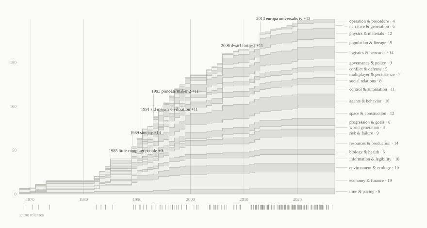
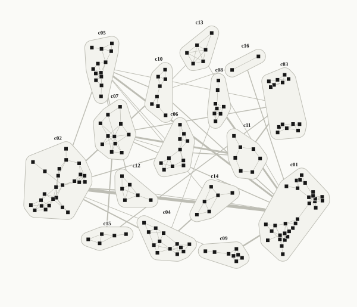

## Abstract

Simulation games are built from a shared but undocumented vocabulary of rule-systems. This report makes that vocabulary explicit and machine-readable, then asks how mathematical, AI, ML, and LLM results from 2019 to 2026 change it. We decompose 174 simulation games (1968 to 2026, 31 subgenres) into 199 atomic mechanics, analyze each mechanic on its own (definition, levers, failure modes, dynamics, mathematical basis, and six anchored scores), map 45 techniques onto mechanics through 218 typed effect edges, and synthesize 42 design opportunities, each with a validation experiment and a dated, falsifiable prediction. All results are projections of a versioned dataset with provenance for every entity and a validator that keeps the report, wiki, tables, and graph consistent.

**Findings.**

1. **Simulation games are compositions of six layers**: substrate, dynamics, coupling, control, legibility, and pacing. Clustering games by the mechanics they use recovers design families (minds, planned economies, build-and-test, hands-on work, authored decisions, generated worlds) that cut across market subgenres; 14 of 16 clusters mix subgenres.
2. **The vocabulary was set early.** 68 percent of mechanics appear in a catalog game released by 2000. 34 mechanics first appear in 2010 or later, and 27.5 percent of possible mechanic pairs have ever co-occurred.
3. **Depth costs legibility.** On rubric scores from a single model rater, legibility falls as emergence potential rises (ρ = -0.42) and as compute cost rises (ρ = -0.35); emergence rises with tuning difficulty (ρ = 0.61).
4. **AI techniques target what games show and say, not what they are built from.** Exposure concentrates in narrative, control, agent, and physics mechanics. 99 mechanics, carrying 51 percent of all mechanic uses in the catalog, are affected by no technique in the set. Explanation is the rarest effect a technique has on a mechanic (5 of 218 edges).
5. **What shipped mostly stays at the edge of simulation state.** Neural rendering, asset and motion generation, and language characters for dialogue and companionship have shipped. The shipped techniques that write into game state are narrow: cached model outputs as crafting rules, language-model characters in a few titles, and learned or search-based opponents. Frame-generating world models and learned physics remain prototypes or research. Of the 34 techniques that can run during play, 10 break reproducibility outright.
6. **The best near-term opportunities keep the simulation symbolic** and let learned models read, explain, decorate, and propose through validated, logged interfaces. The highest-priority opportunity is Why-query over the simulation log.

The dataset, schemas, contract, and every projection are open for extension; the procedure for contributors, human or agent, is in `AGENTS.md`.

## 1. Introduction

A simulation game is a game whose state changes by rules the player did not author and does not fully control. The player builds a road and the traffic is the city's reply; the player sets a tax and the citizens decide whether to stay. Everything distinctive about the form follows from that gap between intent and outcome: the pleasure of watching a system respond, the frustration of not understanding why it did, and the stories players tell about runs no designer scripted.

The genre is old and large. Its lineage runs from text programs on mainframes (a grain-and-population ledger in [Hamurabi](../wiki/game/hamurabi.md), a wagon party's rations in [The Oregon Trail](../wiki/game/oregon-trail.md)) through [SimCity](../wiki/game/simcity-1989.md) and [The Sims](../wiki/game/the-sims.md) to [Dwarf Fortress](../wiki/game/dwarf-fortress.md), [Factorio](../wiki/game/factorio.md), and [EVE Online](../wiki/game/eve-online.md). Its methods are less visible than its titles. Designers share a working vocabulary (needs meters, production chains, storytellers, overlays) but no common, inspectable map of which rule-systems exist, which games combine them, how each one fails, and which are near their ceilings.

That map matters now because the ceilings are moving. For forty years the depth of a simulation game was bounded by a few constraints: how much compute a consumer machine could spend per tick, how much content a studio could author, how much hidden state a player could understand, how tightly a multiplayer game had to stay deterministic, and how believable a rule-driven agent could be. Results from 2019 to 2026 in learned world models, language-model agents, learned physics, accelerated simulation, automated design, and on-device inference press on each of those constraints, unevenly and with new costs.

This report does four things:

1. **Catalogs** 174 simulation games across 31 subgenres, from 1968 to 2026, and decomposes each into the mechanics it uses (1952 typed game-to-mechanic edges, each marked core or supporting, with implementation notes for core mechanics).
2. **Analyzes** 199 mechanics one at a time: rule-level definition, player experience, design levers, failure modes, dynamics, mathematical basis, and six anchored scores (legibility, emergence potential, authoring cost, compute cost, tuning difficulty, AI leverage).
3. **Maps** 45 mathematical, AI, ML, and LLM techniques onto those mechanics through 218 typed `affects` edges that say how each technique changes each mechanic (replaces its substrate, deepens it, enables a new form, cuts its authoring cost, explains it, tunes it, or accelerates it).
4. **Synthesizes** 42 design opportunities, each with a validation experiment a small team could run and a falsifiable prediction with a resolve-by date.

Every number in this document is rendered from the dataset at build time; the dataset hash on the title page identifies the exact version. The report, the wiki, the tables, and the graph are projections of the same YAML files, so a correction to one entity updates all of them.

## 2. Method

### 2.1 Unit of analysis: the mechanic

A **mechanic** here is a rule-system that passes four admission tests (CONTRACT.md, I12):

- **Nameable.** Designers would recognize it in games other than the one being examined.
- **Atomic.** It owns one kind of state and one update rule. If it splits into two parts that each appear without the other in shipped games, it is two mechanics.
- **Tunable.** It has at least two levers.
- **Removable.** A game could drop it and keep running.

The tests exclude two common confusions. Dynamics such as "cascading failure" or "death spiral" are outcomes of coupled mechanics, so they appear in mechanics' `dynamics` fields rather than as entities. Genre-level patterns such as "colony management" are combinations, so they appear as game decompositions or opportunities. The result sits between the MDA framework's *mechanics* layer and a designer's pattern language: concrete enough to implement, general enough to recur.

Each mechanic belongs to one of 21 families, assigned by the state it owns rather than the genre it appears in: [Weather](../wiki/mechanic/weather.md) is environment, [Labor market](../wiki/mechanic/labor-market.md) is economy, [Agent inspection](../wiki/mechanic/agent-inspection.md) is information.

### 2.2 Corpus

The game catalog was built to cover every subgenre in the vocabulary, every lineage-defining title from the 1960s onward, recent releases through 2026, research demonstrations that run as interactive simulations (such as [Generative Agents (Smallville)](../wiki/game/generative-agents-smallville.md) and [Project Sid](../wiki/game/project-sid.md)), and works included for a single mechanic (marked `boundary_case`; 21 such works). The catalog is a purposive sample, not a census: prevalence figures describe this corpus, and the earliest-appearance year of a mechanic is a lower bound on its true origin.

### 2.3 Schema and scoring

Every categorical field draws from a closed vocabulary (`vocab/`), and every ordinal field names an anchored rubric (`vocab/rubrics.yaml`). Scorers match the anchor text and take the lower anchor when between two. This trades resolution for consistency across contributors: a 3 in legibility means "understood after deliberate attention and the game's info tools" whoever assigned it. Every score in this version was assigned by one model rater (claude-opus-5-5) matching the anchor text; scores are judgments, not measurements, and the rubric for each is reproduced in the wiki.

Relations are typed edges with one owner each (`vocab/edge_types.yaml`). Inverses (which games use a mechanic, which techniques affect it) and all aggregates (prevalence, earliest appearance, clusters, technique exposure, opportunity priority) are computed by the build and never stored, so they cannot drift from the edges they summarize.

### 2.4 Evidence

Each entity carries an epistemic status. `asserted` means written from domain knowledge without a citation; `sourced` means at least one cited source supports its factual fields; `verified` requires a second, independent run. Techniques must always cite. At this version, 388 entities are sourced or verified and 71 remain asserted; the asserted ones form a public verification queue (`dist/analysis/verification-queue.csv`).

### 2.5 Production

The dataset was produced by parallel research runs, each recorded in `log/runs/` with its operator, model, method, and the proposals it could not act on. Parallel runs partitioned work by file, not by topic: taxonomy runs analyzed mechanics; catalog runs verified release facts against public sources and decomposed games; technique runs searched the 2019 to 2026 literature and developer announcements. Merge-time runs then edited entities across partitions: the synthesis run added symmetric synergy and tension edges in one pass, and a review run added mechanic tags to games after an independent review found widely shared mechanics (pause controls, placement, tech trees) under-tagged, recoded several decompositions, and tightened every prediction. Each cross-partition edit is attributed in the entity's `provenance.reviewed` list. A validator enforcing the rules in CONTRACT.md §5 gated every merge. The same procedure (AGENTS.md) is what a new contributor, human or agent, follows.

### 2.6 Limitations

- **Sampling.** Commercial, English-language, PC-centric titles are over-represented; mobile management games and non-Western simulation traditions are under-represented.
- **Scoring.** Rubric scores are single-rater judgments by one model (claude-opus-5-5), not independent expert ratings. Correlations among scores (§5.6) and between a score and the technique graph (§8.4) partly reflect that rater's internal consistency. The `verified` status and the review field exist so a second rater, human or model, can confirm or contest them.
- **Decomposition depth.** A game's mechanic list records what is present and meaningful, not a complete specification. Absence of an edge is weak evidence of absence.
- **Recency.** Technique maturity and horizon are judged as of the run date and age quickly; each technique records the sources the judgment rests on.

## 3. The catalog

The corpus spans 1968 to 2026. Its oldest entries are text programs written for teaching ([Hamurabi](../wiki/game/hamurabi.md), [The Oregon Trail](../wiki/game/oregon-trail.md), [Lemonade Stand](../wiki/game/lemonade-stand.md)) and a zero-player automaton ([Conway's Game of Life](../wiki/game/game-of-life.md)); its newest are releases from 2024 to 2026 and research demonstrations whose agents are language models.

| decade | games |
|---|---|
| 1960s | 1 |
| 1970s | 3 |
| 1980s | 7 |
| 1990s | 24 |
| 2000s | 23 |
| 2010s | 73 |
| 2020s | 43 |

*Games in the dataset by decade of first release.*

### 3.1 Lineages

| Subgenre | Games |
|---|---:|
| City builder | 29 |
| Life sim | 10 |
| Management / tycoon | 10 |
| Job sim | 8 |
| Survival sim | 8 |
| Business / economic sim | 7 |
| Factory / automation | 7 |
| Vehicle sim | 7 |
| AI-native | 6 |
| Programming sim | 6 |
| Artificial life | 5 |
| Colony sim | 5 |
| MMO world | 5 |
| Physics sandbox | 5 |
| Political sim | 5 |
| Ecosystem / evolution | 4 |
| Flight sim | 4 |
| God game | 4 |
| Grand strategy | 4 |
| Space sim | 4 |
| 4X strategy | 3 |
| Construction / engineering | 3 |
| Farming sim | 3 |
| Systemic RPG | 3 |
| Sandbox world | 3 |
| Social sim | 3 |
| Sports management | 3 |
| Transport / logistics | 3 |
| Virtual pet | 3 |
| Medical sim | 2 |
| Wargame / military sim | 2 |

Subgenre labels name design lineages, not markets. [Prison Architect](../wiki/game/prison-architect.md) is a management game by lineage whose inmates carry colony-sim needs and moods; [Kenshi](../wiki/game/kenshi.md) is an RPG whose world runs on faction and economic simulation; [The Legend of Zelda: Breath of the Wild](../wiki/game/zelda-breath-of-the-wild.md) and [Noita](../wiki/game/noita.md) are included as boundary cases because their material systems ([Material interactions](../wiki/mechanic/material-interactions.md), [Falling-sand materials](../wiki/mechanic/falling-sand-materials.md)) influenced simulation design beyond their genres. Section 5 shows that clustering games by the mechanics they actually use cuts across these labels.

### 3.2 What is simulated

| Simulated domain | Games |
|---|---:|
| Economic | 61 |
| Biological / ecological | 40 |
| Physical / mechanical | 39 |
| Social / interpersonal | 36 |
| Urban | 34 |
| Military / conflict | 30 |
| Industrial / logistics | 27 |
| Political / governance | 24 |
| Domestic / personal | 16 |
| Planetary / natural | 16 |
| Cosmic / space | 15 |
| Computational / abstract | 13 |
| Occupational | 12 |
| Medical | 6 |
| Sports | 6 |

### 3.3 How failure and story work

| Failure model | Games |
|---|---:|
| Soft / recoverable | 83 |
| Hard restart | 41 |
| None | 26 |
| Cascading collapse | 12 |
| Permadeath | 12 |

| Narrative mode | Games |
|---|---:|
| Emergent | 58 |
| None | 56 |
| Hybrid | 40 |
| Authored | 15 |
| Generative | 5 |

Generative narrative (a learned model producing story text or events at runtime) is still rare in the catalog and concentrated in recent AI-native titles:

| name | year | developer | subgenre | production tier |
|---|---|---|---|---|
| [AI Dungeon](../wiki/game/ai-dungeon.md) | 2019 | Latitude | ai-native | indie |
| [Generative Agents (Smallville)](../wiki/game/generative-agents-smallville.md) | 2023 | Stanford University and Google Research | ai-native | academic |
| [Suck Up!](../wiki/game/suck-up.md) | 2023 | Proxima Enterprises | ai-native | indie |
| [Project Sid](../wiki/game/project-sid.md) | 2024 | Altera | ai-native | academic |
| [Whispers from the Star](../wiki/game/whispers-from-the-star.md) | 2025 | Anuttacon | ai-native | aa |

### 3.4 Most emergent titles

| name | year | subgenre | mechanics | emergence | influence |
|---|---|---|---|---|---|
| [Conway's Game of Life](../wiki/game/game-of-life.md) | 1970 | artificial-life | 3 | 5 | 5 |
| [Dwarf Fortress](../wiki/game/dwarf-fortress.md) | 2006 | colony-sim | 29 | 5 | 5 |
| [EVE Online](../wiki/game/eve-online.md) | 2003 | mmo-world | 12 | 5 | 4 |
| [RimWorld](../wiki/game/rimworld.md) | 2013 | colony-sim | 24 | 5 | 4 |
| [Minecraft](../wiki/game/minecraft.md) | 2009 | sandbox-world | 15 | 4 | 5 |
| [Cities: Skylines](../wiki/game/cities-skylines.md) | 2015 | city-builder | 17 | 4 | 4 |
| [Football Manager](../wiki/game/football-manager.md) | 2004 | sports-management | 15 | 4 | 4 |
| [Ultima Online](../wiki/game/ultima-online.md) | 1997 | mmo-world | 10 | 4 | 4 |
| [Creatures](../wiki/game/creatures.md) | 1996 | artificial-life | 12 | 4 | 3 |
| [Europa Universalis IV](../wiki/game/europa-universalis-4.md) | 2013 | grand-strategy | 20 | 4 | 3 |
| [Oxygen Not Included](../wiki/game/oxygen-not-included.md) | 2017 | colony-sim | 23 | 4 | 3 |
| [Aurora 4X](../wiki/game/aurora-4x.md) | 2004 | 4x-strategy | 13 | 4 | 2 |
| [Caves of Qud](../wiki/game/caves-of-qud.md) | 2015 | rpg-sim | 9 | 4 | 2 |
| [Crusader Kings III](../wiki/game/crusader-kings-3.md) | 2020 | grand-strategy | 20 | 4 | 2 |
| [Kenshi](../wiki/game/kenshi.md) | 2013 | rpg-sim | 16 | 4 | 2 |
| [Noita](../wiki/game/noita.md) | 2019 | physics-sandbox | 11 | 4 | 2 |
| [Project Zomboid](../wiki/game/project-zomboid.md) | 2011 | survival-sim | 18 | 4 | 2 |
| [The Powder Toy](../wiki/game/the-powder-toy.md) | 2008 | physics-sandbox | 9 | 4 | 2 |
| [Sid Meier's Civilization](../wiki/game/civilization.md) | 1991 | 4x-strategy | 13 | 3 | 5 |
| [SimCity](../wiki/game/simcity-1989.md) | 1989 | city-builder | 17 | 3 | 5 |

Emergence and influence are rubric scores (`vocab/rubrics.yaml`): emergence 5 means players report histories no one could have authored; influence 5 means the game created a lineage or changed the medium.

## 4. A grammar of simulation games

### 4.1 Six layers

Decomposing the catalog suggests that every simulation game is assembled from six layers. A mechanic usually lives in one layer, and a game's character comes from which layers it invests in.

1. **Substrate: what exists.** State is held as aggregate stocks (a treasury, a population count), individual agents (a colonist with needs), fields on a grid (pollution, temperature, land value), networks (roads, pipes, social ties), or continuous bodies (a wing, a chassis). The substrate fixes the cost curve: aggregates are cheap and faceless, agents are expensive and legible, fields scale with map area, continuous physics scales with contacts and timestep. The `substrate` field on every mechanic records this (
| Substrate | Mechanics |
|---|---:|
| Rule system | 107 |
| Agent-based | 70 |
| Aggregate stocks | 69 |
| Cellular grid | 38 |
| Stochastic events | 33 |
| Network / graph | 31 |
| Continuous physics | 18 |
| Player-authored logic | 9 |
| UI layer | 9 |
| Learned model | 4 |
).
2. **Dynamics: how it changes.** Update rules form feedback loops. Most simulation games pair a reinforcing growth loop (more citizens, more taxes, more buildings) with balancing loops that resist it (congestion, pollution, unrest, raids). Difficulty is the relative strength of those loops; a death spiral is a reinforcing loop running in reverse. The `feedback` field records the dominant polarity per mechanic.
3. **Coupling: how subsystems touch.** Depth comes less from the number of systems than from how many share state. Systems couple through shared stocks (power, money, labor), shared space (a factory lowers neighboring land value), and shared agents (the same colonist hauls, eats, and grieves). [Dwarf Fortress](../wiki/game/dwarf-fortress.md) is deep because nearly everything touches nearly everything else; a game with many isolated systems feels like many small games.
4. **Control: how intent enters.** The player acts directly (an avatar, a unit), places and zones, sets parameters, issues orders that agents pick up, writes programs, or speaks. Each step away from direct control widens the *control gap*, the designed distance between what the player wants and what happens. Too narrow and the game is a toy; too wide and the player is a spectator. 
| Agency model | Games |
|---|---:|
| Zoning / placement | 70 |
| Policy / parameter | 65 |
| Direct avatar | 61 |
| Direct unit control | 48 |
| Indirect incentive | 25 |
| Design then test | 18 |
| Programmatic | 15 |
| Order queue | 12 |
| Conversational | 11 |
| Caretaking interaction | 9 |
| Supernatural intervention | 6 |

5. **Legibility: how state leaves.** Overlays, inspectors, tooltips, advisors, alerts, graphs, chronicles, and forecasts expose hidden state. This layer is what lets deep simulations ship: [RimWorld](../wiki/game/rimworld.md) itemizes every mood modifier, and Paradox games nest tooltips until each number decomposes into causes. Legibility mechanics own no simulation state of their own; they are the interface between coupling and comprehension.
6. **Pacing and stakes: when the player looks and what can be lost.** Time models (pause, speed, turns, wall clock), failure models (soft setbacks, permadeath, cascading collapse), and narrative directors decide when attention is demanded and what a mistake costs. 
| Time model | Games |
|---|---:|
| Real-time with pause | 84 |
| Real-time | 50 |
| Turn-based | 20 |
| Asynchronous persistent | 7 |
| Run on demand | 7 |
| Real-world clock | 6 |

A compact description of a simulation game is its investment profile across these layers. City builders invest in substrate (fields and networks) and legibility (overlays); colony sims in agents, coupling, and pacing (storytellers); vehicle sims in continuous substrate and direct control; programming games in control alone, with nearly no hidden state. The clustering in §5 recovers these profiles from the data without being told the subgenres.

### 4.2 The families, one at a time

Each family below is described by the state it owns, its canonical mechanics, how it characteristically fails, and what it couples to. Tables list every mechanic in the family with how many catalog games use it and its rubric scores; each mechanic's full analysis (definition, levers, failure modes, dynamics, open questions) is on its wiki page.

#### Resources and production
Owns stocks of goods and the recipes that transform them. [Production chains](../wiki/mechanic/production-chain.md) is the backbone of city builders, factory games, and colony sims alike; [Storage and buffers](../wiki/mechanic/storage-capacity.md), [Spoilage](../wiki/mechanic/spoilage.md), and [Byproducts and waste](../wiki/mechanic/byproducts-waste.md) decide whether a chain is a puzzle or a ledger. The characteristic failure is the spreadsheet: chains whose only decision is ratio arithmetic. The best implementations make chains spatial ([Conveyor transport](../wiki/mechanic/conveyor-transport.md)) or social (who does the work, and in what mood).

| name | games | legibility | emergence potential | authoring cost | compute cost | ai leverage | maturity |
|---|---|---|---|---|---|---|---|
| [Production chains](../wiki/mechanic/production-chain.md) | 38 | 3 | 3 | 2 | 2 | 3 | classic |
| [Resource extraction](../wiki/mechanic/resource-extraction.md) | 29 | 5 | 2 | 2 | 2 | 1 | classic |
| [Crop cultivation](../wiki/mechanic/crop-cultivation.md) | 25 | 4 | 3 | 3 | 2 | 2 | classic |
| [Power grid](../wiki/mechanic/power-grid.md) | 20 | 4 | 3 | 1 | 2 | 2 | classic |
| [Storage and buffers](../wiki/mechanic/storage-capacity.md) | 19 | 4 | 2 | 1 | 1 | 1 | classic |
| [Hand crafting](../wiki/mechanic/hand-crafting.md) | 17 | 4 | 2 | 3 | 1 | 4 | classic |
| [Goods consumption](../wiki/mechanic/goods-consumption.md) | 16 | 3 | 3 | 2 | 2 | 2 | classic |
| [Spoilage](../wiki/mechanic/spoilage.md) | 10 | 4 | 2 | 2 | 2 | 1 | established |
| [Renewable regrowth](../wiki/mechanic/renewable-regrowth.md) | 6 | 3 | 3 | 1 | 2 | 2 | established |
| [Deposit depletion](../wiki/mechanic/deposit-depletion.md) | 5 | 4 | 3 | 1 | 1 | 1 | classic |
| [Machine boosting](../wiki/mechanic/machine-boosting.md) | 5 | 3 | 2 | 2 | 1 | 2 | established |
| [Quality tiers](../wiki/mechanic/quality-tiers.md) | 4 | 3 | 2 | 2 | 1 | 2 | established |
| [Byproducts and waste](../wiki/mechanic/byproducts-waste.md) | 3 | 3 | 3 | 2 | 2 | 2 | established |
| [Power allocation](../wiki/mechanic/power-allocation.md) | 2 | 4 | 3 | 1 | 1 | 2 | established |

#### Logistics and networks
Owns movement across space or graphs: roads, belts, pipes, rails, transit lines, service reach. These mechanics turn production into geography, and they are where compute and legibility first bind: [Traffic congestion](../wiki/mechanic/traffic-congestion.md) is the most visible place a city builder can be wrong, and [Walker service delivery](../wiki/mechanic/walker-service-delivery.md) made service coverage legible by putting it on walking bodies. Networks couple to almost everything, so their bugs (pathfinding loops, gridlock) spread to every system they feed.

| name | games | legibility | emergence potential | authoring cost | compute cost | ai leverage | maturity |
|---|---|---|---|---|---|---|---|
| [Fluid pipe networks](../wiki/mechanic/fluid-pipe-network.md) | 12 | 3 | 3 | 1 | 3 | 3 | established |
| [Service coverage](../wiki/mechanic/service-coverage.md) | 10 | 3 | 3 | 2 | 2 | 2 | classic |
| [Vehicle routes and schedules](../wiki/mechanic/vehicle-route-scheduling.md) | 10 | 4 | 3 | 1 | 2 | 2 | classic |
| [Conveyor transport](../wiki/mechanic/conveyor-transport.md) | 9 | 4 | 3 | 1 | 3 | 2 | established |
| [Road networks](../wiki/mechanic/road-network.md) | 7 | 4 | 3 | 2 | 2 | 2 | classic |
| [Service queues](../wiki/mechanic/service-queues.md) | 7 | 4 | 3 | 2 | 2 | 2 | classic |
| [Traffic congestion](../wiki/mechanic/traffic-congestion.md) | 6 | 2 | 4 | 1 | 3 | 3 | classic |
| [Hauling jobs](../wiki/mechanic/hauling-jobs.md) | 5 | 3 | 3 | 1 | 3 | 2 | classic |
| [Public transit lines](../wiki/mechanic/public-transit.md) | 5 | 3 | 3 | 1 | 3 | 3 | established |
| [Rail signaling](../wiki/mechanic/rail-signaling.md) | 5 | 2 | 3 | 1 | 2 | 2 | classic |
| [Request-provider logistics](../wiki/mechanic/request-provider-logistics.md) | 2 | 3 | 3 | 1 | 3 | 2 | established |
| [Supply lines](../wiki/mechanic/supply-lines.md) | 2 | 3 | 3 | 1 | 2 | 2 | established |
| [Travel mode choice](../wiki/mechanic/travel-mode-choice.md) | 2 | 2 | 3 | 1 | 3 | 3 | established |
| [Walker service delivery](../wiki/mechanic/walker-service-delivery.md) | 2 | 2 | 3 | 2 | 2 | 2 | established |

#### Economy and finance
Owns money, prices, and valuation. Most games use only [Treasury and budget](../wiki/mechanic/budget-treasury.md) and [Taxation](../wiki/mechanic/taxation.md) as a scorekeeping layer; fewer simulate markets with [Supply-demand pricing](../wiki/mechanic/supply-demand-pricing.md), competitors ([Rival firms](../wiki/mechanic/rival-firms.md)), or player-made prices ([Player-driven markets](../wiki/mechanic/player-driven-market.md)). The characteristic failure is the dominant strategy: a price or loan loophole that converts the economy into an exploit, which is why economies are the first target for automated balancing (§9).

| name | games | legibility | emergence potential | authoring cost | compute cost | ai leverage | maturity |
|---|---|---|---|---|---|---|---|
| [Treasury and budget](../wiki/mechanic/budget-treasury.md) | 27 | 4 | 3 | 1 | 1 | 2 | classic |
| [Trade routes](../wiki/mechanic/trade-routes.md) | 17 | 3 | 3 | 1 | 2 | 2 | classic |
| [Contracts and orders](../wiki/mechanic/contracts-orders.md) | 16 | 4 | 2 | 2 | 1 | 3 | classic |
| [Staff hiring and rosters](../wiki/mechanic/staff-hiring.md) | 16 | 4 | 3 | 2 | 1 | 3 | classic |
| [Loans and debt](../wiki/mechanic/loans-debt.md) | 13 | 4 | 2 | 1 | 1 | 2 | classic |
| [Taxation](../wiki/mechanic/taxation.md) | 13 | 4 | 2 | 1 | 1 | 2 | classic |
| [Supply-demand pricing](../wiki/mechanic/supply-demand-pricing.md) | 10 | 4 | 3 | 2 | 2 | 2 | classic |
| [Customer value choice](../wiki/mechanic/customer-value-choice.md) | 8 | 3 | 3 | 2 | 2 | 3 | classic |
| [Rival firms](../wiki/mechanic/rival-firms.md) | 8 | 3 | 3 | 2 | 2 | 4 | classic |
| [Advertising and awareness](../wiki/mechanic/advertising-awareness.md) | 6 | 3 | 2 | 1 | 1 | 3 | classic |
| [Labor market](../wiki/mechanic/labor-market.md) | 5 | 3 | 3 | 1 | 2 | 2 | classic |
| [Land value](../wiki/mechanic/land-value.md) | 5 | 3 | 3 | 1 | 2 | 2 | classic |
| [Player-driven markets](../wiki/mechanic/player-driven-market.md) | 5 | 3 | 4 | 1 | 2 | 3 | established |
| [Auctions](../wiki/mechanic/auctions.md) | 4 | 4 | 3 | 1 | 1 | 3 | established |
| [Equity and buyouts](../wiki/mechanic/equity-buyouts.md) | 4 | 3 | 3 | 1 | 1 | 2 | established |
| [Negotiation](../wiki/mechanic/negotiation.md) | 4 | 3 | 2 | 2 | 1 | 4 | classic |
| [Product development](../wiki/mechanic/product-development.md) | 3 | 2 | 2 | 2 | 1 | 4 | established |
| [RCI demand](../wiki/mechanic/rci-demand.md) | 3 | 4 | 3 | 1 | 1 | 2 | classic |
| [Delivery-time payment](../wiki/mechanic/delivery-time-payment.md) | 2 | 3 | 2 | 2 | 1 | 1 | established |

#### Agents and behavior
Owns individual minds: needs, utilities, moods, memories, skills, schedules. [Needs decay](../wiki/mechanic/needs-decay.md) plus [Utility action selection](../wiki/mechanic/utility-action-selection.md) is the standard architecture since [The Sims](../wiki/game/the-sims.md); [Smart objects](../wiki/mechanic/smart-objects.md) moved behavior knowledge into the world so new objects bring new behaviors. Its variety is paid for in animations, thoughts, and dialogue, which is why it is among the families most exposed to language-model techniques (§8).

| name | games | legibility | emergence potential | authoring cost | compute cost | ai leverage | maturity |
|---|---|---|---|---|---|---|---|
| [Agent skills](../wiki/mechanic/agent-skills.md) | 33 | 4 | 3 | 2 | 1 | 2 | classic |
| [Needs decay](../wiki/mechanic/needs-decay.md) | 30 | 4 | 3 | 2 | 2 | 3 | classic |
| [Personality traits](../wiki/mechanic/personality-traits.md) | 25 | 4 | 3 | 3 | 1 | 3 | classic |
| [Utility action selection](../wiki/mechanic/utility-action-selection.md) | 18 | 3 | 3 | 2 | 2 | 4 | classic |
| [Memories and thoughts](../wiki/mechanic/memories-thoughts.md) | 10 | 4 | 4 | 3 | 2 | 4 | established |
| [Agent pathfinding](../wiki/mechanic/agent-pathfinding.md) | 9 | 4 | 3 | 2 | 3 | 2 | classic |
| [Daily schedules](../wiki/mechanic/daily-schedules.md) | 8 | 4 | 3 | 2 | 1 | 4 | classic |
| [Mood and breakdowns](../wiki/mechanic/mood-breakdown.md) | 8 | 3 | 4 | 3 | 1 | 3 | established |
| [Crowd preferences](../wiki/mechanic/crowd-preferences.md) | 6 | 3 | 3 | 2 | 3 | 3 | classic |
| [Work priorities](../wiki/mechanic/work-priorities.md) | 6 | 3 | 3 | 1 | 2 | 3 | established |
| [Creature learning](../wiki/mechanic/creature-learning.md) | 4 | 2 | 4 | 2 | 2 | 4 | established |
| [Smart objects](../wiki/mechanic/smart-objects.md) | 4 | 4 | 3 | 4 | 2 | 3 | classic |
| [Aspirations and wants](../wiki/mechanic/aspiration-wants.md) | 3 | 4 | 3 | 3 | 1 | 4 | established |
| [Attribute-driven match engine](../wiki/mechanic/attribute-match-engine.md) | 3 | 2 | 3 | 3 | 2 | 3 | classic |
| [Autonomy levels](../wiki/mechanic/autonomy-levels.md) | 3 | 4 | 2 | 1 | 1 | 3 | established |
| [Stress accumulation](../wiki/mechanic/stress-accumulation.md) | 2 | 3 | 4 | 2 | 1 | 3 | established |

#### Social relations
Owns ties between agents: relationship values, opinion modifiers, reputation, factions, gossip, romance, and conversation. Rule-based social systems are cheap but read as formulaic; [Social exchanges](../wiki/mechanic/social-exchanges.md) in [Prom Week](../wiki/game/prom-week.md) and [Versu](../wiki/game/versu.md) showed richer social logic is possible at high authoring cost, and [Natural-language interaction](../wiki/mechanic/natural-language-interaction.md) opened conversation as an input. The characteristic failure is the visible formula: players learn that one compliment always adds a fixed amount.

| name | games | legibility | emergence potential | authoring cost | compute cost | ai leverage | maturity |
|---|---|---|---|---|---|---|---|
| [Reputation](../wiki/mechanic/reputation.md) | 22 | 4 | 3 | 2 | 1 | 3 | classic |
| [Relationship values](../wiki/mechanic/relationship-values.md) | 21 | 4 | 4 | 2 | 2 | 3 | classic |
| [Faction diplomacy](../wiki/mechanic/faction-diplomacy.md) | 15 | 3 | 4 | 2 | 2 | 4 | classic |
| [Natural-language interaction](../wiki/mechanic/natural-language-interaction.md) | 11 | 2 | 4 | 3 | 4 | 5 | established |
| [Romance and family](../wiki/mechanic/romance-family.md) | 11 | 4 | 4 | 3 | 1 | 4 | classic |
| [Social exchanges](../wiki/mechanic/social-exchanges.md) | 7 | 3 | 4 | 4 | 2 | 4 | established |
| [Gossip propagation](../wiki/mechanic/gossip-propagation.md) | 3 | 2 | 4 | 2 | 3 | 4 | emerging |
| [Opinion modifiers](../wiki/mechanic/opinion-modifiers.md) | 2 | 4 | 3 | 2 | 2 | 3 | established |

#### Population and lineage
Owns birth, death, migration, inheritance, and structure. [Immigration by attractiveness](../wiki/mechanic/immigration-attractiveness.md) is the city builder's growth engine; [Population strata](../wiki/mechanic/population-strata.md) turns growth into progression; [Trait inheritance](../wiki/mechanic/trait-inheritance.md) and [Dynasty succession](../wiki/mechanic/dynasty-succession.md) stretch play across generations. These mechanics define the time horizon of a game more than its time model does.

| name | games | legibility | emergence potential | authoring cost | compute cost | ai leverage | maturity |
|---|---|---|---|---|---|---|---|
| [Lifecycle and aging](../wiki/mechanic/lifecycle-aging.md) | 22 | 4 | 4 | 3 | 1 | 2 | classic |
| [Population strata](../wiki/mechanic/population-strata.md) | 13 | 4 | 3 | 3 | 1 | 2 | established |
| [Trait inheritance](../wiki/mechanic/trait-inheritance.md) | 6 | 3 | 4 | 2 | 1 | 3 | established |
| [Culture and religion conversion](../wiki/mechanic/culture-religion-conversion.md) | 4 | 3 | 4 | 3 | 2 | 3 | established |
| [Immigration by attractiveness](../wiki/mechanic/immigration-attractiveness.md) | 4 | 3 | 3 | 1 | 1 | 2 | classic |
| [Dynasty succession](../wiki/mechanic/dynasty-succession.md) | 3 | 3 | 4 | 2 | 1 | 2 | established |
| [Education and workforce](../wiki/mechanic/education-workforce.md) | 3 | 3 | 3 | 1 | 1 | 2 | established |
| [Natural selection](../wiki/mechanic/natural-selection.md) | 3 | 2 | 5 | 1 | 3 | 3 | established |
| [Off-screen life progression](../wiki/mechanic/offscreen-life-progression.md) | 3 | 2 | 3 | 2 | 2 | 4 | established |

#### Governance and policy
Owns rules about rules: policies, laws, elections, interest groups, satisfaction, unrest. Policy menus ([Policy toggles](../wiki/mechanic/policy-toggles.md)) are universal; [Policy influence network](../wiki/mechanic/policy-influence-network.md) in [Democracy 4](../wiki/game/democracy-4.md) made the causal web itself the interface; [Player legislation](../wiki/mechanic/player-legislation.md) in [Eco](../wiki/game/eco.md) and [A Tale in the Desert](../wiki/game/a-tale-in-the-desert.md) let players write rules for each other. The failure is the menu: a fixed list of authored options that no player can extend.

| name | games | legibility | emergence potential | authoring cost | compute cost | ai leverage | maturity |
|---|---|---|---|---|---|---|---|
| [Policy toggles](../wiki/mechanic/policy-toggles.md) | 15 | 4 | 2 | 3 | 1 | 3 | classic |
| [Stability and unrest](../wiki/mechanic/stability-unrest.md) | 12 | 3 | 4 | 2 | 1 | 3 | classic |
| [Citizen satisfaction](../wiki/mechanic/citizen-satisfaction.md) | 10 | 3 | 3 | 2 | 1 | 3 | classic |
| [Elections](../wiki/mechanic/elections.md) | 7 | 3 | 3 | 2 | 2 | 4 | established |
| [Political capital](../wiki/mechanic/political-capital.md) | 7 | 4 | 2 | 1 | 1 | 2 | established |
| [Interest groups](../wiki/mechanic/interest-groups.md) | 6 | 3 | 4 | 3 | 2 | 4 | established |
| [Corruption leakage](../wiki/mechanic/corruption-leakage.md) | 4 | 3 | 2 | 1 | 1 | 2 | established |
| [Player legislation](../wiki/mechanic/player-legislation.md) | 2 | 3 | 4 | 1 | 1 | 4 | established |
| [Policy influence network](../wiki/mechanic/policy-influence-network.md) | 1 | 3 | 3 | 3 | 1 | 4 | emerging |

#### Space and construction
Owns layout: zoning, placement, adjacency, rooms, structure, terrain, and the scoring of player-built designs. [Zoning](../wiki/mechanic/zoning.md) is indirect construction; [Building placement](../wiki/mechanic/free-placement.md) is direct; [Procedural build assist](../wiki/mechanic/procedural-build-assist.md) sits between them, letting rough gestures produce detailed structure. [Design performance rating](../wiki/mechanic/design-performance-rating.md) closes the build-test loop in coaster, bridge, and machine builders.

| name | games | legibility | emergence potential | authoring cost | compute cost | ai leverage | maturity |
|---|---|---|---|---|---|---|---|
| [Building placement](../wiki/mechanic/free-placement.md) | 75 | 4 | 3 | 3 | 1 | 2 | classic |
| [Modular assembly](../wiki/mechanic/modular-assembly.md) | 27 | 3 | 4 | 3 | 3 | 4 | established |
| [Terraforming](../wiki/mechanic/terraforming.md) | 19 | 4 | 3 | 1 | 2 | 3 | classic |
| [Decoration and beauty](../wiki/mechanic/decoration-beauty.md) | 11 | 3 | 2 | 3 | 2 | 3 | classic |
| [Zoning](../wiki/mechanic/zoning.md) | 9 | 3 | 4 | 3 | 2 | 3 | classic |
| [Design performance rating](../wiki/mechanic/design-performance-rating.md) | 8 | 3 | 3 | 2 | 2 | 3 | established |
| [Vertical layers](../wiki/mechanic/vertical-layers.md) | 8 | 3 | 3 | 2 | 3 | 2 | classic |
| [Room recognition](../wiki/mechanic/room-recognition.md) | 6 | 4 | 3 | 2 | 2 | 3 | established |
| [Structural integrity](../wiki/mechanic/structural-integrity.md) | 5 | 3 | 4 | 2 | 2 | 3 | established |
| [Track laying](../wiki/mechanic/track-laying.md) | 5 | 4 | 3 | 2 | 1 | 2 | classic |
| [Adjacency scoring](../wiki/mechanic/adjacency-scoring.md) | 4 | 4 | 2 | 2 | 1 | 2 | established |
| [Procedural build assist](../wiki/mechanic/procedural-build-assist.md) | 2 | 4 | 2 | 3 | 2 | 4 | emerging |

#### Physics and materials
Owns continuous dynamics: rigid bodies, vehicles, flight, orbits, fluids, heat, deformation, destruction, material interactions. These are, on average, the most compute-bound mechanics in the taxonomy, and their legibility depends on how closely they match the physical intuitions players bring. The failure is the uncanny edge: a physics model accurate enough to invite intuition but wrong in the cases players probe.

| name | games | legibility | emergence potential | authoring cost | compute cost | ai leverage | maturity |
|---|---|---|---|---|---|---|---|
| [Rigid-body physics](../wiki/mechanic/rigid-body-physics.md) | 13 | 4 | 4 | 2 | 3 | 3 | classic |
| [Fluid and gas simulation](../wiki/mechanic/fluid-gas-simulation.md) | 11 | 3 | 4 | 1 | 4 | 4 | established |
| [Heat transfer](../wiki/mechanic/heat-transfer.md) | 9 | 3 | 4 | 2 | 3 | 2 | established |
| [Vehicle dynamics](../wiki/mechanic/vehicle-dynamics.md) | 9 | 3 | 2 | 3 | 2 | 2 | classic |
| [Material interactions](../wiki/mechanic/material-interactions.md) | 8 | 4 | 4 | 2 | 2 | 4 | established |
| [Flight aerodynamics](../wiki/mechanic/flight-aerodynamics.md) | 5 | 3 | 2 | 3 | 2 | 3 | classic |
| [Projectile ballistics](../wiki/mechanic/projectile-ballistics.md) | 4 | 3 | 3 | 3 | 2 | 2 | classic |
| [Falling-sand materials](../wiki/mechanic/falling-sand-materials.md) | 2 | 4 | 5 | 2 | 4 | 3 | established |
| [Orbital mechanics](../wiki/mechanic/orbital-mechanics.md) | 2 | 3 | 2 | 1 | 2 | 2 | established |
| [Terrain deformation](../wiki/mechanic/terrain-deformation.md) | 2 | 4 | 3 | 2 | 3 | 2 | established |
| [Voxel destruction](../wiki/mechanic/voxel-destruction.md) | 2 | 4 | 4 | 2 | 4 | 3 | established |
| [Soft-body deformation](../wiki/mechanic/soft-body-deformation.md) | 1 | 4 | 3 | 3 | 4 | 3 | experimental |

#### Environment and ecology
Owns the world's own processes: weather, seasons, food webs, habitats, pollution, fire, contagion, water, climate. Environmental mechanics are where simulation games most often lean on real science ([Contagion](../wiki/mechanic/contagion.md) follows compartment models; [Food web](../wiki/mechanic/food-web.md) follows predator-prey dynamics) and where calibrated learned models can substitute for hand-tuned approximations.

| name | games | legibility | emergence potential | authoring cost | compute cost | ai leverage | maturity |
|---|---|---|---|---|---|---|---|
| [Weather](../wiki/mechanic/weather.md) | 27 | 4 | 3 | 3 | 1 | 2 | classic |
| [Day-night cycle](../wiki/mechanic/day-night-cycle.md) | 20 | 5 | 2 | 2 | 1 | 2 | classic |
| [Fire spread](../wiki/mechanic/fire-spread.md) | 18 | 4 | 4 | 2 | 2 | 2 | classic |
| [Seasons](../wiki/mechanic/seasons.md) | 16 | 4 | 2 | 3 | 1 | 2 | classic |
| [Habitat suitability](../wiki/mechanic/habitat-suitability.md) | 12 | 4 | 2 | 2 | 1 | 2 | established |
| [Contagion](../wiki/mechanic/contagion.md) | 10 | 3 | 4 | 2 | 2 | 3 | established |
| [Pollution spread](../wiki/mechanic/pollution-spread.md) | 7 | 3 | 3 | 1 | 2 | 2 | classic |
| [Planetary climate](../wiki/mechanic/planetary-climate.md) | 5 | 2 | 3 | 2 | 2 | 3 | established |
| [Food web](../wiki/mechanic/food-web.md) | 4 | 2 | 4 | 3 | 2 | 3 | established |
| [Hydrology](../wiki/mechanic/hydrology.md) | 4 | 3 | 4 | 1 | 3 | 3 | established |

#### Biology and health
Owns bodies: survival meters, injuries, diagnosis, creature care, husbandry. [Survival meters](../wiki/mechanic/survival-meters.md) define a subgenre; [Injury body model](../wiki/mechanic/injury-body-model.md) tracks wounds per body part in colony sims; [Creature care](../wiki/mechanic/creature-care.md) is the oldest bond between player and simulated being.

| name | games | legibility | emergence potential | authoring cost | compute cost | ai leverage | maturity |
|---|---|---|---|---|---|---|---|
| [Survival meters](../wiki/mechanic/survival-meters.md) | 13 | 4 | 3 | 2 | 1 | 2 | classic |
| [Animal husbandry](../wiki/mechanic/animal-husbandry.md) | 9 | 4 | 3 | 3 | 2 | 2 | classic |
| [Injury body model](../wiki/mechanic/injury-body-model.md) | 7 | 3 | 4 | 2 | 2 | 2 | established |
| [Creature care](../wiki/mechanic/creature-care.md) | 6 | 4 | 2 | 4 | 1 | 4 | classic |
| [Diagnosis and treatment](../wiki/mechanic/diagnosis-treatment.md) | 3 | 3 | 2 | 3 | 1 | 4 | established |
| [Care-dependent development](../wiki/mechanic/care-dependent-development.md) | 2 | 2 | 2 | 4 | 1 | 4 | established |

#### Time and pacing
Owns the clock. [Pause and speed control](../wiki/mechanic/variable-speed.md) is near-universal in real-time management games; [Real-time clock](../wiki/mechanic/real-time-clock.md) ties play to the calendar; [Daily action budget](../wiki/mechanic/daily-action-budget.md) makes days a scarce resource; [Crisis countdown](../wiki/mechanic/crisis-countdown.md) turns the future into a deadline. Time mechanics are where multiplayer and persistence constraints bite: a shared world cannot pause.

| name | games | legibility | emergence potential | authoring cost | compute cost | ai leverage | maturity |
|---|---|---|---|---|---|---|---|
| [Pause and speed control](../wiki/mechanic/variable-speed.md) | 82 | 5 | 1 | 1 | 1 | 2 | classic |
| [Turn structure](../wiki/mechanic/turn-structure.md) | 12 | 5 | 1 | 1 | 1 | 1 | classic |
| [Crisis countdown](../wiki/mechanic/crisis-countdown.md) | 10 | 4 | 2 | 3 | 1 | 3 | established |
| [Real-time clock](../wiki/mechanic/real-time-clock.md) | 7 | 5 | 2 | 3 | 1 | 2 | classic |
| [Daily action budget](../wiki/mechanic/daily-action-budget.md) | 5 | 4 | 2 | 1 | 1 | 1 | classic |
| [Periodic ticks](../wiki/mechanic/periodic-ticks.md) | 4 | 4 | 1 | 1 | 2 | 1 | classic |

#### Information and legibility
Owns nothing in the simulation and decides whether anyone can understand it. Overlays, inspectors, tooltips, dashboards, alerts, advisors, forecasts, fog of war, scouting, and comparative histograms. This family is the counterweight to emergence and the most direct beneficiary of language models that can read state and explain it (§8).

| name | games | legibility | emergence potential | authoring cost | compute cost | ai leverage | maturity |
|---|---|---|---|---|---|---|---|
| [Fog of war](../wiki/mechanic/fog-of-war.md) | 13 | 4 | 3 | 1 | 2 | 3 | classic |
| [Stats dashboards](../wiki/mechanic/stats-dashboards.md) | 7 | 4 | 1 | 1 | 2 | 3 | classic |
| [Advisors](../wiki/mechanic/advisors.md) | 6 | 4 | 1 | 3 | 1 | 4 | classic |
| [Agent inspection](../wiki/mechanic/agent-inspection.md) | 5 | 4 | 1 | 2 | 1 | 4 | classic |
| [Data overlays](../wiki/mechanic/data-overlays.md) | 5 | 4 | 1 | 2 | 2 | 2 | classic |
| [Scouting knowledge](../wiki/mechanic/scouting-knowledge.md) | 4 | 3 | 3 | 1 | 2 | 3 | established |
| [Alerts feed](../wiki/mechanic/alerts-feed.md) | 3 | 4 | 1 | 2 | 2 | 3 | classic |
| [Causal breakdown tooltips](../wiki/mechanic/causal-tooltips.md) | 3 | 4 | 1 | 2 | 1 | 3 | established |
| [Comparative histograms](../wiki/mechanic/comparative-histograms.md) | 2 | 4 | 1 | 1 | 1 | 2 | established |
| [Forecasting](../wiki/mechanic/forecasting.md) | 2 | 4 | 1 | 1 | 1 | 4 | established |

#### Control and automation
Owns the channel from intent to action: avatars, unit commands, designations, programming, circuits, blueprints, delegation, god powers, and embodied skill. The history of the family is a steady move away from direct control toward specification: from clicking each unit to drawing zones, from wiring logic to writing code, and now toward stating intent in language.

| name | games | legibility | emergence potential | authoring cost | compute cost | ai leverage | maturity |
|---|---|---|---|---|---|---|---|
| [Direct avatar control](../wiki/mechanic/direct-avatar.md) | 31 | 5 | 2 | 4 | 2 | 3 | classic |
| [Unit commands](../wiki/mechanic/unit-commands.md) | 17 | 4 | 2 | 2 | 2 | 3 | classic |
| [Embodied skill control](../wiki/mechanic/embodied-skill-control.md) | 14 | 3 | 3 | 3 | 2 | 3 | classic |
| [Signal circuits](../wiki/mechanic/signal-circuits.md) | 12 | 3 | 3 | 1 | 2 | 3 | established |
| [Blueprints](../wiki/mechanic/blueprints.md) | 11 | 5 | 2 | 1 | 1 | 4 | established |
| [Player programming](../wiki/mechanic/player-programming.md) | 10 | 3 | 3 | 2 | 3 | 4 | established |
| [Delegation to AI managers](../wiki/mechanic/delegation-to-ai.md) | 7 | 3 | 3 | 2 | 2 | 4 | established |
| [Designation orders](../wiki/mechanic/designation-orders.md) | 5 | 4 | 3 | 1 | 2 | 3 | classic |
| [God powers](../wiki/mechanic/god-powers.md) | 5 | 4 | 3 | 3 | 2 | 3 | classic |
| [Execution budget](../wiki/mechanic/execution-budget.md) | 4 | 3 | 2 | 1 | 1 | 3 | established |
| [Programming by demonstration](../wiki/mechanic/programming-by-demonstration.md) | 2 | 4 | 2 | 2 | 1 | 4 | emerging |

#### Progression and goals
Owns what the player is working toward: tech trees, milestones, scenarios, career ladders, collections. Simulation games are often sandbox-first, and these mechanics supply direction without scripting outcomes.

| name | games | legibility | emergence potential | authoring cost | compute cost | ai leverage | maturity |
|---|---|---|---|---|---|---|---|
| [Tech tree](../wiki/mechanic/tech-tree.md) | 43 | 4 | 2 | 3 | 1 | 3 | classic |
| [Scenario objectives](../wiki/mechanic/scenario-objectives.md) | 40 | 4 | 2 | 3 | 1 | 3 | classic |
| [Milestone unlocks](../wiki/mechanic/milestone-unlocks.md) | 21 | 5 | 1 | 2 | 1 | 2 | established |
| [Career ladder](../wiki/mechanic/career-ladder.md) | 12 | 4 | 2 | 3 | 1 | 3 | classic |
| [Collection goals](../wiki/mechanic/collection-goals.md) | 7 | 5 | 1 | 3 | 1 | 2 | classic |
| [Megaproject sink](../wiki/mechanic/megaproject-sink.md) | 6 | 4 | 2 | 3 | 2 | 2 | established |
| [Dated technology timeline](../wiki/mechanic/dated-tech-timeline.md) | 4 | 4 | 2 | 2 | 1 | 2 | classic |
| [Combination discovery](../wiki/mechanic/combination-discovery.md) | 2 | 4 | 2 | 3 | 1 | 4 | established |

#### Risk and failure
Owns what goes wrong: disasters, wear, permadeath, threat scaling, crime. Failure mechanics are the main source of stakes, and [Adaptive threat scaling](../wiki/mechanic/adaptive-threat-scaling.md) is the genre's most consequential balancing decision: whether growth makes the game easier or harder.

| name | games | legibility | emergence potential | authoring cost | compute cost | ai leverage | maturity |
|---|---|---|---|---|---|---|---|
| [Permadeath](../wiki/mechanic/permadeath.md) | 20 | 5 | 3 | 1 | 1 | 2 | classic |
| [Wear and breakdown](../wiki/mechanic/wear-breakdown.md) | 20 | 4 | 3 | 2 | 2 | 2 | classic |
| [Random disasters](../wiki/mechanic/random-disasters.md) | 17 | 4 | 3 | 3 | 2 | 2 | classic |
| [Adaptive threat scaling](../wiki/mechanic/adaptive-threat-scaling.md) | 8 | 2 | 3 | 2 | 1 | 3 | established |
| [Crime and policing](../wiki/mechanic/crime-policing.md) | 5 | 3 | 3 | 2 | 2 | 2 | classic |
| [Subsystem damage](../wiki/mechanic/subsystem-damage.md) | 5 | 4 | 4 | 2 | 1 | 2 | established |
| [Loss on death](../wiki/mechanic/loss-on-death.md) | 4 | 5 | 3 | 1 | 1 | 2 | classic |
| [Board confidence](../wiki/mechanic/board-confidence.md) | 3 | 3 | 3 | 2 | 1 | 3 | classic |
| [Stimulus attraction](../wiki/mechanic/stimulus-attraction.md) | 2 | 3 | 4 | 1 | 2 | 3 | established |

#### Narrative and generation
Owns what events happen and how they are told: storytellers, dilemma cards, triggered event chains, requests, chronicles, and runtime-generated content. Emergent narrative needs both a director (what happens) and a chronicle (what it meant). This family is bounded by writing budgets, which is why it is a primary target for generative techniques and the place where their risks (inconsistency, tone, disclosure) are most visible.

| name | games | legibility | emergence potential | authoring cost | compute cost | ai leverage | maturity |
|---|---|---|---|---|---|---|---|
| [Triggered event chains](../wiki/mechanic/triggered-event-chains.md) | 17 | 3 | 3 | 5 | 2 | 4 | classic |
| [Dilemma cards](../wiki/mechanic/dilemma-cards.md) | 7 | 4 | 2 | 5 | 1 | 4 | established |
| [Generative content on demand](../wiki/mechanic/generative-content.md) | 7 | 2 | 3 | 2 | 5 | 4 | emerging |
| [Storyteller director](../wiki/mechanic/storyteller-director.md) | 3 | 3 | 4 | 3 | 1 | 4 | established |
| [Villager requests](../wiki/mechanic/villager-requests.md) | 3 | 5 | 2 | 3 | 1 | 4 | established |
| [History chronicle](../wiki/mechanic/history-chronicle.md) | 2 | 4 | 3 | 2 | 2 | 4 | established |

#### World generation
Owns initial conditions: terrain, simulated history, characters. [Simulated history generation](../wiki/mechanic/history-generation.md) in [Dwarf Fortress](../wiki/game/dwarf-fortress.md) simulates centuries of events before play, so the world has a past before the player arrives.

| name | games | legibility | emergence potential | authoring cost | compute cost | ai leverage | maturity |
|---|---|---|---|---|---|---|---|
| [Procedural terrain](../wiki/mechanic/procedural-terrain.md) | 20 | 4 | 3 | 2 | 3 | 4 | classic |
| [Procedural characters](../wiki/mechanic/procedural-characters.md) | 6 | 4 | 3 | 3 | 1 | 4 | classic |
| [Real-world data feeds](../wiki/mechanic/real-world-data-feeds.md) | 4 | 4 | 2 | 3 | 3 | 4 | established |
| [Simulated history generation](../wiki/mechanic/history-generation.md) | 2 | 2 | 5 | 3 | 4 | 4 | established |

#### Multiplayer and persistence
Owns other people: persistent worlds, organizations, content sharing, modding, asynchronous regions. These mechanics turn a simulation into a society of players, and they impose the strictest determinism and fairness constraints on everything else.

| name | games | legibility | emergence potential | authoring cost | compute cost | ai leverage | maturity |
|---|---|---|---|---|---|---|---|
| [Modding API](../wiki/mechanic/modding-api.md) | 30 | 3 | 3 | 2 | 2 | 4 | classic |
| [Content sharing](../wiki/mechanic/content-sharing.md) | 24 | 5 | 3 | 2 | 2 | 3 | established |
| [Persistent shared world](../wiki/mechanic/persistent-world.md) | 7 | 3 | 4 | 3 | 4 | 3 | classic |
| [Player organizations](../wiki/mechanic/player-organizations.md) | 5 | 4 | 4 | 1 | 1 | 3 | classic |
| [Asynchronous shared regions](../wiki/mechanic/async-shared-region.md) | 4 | 3 | 3 | 2 | 2 | 3 | established |
| [PvP security zones](../wiki/mechanic/pvp-security-zones.md) | 2 | 4 | 4 | 1 | 1 | 2 | established |
| [Seasonal world reset](../wiki/mechanic/seasonal-world-reset.md) | 2 | 5 | 2 | 2 | 1 | 2 | established |

#### Conflict and defense
Owns violence as a system: raids and operational military simulation. In most simulation games conflict is a stress test of the economy rather than the point.

| name | games | legibility | emergence potential | authoring cost | compute cost | ai leverage | maturity |
|---|---|---|---|---|---|---|---|
| [Raid defense](../wiki/mechanic/raid-defense.md) | 14 | 4 | 4 | 3 | 3 | 3 | established |
| [Statistical combat resolution](../wiki/mechanic/stat-combat-resolution.md) | 7 | 3 | 3 | 2 | 1 | 2 | classic |
| [Territorial control](../wiki/mechanic/territorial-control.md) | 6 | 3 | 4 | 2 | 2 | 2 | classic |
| [War score and peace terms](../wiki/mechanic/war-score-peace.md) | 5 | 3 | 3 | 1 | 1 | 3 | established |
| [Military operations](../wiki/mechanic/military-operations.md) | 4 | 2 | 4 | 4 | 3 | 3 | established |

#### Operation and procedure
Owns hands-on work: checklists, tool use on surfaces, diagnosis and repair, rule-checking. The job-sim boom of the 2010s and 2020s made procedure itself pleasurable when tool feedback is good.

| name | games | legibility | emergence potential | authoring cost | compute cost | ai leverage | maturity |
|---|---|---|---|---|---|---|---|
| [Procedural checklists](../wiki/mechanic/procedural-checklists.md) | 6 | 3 | 2 | 4 | 2 | 3 | established |
| [Surface work tools](../wiki/mechanic/surface-work-tools.md) | 3 | 5 | 1 | 3 | 2 | 2 | emerging |
| [Diagnose and repair](../wiki/mechanic/diagnose-repair.md) | 2 | 4 | 2 | 4 | 1 | 3 | established |
| [Rule-checking inspection](../wiki/mechanic/rule-checking-inspection.md) | 2 | 4 | 2 | 3 | 1 | 4 | established |

## 5. The structure of the design space

### 5.1 What games are made of

The average catalog game uses 11.2 mechanics (median 11). The most widely used is Pause and speed control, present in 47 percent of games. The head of the distribution is interface and structure more than simulation: time controls, placement, progression structures (tech trees, scenarios), then production, skills, avatars, and modding. The table ranks mechanics across families; §4.2 lists them within each family. The figure shows every use at once.

*Figure: Every use: the catalog as a grid. Each square is one game using one mechanic: 582 core uses (dark) and 1370 supporting uses (light). Rows are grouped into the clusters of §5.4 and columns into mechanic families. Hover to read a cell; reorder rows by release year or columns by first use. Interactive version: https://simgrammar.yohei.me/#fig-matrix*

| name | family | games | core in | earliest | legibility | emergence potential | ai leverage |
|---|---|---|---|---|---|---|---|
| [Pause and speed control](../wiki/mechanic/variable-speed.md) | time-pacing | 82 | 1 | 1970 | 5 | 1 | 2 |
| [Building placement](../wiki/mechanic/free-placement.md) | space-construction | 75 | 18 | 1970 | 4 | 3 | 2 |
| [Tech tree](../wiki/mechanic/tech-tree.md) | progression-goals | 43 | 12 | 1991 | 4 | 2 | 3 |
| [Scenario objectives](../wiki/mechanic/scenario-objectives.md) | progression-goals | 40 | 4 | 1989 | 4 | 2 | 3 |
| [Production chains](../wiki/mechanic/production-chain.md) | resources-production | 38 | 15 | 1983 | 3 | 3 | 3 |
| [Agent skills](../wiki/mechanic/agent-skills.md) | agents-behavior | 33 | 6 | 1993 | 4 | 3 | 2 |
| [Direct avatar control](../wiki/mechanic/direct-avatar.md) | control-automation | 31 | 8 | 1983 | 5 | 2 | 3 |
| [Modding API](../wiki/mechanic/modding-api.md) | multiplayer-persistence | 30 | 2 | 1995 | 3 | 3 | 4 |
| [Needs decay](../wiki/mechanic/needs-decay.md) | agents-behavior | 30 | 17 | 1985 | 4 | 3 | 3 |
| [Resource extraction](../wiki/mechanic/resource-extraction.md) | resources-production | 29 | 10 | 1982 | 5 | 2 | 1 |
| [Modular assembly](../wiki/mechanic/modular-assembly.md) | space-construction | 27 | 17 | 1993 | 3 | 4 | 4 |
| [Treasury and budget](../wiki/mechanic/budget-treasury.md) | economy-finance | 27 | 6 | 1973 | 4 | 3 | 2 |
| [Weather](../wiki/mechanic/weather.md) | environment-ecology | 27 | 4 | 1971 | 4 | 3 | 2 |
| [Crop cultivation](../wiki/mechanic/crop-cultivation.md) | resources-production | 25 | 8 | 1968 | 4 | 3 | 2 |
| [Personality traits](../wiki/mechanic/personality-traits.md) | agents-behavior | 25 | 3 | 1985 | 4 | 3 | 3 |

*Most-used mechanics across all families. Scores are rubric anchors (1-5).*

### 5.2 How the vocabulary grew

*Figure: The vocabulary, year by year. Cumulative mechanics by the year of their first catalog game, one layer per family, oldest families at the bottom. Labels mark the years that added the most mechanics and the game that introduced most of them. Drag the year control or hover the chart to read what each year added. Interactive version: https://simgrammar.yohei.me/#fig-strata*

68 percent of mechanics appear in at least one catalog game released by 2000, and 59 percent first appear in the 1980s or 1990s (1990s the largest decade). The early vocabulary came from a short list of titles: [SimCity](../wiki/game/simcity-1989.md) (zoning, land value, overlays, disasters), [Populous](../wiki/game/populous.md) (terraforming as a god power), [Railroad Tycoon](../wiki/game/railroad-tycoon.md) and [Transport Tycoon](../wiki/game/transport-tycoon.md) (route scheduling and competitors), [Theme Park](../wiki/game/theme-park.md) and [Theme Hospital](../wiki/game/theme-hospital.md) (crowds with preferences, queues, diagnosis), [Creatures](../wiki/game/creatures.md) (learning creatures and genetics), and [The Sims](../wiki/game/the-sims.md) (smart objects).

| decade | mechanics |
|---|---|
| 1960s | 6 |
| 1970s | 9 |
| 1980s | 39 |
| 1990s | 79 |
| 2000s | 32 |
| 2010s | 30 |
| 2020s | 4 |

*Mechanics by decade of earliest appearance in the dataset (a lower bound on true origin; dataset is a sample).*

34 mechanics first appear in 2010 or later. They come mainly from four places: factory games (conveyors, request-provider logistics, machine boosting), grand strategy (dynasties, conversion, interest groups), job sims (inspection, repair, surface work), and destructible materials (soft bodies, voxels, terrain deformation).

| family | mechanic | earliest year | earliest game |
|---|---|---|---|
| Conflict & defense | [War score and peace terms](../wiki/mechanic/war-score-peace.md) | 2013 | [Europa Universalis IV](../wiki/game/europa-universalis-4.md) |
| Control & automation | [Execution budget](../wiki/mechanic/execution-budget.md) | 2014 | [Screeps](../wiki/game/screeps.md) |
| Control & automation | [Programming by demonstration](../wiki/mechanic/programming-by-demonstration.md) | 2019 | [Autonauts](../wiki/game/autonauts.md) |
| Economy & finance | [Product development](../wiki/mechanic/product-development.md) | 2012 | [Game Dev Tycoon](../wiki/game/game-dev-tycoon.md) |
| Governance & policy | [Interest groups](../wiki/mechanic/interest-groups.md) | 2013 | [Europa Universalis IV](../wiki/game/europa-universalis-4.md) |
| Governance & policy | [Political capital](../wiki/mechanic/political-capital.md) | 2013 | [Europa Universalis IV](../wiki/game/europa-universalis-4.md) |
| Governance & policy | [Policy influence network](../wiki/mechanic/policy-influence-network.md) | 2020 | [Democracy 4](../wiki/game/democracy-4.md) |
| Information & legibility | [Comparative histograms](../wiki/mechanic/comparative-histograms.md) | 2011 | [SpaceChem](../wiki/game/spacechem.md) |
| Information & legibility | [Causal breakdown tooltips](../wiki/mechanic/causal-tooltips.md) | 2013 | [Europa Universalis IV](../wiki/game/europa-universalis-4.md) |
| Logistics & networks | [Conveyor transport](../wiki/mechanic/conveyor-transport.md) | 2013 | [Factorio](../wiki/game/factorio.md) |
| Logistics & networks | [Request-provider logistics](../wiki/mechanic/request-provider-logistics.md) | 2013 | [Factorio](../wiki/game/factorio.md) |
| Logistics & networks | [Travel mode choice](../wiki/mechanic/travel-mode-choice.md) | 2015 | [Cities: Skylines](../wiki/game/cities-skylines.md) |
| Logistics & networks | [Supply lines](../wiki/mechanic/supply-lines.md) | 2016 | [Hearts of Iron IV](../wiki/game/hearts-of-iron-4.md) |
| Narrative & generation | [Generative content on demand](../wiki/mechanic/generative-content.md) | 2019 | [AI Dungeon](../wiki/game/ai-dungeon.md) |
| Operation & procedure | [Rule-checking inspection](../wiki/mechanic/rule-checking-inspection.md) | 2013 | [Papers, Please](../wiki/game/papers-please.md) |
| Operation & procedure | [Diagnose and repair](../wiki/mechanic/diagnose-repair.md) | 2018 | [PC Building Simulator](../wiki/game/pc-building-simulator.md) |
| Operation & procedure | [Surface work tools](../wiki/mechanic/surface-work-tools.md) | 2018 | [House Flipper](../wiki/game/house-flipper.md) |
| Physics & materials | [Soft-body deformation](../wiki/mechanic/soft-body-deformation.md) | 2013 | [BeamNG.drive](../wiki/game/beamng-drive.md) |
| Physics & materials | [Voxel destruction](../wiki/mechanic/voxel-destruction.md) | 2013 | [Space Engineers](../wiki/game/space-engineers.md) |
| Physics & materials | [Terrain deformation](../wiki/mechanic/terrain-deformation.md) | 2020 | [SnowRunner](../wiki/game/snowrunner.md) |
| Population & lineage | [Culture and religion conversion](../wiki/mechanic/culture-religion-conversion.md) | 2013 | [Europa Universalis IV](../wiki/game/europa-universalis-4.md) |
| Population & lineage | [Dynasty succession](../wiki/mechanic/dynasty-succession.md) | 2013 | [Europa Universalis IV](../wiki/game/europa-universalis-4.md) |
| Population & lineage | [Education and workforce](../wiki/mechanic/education-workforce.md) | 2015 | [Cities: Skylines](../wiki/game/cities-skylines.md) |
| Progression & goals | [Combination discovery](../wiki/mechanic/combination-discovery.md) | 2019 | [Noita](../wiki/game/noita.md) |
| Resources & production | [Power allocation](../wiki/mechanic/power-allocation.md) | 2012 | [FTL: Faster Than Light](../wiki/game/ftl.md) |
| Resources & production | [Renewable regrowth](../wiki/mechanic/renewable-regrowth.md) | 2012 | [Don't Starve](../wiki/game/dont-starve.md) |
| Resources & production | [Machine boosting](../wiki/mechanic/machine-boosting.md) | 2013 | [Factorio](../wiki/game/factorio.md) |
| Resources & production | [Byproducts and waste](../wiki/mechanic/byproducts-waste.md) | 2017 | [Oxygen Not Included](../wiki/game/oxygen-not-included.md) |
| Risk & failure | [Stimulus attraction](../wiki/mechanic/stimulus-attraction.md) | 2011 | [Project Zomboid](../wiki/game/project-zomboid.md) |
| Social relations | [Opinion modifiers](../wiki/mechanic/opinion-modifiers.md) | 2013 | [Europa Universalis IV](../wiki/game/europa-universalis-4.md) |
| Social relations | [Gossip propagation](../wiki/mechanic/gossip-propagation.md) | 2023 | [Generative Agents (Smallville)](../wiki/game/generative-agents-smallville.md) |
| Space & construction | [Structural integrity](../wiki/mechanic/structural-integrity.md) | 2015 | [Poly Bridge](../wiki/game/poly-bridge.md) |
| Space & construction | [Procedural build assist](../wiki/mechanic/procedural-build-assist.md) | 2020 | [Townscaper](../wiki/game/townscaper.md) |
| Time & pacing | [Crisis countdown](../wiki/mechanic/crisis-countdown.md) | 2011 | [Project Zomboid](../wiki/game/project-zomboid.md) |

*Mechanics whose earliest appearance in the dataset is 2010 or later, grouped by family.*

The dataset is a sample, so these are lower bounds on origin dates, and the pattern partly reflects which early games are canonical.

### 5.3 Which mechanics travel together

Co-occurrence lift measures how much more often two mechanics share a game than independence predicts. The strongest pairs are packages inherited from one lineage: the sports-management trio of match engine, board confidence, and negotiation; the grand-strategy package of war score, territorial control, and conversion; the SimCity core of land value, demand, and traffic; aspirations with smart objects from The Sims; care with learning from virtual pets.

| mechanic a | mechanic b | games | lift | jaccard |
|---|---|---|---|---|
| [Attribute-driven match engine](../wiki/mechanic/attribute-match-engine.md) | [Board confidence](../wiki/mechanic/board-confidence.md) | 3 | 58 | 1 |
| [Military operations](../wiki/mechanic/military-operations.md) | [Projectile ballistics](../wiki/mechanic/projectile-ballistics.md) | 4 | 43.5 | 1 |
| [Aspirations and wants](../wiki/mechanic/aspiration-wants.md) | [Smart objects](../wiki/mechanic/smart-objects.md) | 3 | 43.5 | 0.75 |
| [Attribute-driven match engine](../wiki/mechanic/attribute-match-engine.md) | [Negotiation](../wiki/mechanic/negotiation.md) | 3 | 43.5 | 0.75 |
| [Board confidence](../wiki/mechanic/board-confidence.md) | [Negotiation](../wiki/mechanic/negotiation.md) | 3 | 43.5 | 0.75 |
| [Causal breakdown tooltips](../wiki/mechanic/causal-tooltips.md) | [Culture and religion conversion](../wiki/mechanic/culture-religion-conversion.md) | 3 | 43.5 | 0.75 |
| [Culture and religion conversion](../wiki/mechanic/culture-religion-conversion.md) | [War score and peace terms](../wiki/mechanic/war-score-peace.md) | 4 | 34.8 | 0.8 |
| [Causal breakdown tooltips](../wiki/mechanic/causal-tooltips.md) | [War score and peace terms](../wiki/mechanic/war-score-peace.md) | 3 | 34.8 | 0.6 |
| [Land value](../wiki/mechanic/land-value.md) | [RCI demand](../wiki/mechanic/rci-demand.md) | 3 | 34.8 | 0.6 |
| [Land value](../wiki/mechanic/land-value.md) | [Traffic congestion](../wiki/mechanic/traffic-congestion.md) | 5 | 29 | 0.833 |
| [Territorial control](../wiki/mechanic/territorial-control.md) | [War score and peace terms](../wiki/mechanic/war-score-peace.md) | 5 | 29 | 0.833 |
| [Creature care](../wiki/mechanic/creature-care.md) | [Creature learning](../wiki/mechanic/creature-learning.md) | 4 | 29 | 0.667 |
| [Culture and religion conversion](../wiki/mechanic/culture-religion-conversion.md) | [Territorial control](../wiki/mechanic/territorial-control.md) | 4 | 29 | 0.667 |
| [Causal breakdown tooltips](../wiki/mechanic/causal-tooltips.md) | [Territorial control](../wiki/mechanic/territorial-control.md) | 3 | 29 | 0.5 |
| [RCI demand](../wiki/mechanic/rci-demand.md) | [Traffic congestion](../wiki/mechanic/traffic-congestion.md) | 3 | 29 | 0.5 |
| [Persistent shared world](../wiki/mechanic/persistent-world.md) | [Player organizations](../wiki/mechanic/player-organizations.md) | 5 | 24.86 | 0.714 |
| [Political capital](../wiki/mechanic/political-capital.md) | [War score and peace terms](../wiki/mechanic/war-score-peace.md) | 5 | 24.86 | 0.714 |
| [Culture and religion conversion](../wiki/mechanic/culture-religion-conversion.md) | [Political capital](../wiki/mechanic/political-capital.md) | 4 | 24.86 | 0.571 |
| [Smart objects](../wiki/mechanic/smart-objects.md) | [Social exchanges](../wiki/mechanic/social-exchanges.md) | 4 | 24.86 | 0.571 |
| [Aspirations and wants](../wiki/mechanic/aspiration-wants.md) | [Social exchanges](../wiki/mechanic/social-exchanges.md) | 3 | 24.86 | 0.429 |
| [Causal breakdown tooltips](../wiki/mechanic/causal-tooltips.md) | [Political capital](../wiki/mechanic/political-capital.md) | 3 | 24.86 | 0.429 |
| [Diagnosis and treatment](../wiki/mechanic/diagnosis-treatment.md) | [Service queues](../wiki/mechanic/service-queues.md) | 3 | 24.86 | 0.429 |
| [Generative content on demand](../wiki/mechanic/generative-content.md) | [Gossip propagation](../wiki/mechanic/gossip-propagation.md) | 3 | 24.86 | 0.429 |
| [Designation orders](../wiki/mechanic/designation-orders.md) | [Room recognition](../wiki/mechanic/room-recognition.md) | 4 | 23.2 | 0.571 |
| [Flight aerodynamics](../wiki/mechanic/flight-aerodynamics.md) | [Procedural checklists](../wiki/mechanic/procedural-checklists.md) | 4 | 23.2 | 0.571 |
| [Equity and buyouts](../wiki/mechanic/equity-buyouts.md) | [Rival firms](../wiki/mechanic/rival-firms.md) | 4 | 21.75 | 0.5 |
| [Corruption leakage](../wiki/mechanic/corruption-leakage.md) | [Territorial control](../wiki/mechanic/territorial-control.md) | 3 | 21.75 | 0.429 |
| [Culture and religion conversion](../wiki/mechanic/culture-religion-conversion.md) | [Interest groups](../wiki/mechanic/interest-groups.md) | 3 | 21.75 | 0.429 |
| [Land value](../wiki/mechanic/land-value.md) | [Public transit lines](../wiki/mechanic/public-transit.md) | 3 | 20.88 | 0.429 |
| [Rail signaling](../wiki/mechanic/rail-signaling.md) | [Track laying](../wiki/mechanic/track-laying.md) | 3 | 20.88 | 0.429 |

*Mechanic pairs ranked by lift (observed / expected co-occurrence across games), support >= 3 games.*

27.5 percent of possible mechanic pairs co-occur in at least one game. Most of the combinatorial space is untried, which is the subject of §5.5.

### 5.4 Families of games by what they use

Clustering games by the mechanics they use, ignoring their subgenre labels, produces 16 clusters, 14 of which mix subgenres. Each mechanic is weighted by inverse prevalence, so two games sharing a rare mechanic count as closer than two games sharing a pause button.

*Figure: A map of the design space. One island per cluster (14 of 16 mix subgenres). Inside an island, lines join games to their nearest neighbours by shared mechanics (inverse-prevalence weighted Jaccard, the measure behind the clustering); bridges join islands whose games are each other's nearest neighbours, wider for more links. Islands sit near the islands they most resemble. Hover a game to see its neighbours; highlight a subgenre to see it spread across islands. Interactive version: https://simgrammar.yohei.me/#fig-design-map*

| cluster | label | size | dominant subgenres | signature mechanics | members |
|---|---|---|---|---|---|
| C01 | Utility action selection + Personality traits | 31 | Management / tycoon (8), Life sim (7) | [Utility action selection](../wiki/mechanic/utility-action-selection.md), [Personality traits](../wiki/mechanic/personality-traits.md), [Staff hiring and rosters](../wiki/mechanic/staff-hiring.md), [Needs decay](../wiki/mechanic/needs-decay.md), [Agent skills](../wiki/mechanic/agent-skills.md) | [Paralives](../wiki/game/paralives.md), [Two Point Hospital](../wiki/game/two-point-hospital.md), [The Sims 4](../wiki/game/the-sims-4.md), [The Sims](../wiki/game/the-sims.md), [The Sims 3](../wiki/game/the-sims-3.md), [The Sims 2](../wiki/game/the-sims-2.md), [Theme Hospital](../wiki/game/theme-hospital.md), [inZOI](../wiki/game/inzoi.md), and 23 more |
| C02 | Production chains + Building placement | 25 | City builder (12), Factory / automation (7) | [Production chains](../wiki/mechanic/production-chain.md), [Building placement](../wiki/mechanic/free-placement.md), [Goods consumption](../wiki/mechanic/goods-consumption.md), [Storage and buffers](../wiki/mechanic/storage-capacity.md), [Trade routes](../wiki/mechanic/trade-routes.md) | [Anno 1800](../wiki/game/anno-1800.md), [Anno 117: Pax Romana](../wiki/game/anno-117.md), [Satisfactory](../wiki/game/satisfactory.md), [Farthest Frontier](../wiki/game/farthest-frontier.md), [Workers & Resources: Soviet Republic](../wiki/game/workers-and-resources.md), [Manor Lords](../wiki/game/manor-lords.md), [Caesar III](../wiki/game/caesar-3.md), [Dyson Sphere Program](../wiki/game/dyson-sphere-program.md), and 17 more |
| C03 | Embodied skill control + Weather | 14 | Vehicle sim (7), Flight sim (4) | [Embodied skill control](../wiki/mechanic/embodied-skill-control.md), [Weather](../wiki/mechanic/weather.md), [Vehicle dynamics](../wiki/mechanic/vehicle-dynamics.md), [Modding API](../wiki/mechanic/modding-api.md), [Procedural checklists](../wiki/mechanic/procedural-checklists.md) | [Gran Turismo 7](../wiki/game/gran-turismo-7.md), [Microsoft Flight Simulator 2024](../wiki/game/microsoft-flight-simulator-2024.md), [DCS World](../wiki/game/dcs-world.md), [Gran Turismo](../wiki/game/gran-turismo.md), [X-Plane](../wiki/game/x-plane.md), [Microsoft Flight Simulator (2020)](../wiki/game/microsoft-flight-simulator-2020.md), [iRacing](../wiki/game/iracing.md), [Silent Hunter III](../wiki/game/silent-hunter-3.md), and 6 more |
| C04 | Policy toggles + Stability and unrest | 13 | City builder (5), Grand strategy (4) | [Policy toggles](../wiki/mechanic/policy-toggles.md), [Stability and unrest](../wiki/mechanic/stability-unrest.md), [Interest groups](../wiki/mechanic/interest-groups.md), [Territorial control](../wiki/mechanic/territorial-control.md), [Political capital](../wiki/mechanic/political-capital.md) | [Stellaris](../wiki/game/stellaris.md), [Europa Universalis IV](../wiki/game/europa-universalis-4.md), [Tropico 6](../wiki/game/tropico-6.md), [Victoria 3](../wiki/game/victoria-3.md), [Hearts of Iron IV](../wiki/game/hearts-of-iron-4.md), [Rebel Inc.](../wiki/game/rebel-inc.md), [Frostpunk 2](../wiki/game/frostpunk-2.md), [Sid Meier's Civilization](../wiki/game/civilization.md), and 5 more |
| C05 | Hand crafting + Survival meters | 13 | Survival sim (5), Ecosystem / evolution (2) | [Hand crafting](../wiki/mechanic/hand-crafting.md), [Survival meters](../wiki/mechanic/survival-meters.md), [Crop cultivation](../wiki/mechanic/crop-cultivation.md), [Day-night cycle](../wiki/mechanic/day-night-cycle.md), [Animal husbandry](../wiki/mechanic/animal-husbandry.md) | [Don't Starve](../wiki/game/dont-starve.md), [Subnautica](../wiki/game/subnautica.md), [The Long Dark](../wiki/game/the-long-dark.md), [Project Zomboid](../wiki/game/project-zomboid.md), [Minecraft](../wiki/game/minecraft.md), [Valheim](../wiki/game/valheim.md), [Animal Crossing: New Horizons](../wiki/game/animal-crossing-new-horizons.md), [The Legend of Zelda: Breath of the Wild](../wiki/game/zelda-breath-of-the-wild.md), and 5 more |
| C06 | Player programming + Persistent shared world | 11 | Programming sim (6), MMO world (5) | [Player programming](../wiki/mechanic/player-programming.md), [Persistent shared world](../wiki/mechanic/persistent-world.md), [Execution budget](../wiki/mechanic/execution-budget.md), [Player-driven markets](../wiki/mechanic/player-driven-market.md), [Player organizations](../wiki/mechanic/player-organizations.md) | [Second Life](../wiki/game/second-life.md), [Opus Magnum](../wiki/game/opus-magnum.md), [Screeps](../wiki/game/screeps.md), [SpaceChem](../wiki/game/spacechem.md), [EVE Online](../wiki/game/eve-online.md), [The Farmer Was Replaced](../wiki/game/the-farmer-was-replaced.md), [Bitburner](../wiki/game/bitburner.md), [Autonauts](../wiki/game/autonauts.md), and 3 more |
| C07 | Rigid-body physics + Signal circuits | 11 | Physics sandbox (4), Construction / engineering (3) | [Rigid-body physics](../wiki/mechanic/rigid-body-physics.md), [Signal circuits](../wiki/mechanic/signal-circuits.md), [Material interactions](../wiki/mechanic/material-interactions.md), [Modular assembly](../wiki/mechanic/modular-assembly.md), [Modding API](../wiki/mechanic/modding-api.md) | [Besiege](../wiki/game/besiege.md), [The Incredible Machine](../wiki/game/the-incredible-machine.md), [Garry's Mod](../wiki/game/garrys-mod.md), [Space Engineers](../wiki/game/space-engineers.md), [Poly Bridge](../wiki/game/poly-bridge.md), [Teardown](../wiki/game/teardown.md), [Job Simulator](../wiki/game/job-simulator.md), [Noita](../wiki/game/noita.md), and 3 more |
| C08 | Generative content on demand + Natural-language interaction | 8 | AI-native (6), Social sim (1) | [Generative content on demand](../wiki/mechanic/generative-content.md), [Natural-language interaction](../wiki/mechanic/natural-language-interaction.md), [Relationship values](../wiki/mechanic/relationship-values.md), [Gossip propagation](../wiki/mechanic/gossip-propagation.md), [Direct avatar control](../wiki/mechanic/direct-avatar.md) | [Whispers from the Star](../wiki/game/whispers-from-the-star.md), [Suck Up!](../wiki/game/suck-up.md), [AI Dungeon](../wiki/game/ai-dungeon.md), [Where Winds Meet](../wiki/game/where-winds-meet.md), [Façade](../wiki/game/facade.md), [Generative Agents (Smallville)](../wiki/game/generative-agents-smallville.md), [Infinite Craft](../wiki/game/infinite-craft.md), [Project Sid](../wiki/game/project-sid.md) |
| C09 | Traffic congestion + Zoning | 8 | City builder (6), Transport / logistics (1) | [Traffic congestion](../wiki/mechanic/traffic-congestion.md), [Zoning](../wiki/mechanic/zoning.md), [Service coverage](../wiki/mechanic/service-coverage.md), [Land value](../wiki/mechanic/land-value.md), [Agent pathfinding](../wiki/mechanic/agent-pathfinding.md) | [SimCity 4](../wiki/game/simcity-4.md), [Cities: Skylines II](../wiki/game/cities-skylines-2.md), [SimCity 2000](../wiki/game/simcity-2000.md), [SimCity](../wiki/game/simcity-1989.md), [Cities: Skylines](../wiki/game/cities-skylines.md), [SimCity (2013)](../wiki/game/simcity-2013.md), [SimTower](../wiki/game/simtower.md), [Mini Metro](../wiki/game/mini-metro.md) |
| C10 | Habitat suitability + Terraforming | 8 | God game (3), Artificial life (2) | [Habitat suitability](../wiki/mechanic/habitat-suitability.md), [Terraforming](../wiki/mechanic/terraforming.md), [God powers](../wiki/mechanic/god-powers.md), [Natural selection](../wiki/mechanic/natural-selection.md), [Hydrology](../wiki/mechanic/hydrology.md) | [Species: Artificial Life, Real Evolution](../wiki/game/species-alre.md), [SimLife](../wiki/game/simlife.md), [Populous](../wiki/game/populous.md), [SimEarth](../wiki/game/simearth.md), [Terra Nil](../wiki/game/terra-nil.md), [From Dust](../wiki/game/from-dust.md), [Plague Inc.](../wiki/game/plague-inc.md), [Timberborn](../wiki/game/timberborn.md) |
| C11 | Procedural terrain + Heat transfer | 7 | Space sim (3), 4X strategy (1) | [Procedural terrain](../wiki/mechanic/procedural-terrain.md), [Heat transfer](../wiki/mechanic/heat-transfer.md), [Orbital mechanics](../wiki/mechanic/orbital-mechanics.md), [Modular assembly](../wiki/mechanic/modular-assembly.md), [Resource extraction](../wiki/mechanic/resource-extraction.md) | [Elite Dangerous](../wiki/game/elite-dangerous.md), [Kerbal Space Program](../wiki/game/kerbal-space-program.md), [Elite](../wiki/game/elite.md), [Spore](../wiki/game/spore.md), [Aurora 4X](../wiki/game/aurora-4x.md), [Universe Sandbox](../wiki/game/universe-sandbox.md), [Islanders](../wiki/game/islanders.md) |
| C12 | Turn structure + Random disasters | 6 | Political sim (1), Systemic RPG (1) | [Turn structure](../wiki/mechanic/turn-structure.md), [Random disasters](../wiki/mechanic/random-disasters.md), [Faction diplomacy](../wiki/mechanic/faction-diplomacy.md), [Forecasting](../wiki/mechanic/forecasting.md), [Simulated history generation](../wiki/mechanic/history-generation.md) | [The Oregon Trail](../wiki/game/oregon-trail.md), [Hamurabi](../wiki/game/hamurabi.md), [Lemonade Stand](../wiki/game/lemonade-stand.md), [Balance of Power](../wiki/game/balance-of-power.md), [Conway's Game of Life](../wiki/game/game-of-life.md), [Caves of Qud](../wiki/game/caves-of-qud.md) |
| C13 | Creature care + Creature learning | 6 | Virtual pet (3), God game (1) | [Creature care](../wiki/mechanic/creature-care.md), [Creature learning](../wiki/mechanic/creature-learning.md), [Natural-language interaction](../wiki/mechanic/natural-language-interaction.md), [Needs decay](../wiki/mechanic/needs-decay.md), [Real-time clock](../wiki/mechanic/real-time-clock.md) | [Nintendogs](../wiki/game/nintendogs.md), [Seaman](../wiki/game/seaman.md), [Creatures](../wiki/game/creatures.md), [Tamagotchi](../wiki/game/tamagotchi.md), [Little Computer People](../wiki/game/little-computer-people.md), [Black & White](../wiki/game/black-and-white.md) |
| C14 | Triggered event chains + Dilemma cards | 6 | Job sim (2), Political sim (2) | [Triggered event chains](../wiki/mechanic/triggered-event-chains.md), [Dilemma cards](../wiki/mechanic/dilemma-cards.md), [Rule-checking inspection](../wiki/mechanic/rule-checking-inspection.md), [Treasury and budget](../wiki/mechanic/budget-treasury.md), [Daily action budget](../wiki/mechanic/daily-action-budget.md) | [Papers, Please](../wiki/game/papers-please.md), [Suzerain](../wiki/game/suzerain.md), [Contraband Police](../wiki/game/contraband-police.md), [Reigns](../wiki/game/reigns.md), [This War of Mine](../wiki/game/this-war-of-mine.md), [Princess Maker 2](../wiki/game/princess-maker-2.md) |
| C15 | Surface work tools + Contracts and orders | 5 | Job sim (5) | [Surface work tools](../wiki/mechanic/surface-work-tools.md), [Contracts and orders](../wiki/mechanic/contracts-orders.md), [Diagnose and repair](../wiki/mechanic/diagnose-repair.md), [Auctions](../wiki/mechanic/auctions.md), [Direct avatar control](../wiki/mechanic/direct-avatar.md) | [House Flipper](../wiki/game/house-flipper.md), [PowerWash Simulator](../wiki/game/powerwash-simulator.md), [Car Mechanic Simulator 2021](../wiki/game/car-mechanic-simulator-2021.md), [PC Building Simulator](../wiki/game/pc-building-simulator.md), [Hardspace: Shipbreaker](../wiki/game/hardspace-shipbreaker.md) |
| C16 | Procedural build assist + Room recognition | 2 | City builder (2) | [Procedural build assist](../wiki/mechanic/procedural-build-assist.md), [Room recognition](../wiki/mechanic/room-recognition.md), [Building placement](../wiki/mechanic/free-placement.md), [Terraforming](../wiki/mechanic/terraforming.md) | [Tiny Glade](../wiki/game/tiny-glade.md), [Townscaper](../wiki/game/townscaper.md) |

*Games clustered by weighted Jaccard similarity of mechanic sets (average linkage, k=16, core weight 2.0, inverse-prevalence weighting so ubiquitous mechanics do not dominate). Signature mechanics maximize within-cluster share x log-lift. Members are ordered by centrality (mean distance to the rest of the cluster), so the first members are the most typical.*

The clusters read as design families:

- **Minds.** Life sims, colony sims, and agent-driven management share the largest cluster, built on utility action selection, personality, and needs: [The Sims](../wiki/game/the-sims.md), [RimWorld](../wiki/game/rimworld.md), [Dwarf Fortress](../wiki/game/dwarf-fortress.md), [Two Point Hospital](../wiki/game/two-point-hospital.md). Virtual pets and trainable creatures form a separate cluster on care and learning: [Creatures](../wiki/game/creatures.md), [Tamagotchi](../wiki/game/tamagotchi.md), [Black & White](../wiki/game/black-and-white.md).
- **Planned economies.** City builders split into two lineages: production chains and placement ([Anno 1800](../wiki/game/anno-1800.md), [Factorio](../wiki/game/factorio.md), [Manor Lords](../wiki/game/manor-lords.md)) and the SimCity line of zoning, land value, and traffic ([SimCity](../wiki/game/simcity-1989.md), [Cities: Skylines](../wiki/game/cities-skylines.md)). Grand strategy and political city builders cluster on policy and unrest: [Europa Universalis IV](../wiki/game/europa-universalis-4.md), [Crusader Kings III](../wiki/game/crusader-kings-3.md), [Tropico 6](../wiki/game/tropico-6.md), [Frostpunk](../wiki/game/frostpunk.md).
- **Build and test.** Physics sandboxes and construction games cluster on rigid bodies and signal circuits: [Besiege](../wiki/game/besiege.md), [Teardown](../wiki/game/teardown.md), [Poly Bridge](../wiki/game/poly-bridge.md). Programming puzzles share a cluster with persistent programmable worlds, since both are about systems the player writes and leaves running: [SpaceChem](../wiki/game/spacechem.md), [Screeps](../wiki/game/screeps.md), [EVE Online](../wiki/game/eve-online.md).
- **Hands-on work.** Job sims form their own cluster on surface tools and contracts, apart from the physics sandboxes: [PowerWash Simulator](../wiki/game/powerwash-simulator.md), [Car Mechanic Simulator 2021](../wiki/game/car-mechanic-simulator-2021.md), [PC Building Simulator](../wiki/game/pc-building-simulator.md). Vehicle and flight sims cluster on embodied skill and weather: [iRacing](../wiki/game/iracing.md), [X-Plane](../wiki/game/x-plane.md), [DCS World](../wiki/game/dcs-world.md).
- **Authored decisions.** Inspection and dilemma games cluster on event chains and dilemma cards across subgenres: [Papers, Please](../wiki/game/papers-please.md), [Reigns](../wiki/game/reigns.md), [Suzerain](../wiki/game/suzerain.md), [This War of Mine](../wiki/game/this-war-of-mine.md).
- **Turn reports.** The 1970s text sims ([Hamurabi](../wiki/game/hamurabi.md), [The Oregon Trail](../wiki/game/oregon-trail.md), [Lemonade Stand](../wiki/game/lemonade-stand.md)) form a cluster on turn structure and random events.
- **Generated worlds.** The AI-native titles cluster on generated content and natural-language interaction, apart from the life sims they resemble on the surface: [AI Dungeon](../wiki/game/ai-dungeon.md), [Infinite Craft](../wiki/game/infinite-craft.md), [Suck Up!](../wiki/game/suck-up.md).

These families match the layer profiles in §4.1: minds invest in agents and social coupling; planned economies in stocks, networks, and legibility; build-and-test games in control and continuous substrate; hands-on work and vehicle sims in direct control and physics.

### 5.5 White space

Some mechanics are individually common but rarely combined. The table lists pairs where each mechanic appears in at least eight percent of games, the two belong to different families, neither is a time-and-pacing control, they are not recorded as being in design tension, and they co-occur at most once. The figure lays every pair of common mechanics out as a plan of built and vacant lots.

*Figure: Built and vacant lots. Every pair of the 41 mechanics used by at least 8 percent of games, laid out like a plan: each lot is a pair, darker lots are built more often than chance would predict, dashed lots are white space (different families, no recorded tension, co-occurring at most 1 time), and slashed lots are pairs recorded as being in design tension. Numbers mark the ten largest gaps in the white-space table. Names sit on the diagonal: read a lot by following its row and its column back to the staircase. Interactive version: https://simgrammar.yohei.me/#fig-vacant-lots*

| mechanic a | mechanic b | family a | family b | observed | expected | gap |
|---|---|---|---|---|---|---|
| [Building placement](../wiki/mechanic/free-placement.md) | [Triggered event chains](../wiki/mechanic/triggered-event-chains.md) | space-construction | narrative-generation | 1 | 7.33 | 6.33 |
| [Embodied skill control](../wiki/mechanic/embodied-skill-control.md) | [Building placement](../wiki/mechanic/free-placement.md) | control-automation | space-construction | 0 | 6.03 | 6.03 |
| [Lifecycle and aging](../wiki/mechanic/lifecycle-aging.md) | [Production chains](../wiki/mechanic/production-chain.md) | population-lineage | resources-production | 0 | 4.8 | 4.8 |
| [Permadeath](../wiki/mechanic/permadeath.md) | [Scenario objectives](../wiki/mechanic/scenario-objectives.md) | risk-failure | progression-goals | 0 | 4.6 | 4.6 |
| [Content sharing](../wiki/mechanic/content-sharing.md) | [Production chains](../wiki/mechanic/production-chain.md) | multiplayer-persistence | resources-production | 1 | 5.24 | 4.24 |
| [Relationship values](../wiki/mechanic/relationship-values.md) | [Tech tree](../wiki/mechanic/tech-tree.md) | social-relations | progression-goals | 1 | 5.19 | 4.19 |
| [Content sharing](../wiki/mechanic/content-sharing.md) | [Resource extraction](../wiki/mechanic/resource-extraction.md) | multiplayer-persistence | resources-production | 0 | 4 | 4 |
| [Hand crafting](../wiki/mechanic/hand-crafting.md) | [Scenario objectives](../wiki/mechanic/scenario-objectives.md) | resources-production | progression-goals | 0 | 3.91 | 3.91 |
| [Treasury and budget](../wiki/mechanic/budget-treasury.md) | [Crop cultivation](../wiki/mechanic/crop-cultivation.md) | economy-finance | resources-production | 0 | 3.88 | 3.88 |
| [Treasury and budget](../wiki/mechanic/budget-treasury.md) | [Direct avatar control](../wiki/mechanic/direct-avatar.md) | economy-finance | control-automation | 1 | 4.81 | 3.81 |
| [Procedural terrain](../wiki/mechanic/procedural-terrain.md) | [Scenario objectives](../wiki/mechanic/scenario-objectives.md) | world-generation | progression-goals | 1 | 4.6 | 3.6 |
| [Content sharing](../wiki/mechanic/content-sharing.md) | [Crop cultivation](../wiki/mechanic/crop-cultivation.md) | multiplayer-persistence | resources-production | 0 | 3.45 | 3.45 |
| [Faction diplomacy](../wiki/mechanic/faction-diplomacy.md) | [Scenario objectives](../wiki/mechanic/scenario-objectives.md) | social-relations | progression-goals | 0 | 3.45 | 3.45 |
| [Permadeath](../wiki/mechanic/permadeath.md) | [Production chains](../wiki/mechanic/production-chain.md) | risk-failure | resources-production | 1 | 4.37 | 3.37 |
| [Modding API](../wiki/mechanic/modding-api.md) | [Terraforming](../wiki/mechanic/terraforming.md) | multiplayer-persistence | space-construction | 0 | 3.28 | 3.28 |
| [Modular assembly](../wiki/mechanic/modular-assembly.md) | [Relationship values](../wiki/mechanic/relationship-values.md) | space-construction | social-relations | 0 | 3.26 | 3.26 |
| [Agent skills](../wiki/mechanic/agent-skills.md) | [Random disasters](../wiki/mechanic/random-disasters.md) | agents-behavior | risk-failure | 0 | 3.22 | 3.22 |
| [Embodied skill control](../wiki/mechanic/embodied-skill-control.md) | [Production chains](../wiki/mechanic/production-chain.md) | control-automation | resources-production | 0 | 3.06 | 3.06 |
| [Agent skills](../wiki/mechanic/agent-skills.md) | [Goods consumption](../wiki/mechanic/goods-consumption.md) | agents-behavior | resources-production | 0 | 3.03 | 3.03 |
| [Direct avatar control](../wiki/mechanic/direct-avatar.md) | [Trade routes](../wiki/mechanic/trade-routes.md) | control-automation | economy-finance | 0 | 3.03 | 3.03 |
| [Treasury and budget](../wiki/mechanic/budget-treasury.md) | [Storage and buffers](../wiki/mechanic/storage-capacity.md) | economy-finance | resources-production | 0 | 2.95 | 2.95 |
| [Modding API](../wiki/mechanic/modding-api.md) | [Trade routes](../wiki/mechanic/trade-routes.md) | multiplayer-persistence | economy-finance | 0 | 2.93 | 2.93 |
| [Scenario objectives](../wiki/mechanic/scenario-objectives.md) | [Triggered event chains](../wiki/mechanic/triggered-event-chains.md) | progression-goals | narrative-generation | 1 | 3.91 | 2.91 |
| [Modular assembly](../wiki/mechanic/modular-assembly.md) | [Personality traits](../wiki/mechanic/personality-traits.md) | space-construction | agents-behavior | 1 | 3.88 | 2.88 |
| [Agent skills](../wiki/mechanic/agent-skills.md) | [Policy toggles](../wiki/mechanic/policy-toggles.md) | agents-behavior | governance-policy | 0 | 2.84 | 2.84 |
| [Utility action selection](../wiki/mechanic/utility-action-selection.md) | [Weather](../wiki/mechanic/weather.md) | agents-behavior | environment-ecology | 0 | 2.79 | 2.79 |
| [Goods consumption](../wiki/mechanic/goods-consumption.md) | [Needs decay](../wiki/mechanic/needs-decay.md) | resources-production | agents-behavior | 0 | 2.76 | 2.76 |
| [Treasury and budget](../wiki/mechanic/budget-treasury.md) | [Content sharing](../wiki/mechanic/content-sharing.md) | economy-finance | multiplayer-persistence | 1 | 3.72 | 2.72 |
| [Production chains](../wiki/mechanic/production-chain.md) | [Triggered event chains](../wiki/mechanic/triggered-event-chains.md) | resources-production | narrative-generation | 1 | 3.71 | 2.71 |
| [Direct avatar control](../wiki/mechanic/direct-avatar.md) | [Policy toggles](../wiki/mechanic/policy-toggles.md) | control-automation | governance-policy | 0 | 2.67 | 2.67 |

*Pairs of common mechanics (each in >= 8% of games, different families, not marked as tension, excluding Time & pacing) that co-occur at most 1 time(s). Gap = expected - observed co-occurrence under independence.*

Some pairs are absent because they do not fit: vehicle sims have no use for free building placement. Others point at specific underexplored designs: building placement that triggers authored or generated story events; production chains whose workers age, form families, and are replaced (factory games are populated by machines or faceless workers); research trees driven by relationships between named scientists; production economies whose layouts players publish and remix. Section 9 develops several of these as opportunities.

### 5.6 The legibility frontier

Across all mechanics, legibility and emergence potential are negatively correlated (Spearman ρ = -0.42, p <0.001), and emergence potential is strongly correlated with tuning difficulty (ρ = 0.61, p <0.001). Mechanics that generate unscripted variety are harder to understand and harder to balance. Legibility also falls as compute cost rises (ρ = -0.35, p <0.001): expensive simulation tends to be hidden simulation.

Two caveats bound these numbers. First, every rubric score was assigned by one model rater (claude-opus-5-5) against written anchors, so the correlations describe that rater's reading of design knowledge, not independent expert agreement or player measurement. Second, mechanics in the legibility and time-and-pacing families sit at the bottom of the emergence scale by construction (69 percent score 1), since an overlay or a pause button generates nothing on its own; excluding them leaves the legibility-emergence correlation at ρ = -0.35, weaker but the same sign.

## 6. Five ceilings

Simulation design has been shaped less by imagination than by five constraints. Each one explains a family of conventions, and each one is the target of a different group of techniques in §7.

### 6.1 Compute per tick

A consumer machine must advance the whole simulation many times per second while rendering it. The constraint explains why city builders simulate aggregate populations with a sample of visible agents, why per-particle material simulation ([Falling-sand materials](../wiki/mechanic/falling-sand-materials.md), [Fluid and gas simulation](../wiki/mechanic/fluid-gas-simulation.md)) appears in 2D or small arenas, why late-game slowdown is a genre-wide complaint, and why [Agent pathfinding](../wiki/mechanic/agent-pathfinding.md) and [Traffic congestion](../wiki/mechanic/traffic-congestion.md) are the usual bottlenecks. Mechanics scored 4 or 5 on compute cost are the ones whose scale is capped by hardware rather than design.

**Relaxed by:** GPU-parallel and accelerated simulation, learned surrogates for physics and weather, mean-field approximations for large populations, and inference-efficient models for agent decisions.

### 6.2 Authoring cost

Every unit of variety in some mechanics must be made by hand: an animation for each interaction, a line of dialogue for each social exchange, an event for each situation, an asset for each catalog entry. Mechanics with high authoring cost are capped by budgets, and players exhaust them; this is why event decks repeat, why villagers recycle requests, and why social systems in rule-based games read as formulaic. Across mechanics, authoring cost and judged AI leverage have a Spearman correlation of 0.34 (p <0.001): the mechanics most limited by content budgets are, in the rater's judgment, the ones most open to generative techniques. Both scores come from the same model rater (§2.6), so the correlation shows a consistent reading rather than independent confirmation.

**Relaxed by:** constrained language generation for events and dialogue, text-to-3D and neural rendering for assets, learned motion for animation, and procedural generation with learned priors.

### 6.3 Legibility

Players must form a working model of why the simulation did what it did, or they experience the depth as randomness. The rubric scores show the tension (§5.6): the mechanics that generate the most unscripted variety are the hardest to understand.

*Figure: Each mechanic placed by rubric legibility (x) and emergence potential (y); area ~ number of games using it. Jitter is deterministic.*

Designers have answered with a whole family of mechanics that own no simulation state ([Data overlays](../wiki/mechanic/data-overlays.md), [Causal breakdown tooltips](../wiki/mechanic/causal-tooltips.md), [Agent inspection](../wiki/mechanic/agent-inspection.md), [History chronicle](../wiki/mechanic/history-chronicle.md)). Each costs design effort and screen space, and each coupled system a game adds needs one.

**Relaxed by:** language models that read state and event logs and explain causes, forecasting by simulating futures, and learned surrogates that make expensive hidden fields cheap to visualize.

### 6.4 Determinism

Replays, lockstep multiplayer, bug reproduction, competitive leaderboards, and save integrity require that the same inputs produce the same state. [Factorio](../wiki/game/factorio.md)'s multiplayer depends on it. Determinism has kept stochastic or learned components out of authoritative game state. Of the 34 techniques here that can run during play, 10 break reproducibility outright, 16 can be made reproducible by seeding, caching, or logging their outputs, and 8 leave it intact (see `determinism_impact`).

**Relaxed by:** recording model outputs as events so replays read the log rather than re-call the model, splitting authoritative symbolic state from non-authoritative generated presentation, and constrained decoding that maps open-ended outputs into typed, validated state changes.

### 6.5 Believability of agents

Rule-driven agents are legible and cheap but shallow: their utilities are visible formulas and their speech is canned. The constraint shapes the genre's preference for many shallow agents ([Crowd preferences](../wiki/mechanic/crowd-preferences.md)) or few agents with thick systemic state ([Memories and thoughts](../wiki/mechanic/memories-thoughts.md), [Injury body model](../wiki/mechanic/injury-body-model.md)) over agents with rich minds.

**Relaxed by:** language-model agents with memory and reflection, models trained to predict human choices, and small local models that make per-agent language affordable.

### 6.6 What the ceilings imply

The five constraints do not move together. Authoring cost is being relaxed fastest, with asset, motion, and language techniques already shipped; compute is being relaxed mostly in rendering, not in simulation. Agent believability is being relaxed at a new cost in determinism and legibility. Legibility shows the widest gap between available technique and use (§8.1): explanation over structured state needs retrieval, constrained generation, and summarization, all of which exist.

## 7. The technique landscape, 2019 to 2026

### 7.1 What is in the set

| Category | Techniques |
|---|---:|
| Generative world model | 6 |
| Neural rendering & 3D generation | 5 |
| Game-theoretic solvers | 4 |
| LLM agents | 4 |
| Procedural content generation | 4 |
| Neural physics & surrogates | 3 |
| Reinforcement learning | 3 |
| Animation & motion | 2 |
| Artificial life research | 2 |
| Automated game design & playtesting | 2 |
| Differentiable & accelerated simulation | 2 |
| LLM narrative & dialogue | 2 |
| Mathematical & algorithmic discovery | 2 |
| Inference efficiency | 1 |
| Multi-agent social simulation | 1 |
| Player modeling | 1 |
| Speech & audio | 1 |

A technique enters the dataset only as a dated, citable result that changes at least one mechanic (CONTRACT.md, I12). Maturity and technology readiness are judged for deployment *in games*, not for AI in general: [Grammar-constrained decoding for valid game actions](../wiki/technique/constrained-decoding.md) is routine in software engineering but rare in shipped game runtimes, so it is scored as research for this purpose.

| Maturity in games | Techniques |
|---|---:|
| Research | 22 |
| Shipped (niche) | 12 |
| Prototype | 10 |
| Shipped (mainstream) | 1 |

Of 45 techniques, 1 is shipped as a genre norm, 12 are shipped in at least one commercial game, 10 exist as public prototypes, and 22 are research only. The shipped ones cluster in three places: rendering and assets ([Neural rendering in the graphics pipeline](../wiki/technique/neural-rendering-shaders.md), [ML reconstruction of the planet from aerial imagery](../wiki/technique/satellite-world-reconstruction.md), [Text- and image-to-3D asset generation](../wiki/technique/text-to-3d-assets.md), [Learned kinematic motion synthesis](../wiki/technique/learned-motion-synthesis.md)), language characters ([Generative agents (memory stream, reflection, planning)](../wiki/technique/generative-agents.md), [On-device small language models for characters](../wiki/technique/on-device-language-models.md), [Realtime speech-to-speech and expressive TTS for characters](../wiki/technique/realtime-voice-models.md), [LLM game master and narrative director](../wiki/technique/llm-game-master.md), [LLM-adjudicated state transitions (LLM as game mechanic)](../wiki/technique/llm-rule-adjudication.md)), and older search and learning methods ([Monte Carlo tree search for game AI](../wiki/technique/monte-carlo-tree-search.md), [Wave Function Collapse and constraint-based tile generation](../wiki/technique/wave-function-collapse.md), [Deep reinforcement learning policies for NPC opponents and navigation](../wiki/technique/deep-rl-npc-policies.md), [Agent-based automated playtesting and balancing](../wiki/technique/automated-playtesting.md)). The shipped techniques that write into authoritative state are narrow: [LLM-adjudicated state transitions (LLM as game mechanic)](../wiki/technique/llm-rule-adjudication.md) stores cached model outputs as [Infinite Craft](../wiki/game/infinite-craft.md)'s combination rules, language agents choose actions for characters in [inZOI](../wiki/game/inzoi.md) and a few AI-native titles, and search and learned policies drive opponents such as Gran Turismo Sophy in [Gran Turismo 7](../wiki/game/gran-turismo-7.md). No learned replacement for physics, fields, or the world itself is deployed in a catalog game.

### 7.2 Adoption and reception

Generative AI has moved from novelty to a measurable share of releases. Disclosures on Steam rose from about a thousand games in April 2024 [[1](#ref-src-totallyhuman-2024-steam-genai-count)] to 7,818 titles by July 2025, about 7 percent of the store, with just under a fifth of 2025 releases disclosing [[2](#ref-src-totallyhuman-2025-steam-genai-count)]; and an estimate in November 2025 put games with disclosures at roughly 8 percent of the store with about 660 million dollars in combined gross [[3](#ref-src-totallyhuman-2025-steam-ai-revenue)]. Most disclosures concern pre-generated visual assets rather than runtime systems. Valve's survey distinguishes pre-generated from live-generated content and requires the latter to describe its guardrails [[4](#ref-src-valve-2026-steamworks-content-survey)].

Developer sentiment moved the other way. In GDC's surveys, 36 percent of respondents reported using generative AI themselves in both 2025 and 2026, while the share who believe it harms the industry rose to 52 percent from 30 percent [[5](#ref-src-gdc-2025-state-of-industry), [6](#ref-src-gdc-2026-state-of-industry)]. Player reception has been mixed in visible cases: [inZOI](../wiki/game/inzoi.md) sold strongly at launch and drew negative reviews after announcing generative features [[7](#ref-src-wikipedia-inzoi)]; ARC Raiders was criticized for synthetic voice lines, some of which were later re-recorded by actors [[8](#ref-src-wikipedia-arc-raiders)].

Runtime language characters did ship. On-device small language models power simulated people in inZOI's Smart Zoi and companions in NARAKA's teammate and the PUBG Ally limited beta of June 2026 [[9](#ref-src-nvidia-2025-ace-companions), [10](#ref-src-krafton-2026-pubg-ally-beta)]; [Where Winds Meet](../wiki/game/where-winds-meet.md) discloses live NPC text and voice chat [[11](#ref-src-steam-2025-where-winds-meet)]. Audio prices for one leading realtime speech API fell from 100 and 200 dollars per million input and output tokens at launch in October 2024 to 32 and 64 dollars in August 2025, about 68 percent [[12](#ref-src-openai-2024-realtime-api), [13](#ref-src-openai-2025-gpt-realtime)], and specialized text-to-speech vendors price in cents per minute [[14](#ref-src-inworld-2026-tts-1-5)]. Cost limits frame-generating world models: the consumer Genie product grants sixty seconds of play per world, which DeepMind attributed to reaching more users on limited compute [[15](#ref-src-techcrunch-2026-project-genie)].

Among rendering techniques, neural upscaling and frame generation are the one area where learned models are a norm, with hundreds of supported titles [[16](#ref-src-nvidia-2026-dlss-4-5)]. They never touch simulation state, which is why they could spread.

### 7.3 Seven clusters

**Frame-generating world models.** [Diffusion and autoregressive neural game engines](../wiki/technique/diffusion-game-engines.md), [Genie foundation world models](../wiki/technique/genie-world-models.md), [Muse World and Human Action Model (WHAM)](../wiki/technique/muse-wham.md), and [Open real-time interactive video world models](../wiki/technique/open-interactive-video-models.md) learn to predict the next frame from recent frames and player input, so the model is the engine. They produce convincing short interactions and fail at what simulation games need most: exact persistent state, long memory, and inspectable causes. Their realistic near-term role is ideation, previsualization, and non-authoritative views (§9).

**3D, rendering, and assets.** [3D Gaussian Splatting](../wiki/technique/gaussian-splatting.md), [Prompt-to-persistent 3D world generation](../wiki/technique/generated-3d-worlds.md), [Text- and image-to-3D asset generation](../wiki/technique/text-to-3d-assets.md), [Neural rendering in the graphics pipeline](../wiki/technique/neural-rendering-shaders.md), [Real-time generative restyling of game video](../wiki/technique/real-time-video-restyling.md), and [ML reconstruction of the planet from aerial imagery](../wiki/technique/satellite-world-reconstruction.md) cut the authoring cost of what the simulation is drawn with, leaving rules untouched. They are the most mature group. Most preserve determinism; [Text- and image-to-3D asset generation](../wiki/technique/text-to-3d-assets.md) and [Real-time generative restyling of game video](../wiki/technique/real-time-video-restyling.md) are mitigable, since a generated asset or frame must be stored to be reproduced. Their main risks are provenance and reception.

**Motion.** [Learned kinematic motion synthesis](../wiki/technique/learned-motion-synthesis.md) has shipped in sports and life games; [Learned physics-based character control](../wiki/technique/physics-based-character-control.md) remains research. Both matter to simulation games because canned animation is how most agents' internal states are (poorly) displayed.

**Language agents and dialogue.** [Generative agents (memory stream, reflection, planning)](../wiki/technique/generative-agents.md), [Many-agent LLM societies](../wiki/technique/llm-agent-societies.md), [LLM models of individual human choice](../wiki/technique/human-behavior-simulation-models.md), [On-device small language models for characters](../wiki/technique/on-device-language-models.md), [Grammar-constrained decoding for valid game actions](../wiki/technique/constrained-decoding.md), [Realtime speech-to-speech and expressive TTS for characters](../wiki/technique/realtime-voice-models.md), [LLM game master and narrative director](../wiki/technique/llm-game-master.md), [LLM explanation of simulation state](../wiki/technique/llm-explanation-of-state.md), and [LLM-adjudicated state transitions (LLM as game mechanic)](../wiki/technique/llm-rule-adjudication.md) change who decides what agents do and say, who narrates, and who explains. They relax the authoring and believability ceilings at a cost in consistency. Their determinism cost varies: [Generative agents (memory stream, reflection, planning)](../wiki/technique/generative-agents.md), [Many-agent LLM societies](../wiki/technique/llm-agent-societies.md), [LLM game master and narrative director](../wiki/technique/llm-game-master.md), and [Realtime speech-to-speech and expressive TTS for characters](../wiki/technique/realtime-voice-models.md) break reproducibility; [On-device small language models for characters](../wiki/technique/on-device-language-models.md) and [LLM-adjudicated state transitions (LLM as game mechanic)](../wiki/technique/llm-rule-adjudication.md) are mitigable because a local model can be seeded and a cached rule is replayed rather than regenerated.

**Planning and game theory.** [Monte Carlo tree search for game AI](../wiki/technique/monte-carlo-tree-search.md), [Self-play planning with learned models (AlphaZero, MuZero, Dreamer)](../wiki/technique/model-based-planning-muzero.md), [Regret minimization and search for imperfect-information games](../wiki/technique/imperfect-information-solvers.md), [Language models grounded in strategic planning for negotiation games](../wiki/technique/cicero-strategic-dialogue.md), [Deep reinforcement learning policies for NPC opponents and navigation](../wiki/technique/deep-rl-npc-policies.md), and [Mean field games and mean-field learning](../wiki/technique/mean-field-games.md) produce strong opponents and equilibrium-consistent populations. Their game deployments are few because strength is rarely the design goal; believable and tunable opponents are.

**Design automation.** [Wave Function Collapse and constraint-based tile generation](../wiki/technique/wave-function-collapse.md), [Quality-diversity search (MAP-Elites) for content and balance](../wiki/technique/quality-diversity-search.md), [Learned level and map generation (PCGRL, MarioGPT, LLM generators)](../wiki/technique/learned-level-generation.md), [Automated generation of game rules and mechanics](../wiki/technique/automated-rule-generation.md), [Agent-based automated playtesting and balancing](../wiki/technique/automated-playtesting.md), [Open-ended co-generation of environments and agents](../wiki/technique/open-ended-environment-generation.md), [LLM-written skill libraries (Voyager)](../wiki/technique/voyager-skill-libraries.md), [Generalist instructable game agents (SIMA)](../wiki/technique/generalist-game-agents.md), and [LLM-guided evolutionary program search](../wiki/technique/alphaevolve-algorithm-discovery.md) mostly work on the developer's side: generating content and rules, finding exploits, and estimating difficulty. Used offline they preserve determinism. Some also run during play ([Wave Function Collapse and constraint-based tile generation](../wiki/technique/wave-function-collapse.md) in [Townscaper](../wiki/game/townscaper.md), agents that play alongside the player). Deterministic algorithms such as wave-function collapse stay reproducible there; learned generators and agents need seeds or logs.

**Simulation science.** [Massively parallel GPU simulation](../wiki/technique/massively-parallel-simulation.md), [Differentiable simulation](../wiki/technique/differentiable-simulation.md), [Graph network simulators and neural operators](../wiki/technique/graph-network-simulators.md), [Subspace neural physics and learned deformers](../wiki/technique/subspace-neural-physics.md), [Machine-learned weather forecasting](../wiki/technique/ml-weather-models.md), [Neural cellular automata](../wiki/technique/neural-cellular-automata.md), [Continuous cellular automata and foundation-model search for artificial life](../wiki/technique/continuous-alife-and-asal.md), and [Simulation-based inference for calibrating simulators](../wiki/technique/simulation-based-inference.md) come from robotics, physics, climate, and artificial life. They relax the compute ceiling and make calibration possible, and they are the least connected to game development today: an operational ML weather model runs at about a thousandth of the energy of the physics model it complements [[17](#ref-src-ecmwf-2025-aifs-operational)], yet none of these techniques is confirmed at runtime in a catalog game.

### 7.4 Landscape

| technique | category | maturity | trl | horizon | families |
|---|---|---|---|---|---|
| [Neural rendering in the graphics pipeline](../wiki/technique/neural-rendering-shaders.md) | neural-rendering-3d | shipped-mainstream | 9 | now | Control & automation (1), Environment & ecology (1), Space & construction (1) |
| [LLM game master and narrative director](../wiki/technique/llm-game-master.md) | llm-narrative-dialogue | shipped-niche | 8 | now | Narrative & generation (4), Social relations (1), World generation (1) |
| [Realtime speech-to-speech and expressive TTS for characters](../wiki/technique/realtime-voice-models.md) | speech-audio | shipped-niche | 8 | now | Social relations (2), Control & automation (1), World generation (1) |
| [ML reconstruction of the planet from aerial imagery](../wiki/technique/satellite-world-reconstruction.md) | procedural-generation | shipped-niche | 8 | now | World generation (2), Control & automation (1) |
| [Wave Function Collapse and constraint-based tile generation](../wiki/technique/wave-function-collapse.md) | procedural-generation | shipped-niche | 8 | now | Space & construction (2), World generation (1) |
| [Agent-based automated playtesting and balancing](../wiki/technique/automated-playtesting.md) | automated-game-design | shipped-niche | 7 | now | Progression & goals (3), Agents & behavior (1), Conflict & defense (1), Risk & failure (1) |
| [Deep reinforcement learning policies for NPC opponents and navigation](../wiki/technique/deep-rl-npc-policies.md) | reinforcement-learning | shipped-niche | 7 | now | Agents & behavior (1), Control & automation (1), Physics & materials (1) |
| [Generative agents (memory stream, reflection, planning)](../wiki/technique/generative-agents.md) | llm-agents | shipped-niche | 7 | now | Agents & behavior (4), Social relations (3), Information & legibility (1), Population & lineage (1) |
| [Learned kinematic motion synthesis](../wiki/technique/learned-motion-synthesis.md) | animation-motion | shipped-niche | 7 | now | Control & automation (1), Narrative & generation (1) |
| [LLM-adjudicated state transitions (LLM as game mechanic)](../wiki/technique/llm-rule-adjudication.md) | generative-world-model | shipped-niche | 7 | now | Progression & goals (2), Narrative & generation (1), Physics & materials (1), Resources & production (1) |
| [Monte Carlo tree search for game AI](../wiki/technique/monte-carlo-tree-search.md) | game-theoretic-solvers | shipped-niche | 7 | now | Agents & behavior (1), Conflict & defense (1), Control & automation (1), Economy & finance (1), Social relations (1) |
| [On-device small language models for characters](../wiki/technique/on-device-language-models.md) | inference-efficiency | shipped-niche | 7 | now | Agents & behavior (2), Control & automation (1), Information & legibility (1), Social relations (1) |
| [Text- and image-to-3D asset generation](../wiki/technique/text-to-3d-assets.md) | neural-rendering-3d | shipped-niche | 7 | now | Space & construction (2), Narrative & generation (1) |
| [Diffusion and autoregressive neural game engines](../wiki/technique/diffusion-game-engines.md) | generative-world-model | prototype | 6 | 3-5y | Physics & materials (2), Control & automation (1), Narrative & generation (1), World generation (1) |
| [3D Gaussian Splatting](../wiki/technique/gaussian-splatting.md) | neural-rendering-3d | prototype | 6 | 1-2y | Physics & materials (1), Space & construction (1) |
| [Prompt-to-persistent 3D world generation](../wiki/technique/generated-3d-worlds.md) | neural-rendering-3d | prototype | 6 | 1-2y | Physics & materials (1), Progression & goals (1), Space & construction (1), World generation (1) |
| [Genie foundation world models](../wiki/technique/genie-world-models.md) | generative-world-model | prototype | 6 | 3-5y | Control & automation (2), Narrative & generation (2), Environment & ecology (1), Physics & materials (1), World generation (1) |
| [Muse World and Human Action Model (WHAM)](../wiki/technique/muse-wham.md) | generative-world-model | prototype | 6 | 3-5y | Control & automation (1), Narrative & generation (1), Physics & materials (1) |
| [Open real-time interactive video world models](../wiki/technique/open-interactive-video-models.md) | generative-world-model | prototype | 6 | 3-5y | Physics & materials (2), Control & automation (1), Multiplayer & persistence (1), Narrative & generation (1), World generation (1) |
| [Real-time generative restyling of game video](../wiki/technique/real-time-video-restyling.md) | neural-rendering-3d | prototype | 6 | 1-2y | Narrative & generation (1), Space & construction (1) |
| [Subspace neural physics and learned deformers](../wiki/technique/subspace-neural-physics.md) | neural-physics | prototype | 6 | now | Control & automation (1), Physics & materials (1) |
| [Automated generation of game rules and mechanics](../wiki/technique/automated-rule-generation.md) | automated-game-design | prototype | 5 | 3-5y | Governance & policy (2), Narrative & generation (1), Progression & goals (1), Time & pacing (1) |
| [LLM explanation of simulation state](../wiki/technique/llm-explanation-of-state.md) | llm-narrative-dialogue | prototype | 5 | 1-2y | Information & legibility (4), Narrative & generation (1) |
| [Language models grounded in strategic planning for negotiation games](../wiki/technique/cicero-strategic-dialogue.md) | game-theoretic-solvers | research | 5 | 1-2y | Social relations (3), Conflict & defense (1), Economy & finance (1) |
| [Regret minimization and search for imperfect-information games](../wiki/technique/imperfect-information-solvers.md) | game-theoretic-solvers | research | 5 | 3-5y | Economy & finance (3), Information & legibility (2), Conflict & defense (1) |
| [Grammar-constrained decoding for valid game actions](../wiki/technique/constrained-decoding.md) | llm-agents | research | 4 | now | Narrative & generation (2), Agents & behavior (1), Governance & policy (1), Social relations (1) |
| [Generalist instructable game agents (SIMA)](../wiki/technique/generalist-game-agents.md) | llm-agents | research | 4 | 3-5y | Control & automation (3), Progression & goals (1), Social relations (1) |
| [Learned level and map generation (PCGRL, MarioGPT, LLM generators)](../wiki/technique/learned-level-generation.md) | procedural-generation | research | 4 | 1-2y | Narrative & generation (1), Progression & goals (1), Risk & failure (1), World generation (1) |
| [Many-agent LLM societies](../wiki/technique/llm-agent-societies.md) | multi-agent-social-sim | research | 4 | 3-5y | Governance & policy (3), Economy & finance (2), Multiplayer & persistence (1), Population & lineage (1), Social relations (1) |
| [Massively parallel GPU simulation](../wiki/technique/massively-parallel-simulation.md) | differentiable-simulation | research | 4 | 1-2y | Agents & behavior (3), Space & construction (2), Logistics & networks (1), Physics & materials (1), Population & lineage (1) |
| [Self-play planning with learned models (AlphaZero, MuZero, Dreamer)](../wiki/technique/model-based-planning-muzero.md) | reinforcement-learning | research | 4 | 3-5y | Agents & behavior (1), Conflict & defense (1), Economy & finance (1), Governance & policy (1), Progression & goals (1) |
| [Neural cellular automata](../wiki/technique/neural-cellular-automata.md) | artificial-life-research | research | 4 | 3-5y | Physics & materials (2), Space & construction (1), World generation (1) |
| [Open-ended co-generation of environments and agents](../wiki/technique/open-ended-environment-generation.md) | reinforcement-learning | research | 4 | 3-5y | Agents & behavior (1), Narrative & generation (1), Progression & goals (1), Risk & failure (1), World generation (1) |
| [Learned physics-based character control](../wiki/technique/physics-based-character-control.md) | animation-motion | research | 4 | 3-5y | Agents & behavior (1), Biology & health (1), Control & automation (1), Physics & materials (1) |
| [Quality-diversity search (MAP-Elites) for content and balance](../wiki/technique/quality-diversity-search.md) | procedural-generation | research | 4 | now | Space & construction (2), Economy & finance (1), Progression & goals (1), Resources & production (1), World generation (1) |
| [LLM-written skill libraries (Voyager)](../wiki/technique/voyager-skill-libraries.md) | llm-agents | research | 4 | 1-2y | Control & automation (3), Agents & behavior (1), Progression & goals (1) |
| [LLM-guided evolutionary program search](../wiki/technique/alphaevolve-algorithm-discovery.md) | math-discovery | research | 3 | 1-2y | Agents & behavior (2), Logistics & networks (2), Control & automation (1), Information & legibility (1) |
| [Continuous cellular automata and foundation-model search for artificial life](../wiki/technique/continuous-alife-and-asal.md) | artificial-life-research | research | 3 | 3-5y | Population & lineage (2), Narrative & generation (1) |
| [Differentiable simulation](../wiki/technique/differentiable-simulation.md) | differentiable-simulation | research | 3 | 3-5y | Physics & materials (3), Space & construction (2), Environment & ecology (1) |
| [Graph network simulators and neural operators](../wiki/technique/graph-network-simulators.md) | neural-physics | research | 3 | 3-5y | Physics & materials (4), Environment & ecology (1), Space & construction (1) |
| [LLM models of individual human choice](../wiki/technique/human-behavior-simulation-models.md) | player-modeling | research | 3 | 3-5y | Economy & finance (3), Agents & behavior (2), Governance & policy (2), Logistics & networks (1), Narrative & generation (1) |
| [Mean field games and mean-field learning](../wiki/technique/mean-field-games.md) | game-theoretic-solvers | research | 3 | 3-5y | Logistics & networks (3), Agents & behavior (2), Economy & finance (1) |
| [Machine-learned weather forecasting](../wiki/technique/ml-weather-models.md) | neural-physics | research | 3 | 3-5y | Environment & ecology (3), Information & legibility (1), Risk & failure (1) |
| [Physical-world foundation models](../wiki/technique/physical-world-foundation-models.md) | generative-world-model | research | 3 | 5y-plus | Physics & materials (2), Agents & behavior (1) |
| [Simulation-based inference for calibrating simulators](../wiki/technique/simulation-based-inference.md) | math-discovery | research | 3 | 1-2y | Environment & ecology (2), Agents & behavior (1), Economy & finance (1), Logistics & networks (1), Risk & failure (1) |

*Techniques ordered by game-deployment maturity and TRL, with mechanic families they affect.*

## 8. Where the techniques land

### 8.1 How techniques change mechanics

Each `affects` edge records one of seven effects. Across 218 edges the most common effect is *deepens* (74 edges): the technique makes an existing mechanic richer, larger, or more varied without changing its role. Explanation is the rarest effect (5 edges).

| effect | edges |
|---|---|
| deepens | 74 |
| enables-new | 51 |
| replaces-substrate | 33 |
| tunes | 32 |
| cuts-authoring-cost | 13 |
| accelerates | 10 |
| explains | 5 |

*How techniques change mechanics, by effect type.*

The imbalance shows where research effort points. Generating content and replacing substrates (rule-based behavior with language models, numerical physics with learned dynamics) attract most work; explaining a simulation to the person playing it attracts little, although the techniques it needs (retrieval over structured logs, constrained generation, summarization) exist.

### 8.2 Exposure by family

Technique exposure weights each `affects` edge by the technique's maturity in games and by its effect type (weights in `vocab/rubrics.yaml`), then sums over a family's mechanics.

*Figure: Where the techniques land. Each ribbon follows one technique's edges to one mechanic family, through the kind of change it makes. Darker ribbons come from techniques that have shipped in games. Hover a technique, an effect, or a family to isolate its ribbons; switch the width to weight each edge by maturity and effect, the exposure measure of §8.2. Families with no ribbon: operation & procedure. Interactive version: https://simgrammar.yohei.me/#fig-technique-flows*

| family | mechanics | uses | mean legibility | mean emergence | mean authoring cost | mean ai leverage | technique exposure | mean exposure |
|---|---|---|---|---|---|---|---|---|
| narrative-generation | 6 | 39 | 3.5 | 2.83 | 3.33 | 4 | 8.91 | 1.49 |
| agents-behavior | 16 | 172 | 3.44 | 3.19 | 2.31 | 3.19 | 8.78 | 0.55 |
| control-automation | 11 | 118 | 3.73 | 2.55 | 2 | 3.36 | 8.71 | 0.79 |
| physics-materials | 12 | 68 | 3.5 | 3.33 | 2.17 | 2.75 | 7.43 | 0.62 |
| social-relations | 8 | 92 | 3.25 | 3.75 | 2.5 | 3.75 | 5.99 | 0.75 |
| space-construction | 12 | 179 | 3.5 | 3 | 2.33 | 2.83 | 5.54 | 0.46 |
| world-generation | 4 | 32 | 3.5 | 3.25 | 2.75 | 4 | 5.5 | 1.38 |
| progression-goals | 8 | 135 | 4.25 | 1.75 | 2.75 | 2.62 | 3.7 | 0.46 |
| economy-finance | 19 | 169 | 3.37 | 2.68 | 1.42 | 2.58 | 3.23 | 0.17 |
| information-legibility | 10 | 50 | 3.9 | 1.4 | 1.6 | 3.1 | 3.2 | 0.32 |
| governance-policy | 9 | 64 | 3.22 | 3 | 2 | 3.22 | 2.48 | 0.28 |
| environment-ecology | 10 | 123 | 3.4 | 3.1 | 2.1 | 2.4 | 2.21 | 0.22 |
| population-lineage | 9 | 61 | 3 | 3.67 | 2 | 2.56 | 1.44 | 0.16 |
| conflict-defense | 5 | 36 | 3 | 3.6 | 2.4 | 2.6 | 1.43 | 0.29 |
| logistics-networks | 14 | 84 | 3 | 3.07 | 1.29 | 2.29 | 1.12 | 0.08 |
| risk-failure | 9 | 84 | 3.67 | 3.22 | 1.78 | 2.33 | 0.96 | 0.11 |
| resources-production | 14 | 199 | 3.64 | 2.57 | 1.79 | 1.93 | 0.85 | 0.06 |
| multiplayer-persistence | 7 | 74 | 3.86 | 3.29 | 1.86 | 2.86 | 0.69 | 0.1 |
| biology-health | 6 | 40 | 3.33 | 2.67 | 3 | 3 | 0.25 | 0.04 |
| time-pacing | 6 | 120 | 4.5 | 1.5 | 1.67 | 1.67 | 0.2 | 0.03 |
| operation-procedure | 4 | 13 | 4 | 1.75 | 3.5 | 3 | 0 | 0 |

*Per mechanic family: size, total game uses, mean rubric scores, summed technique exposure (maturity x effect weights from vocab/rubrics.yaml), and exposure per mechanic. Sorted by summed exposure.*

Exposure concentrates in four families: narrative and generation, agents and behavior, control and automation, and physics and materials: the layers where content is expensive to author or where behavior is expensive to compute. Per mechanic, Narrative & generation still leads, so the concentration is not an artifact of family size. Exposure is low across the economic and logistic core of the genre (resources, logistics, economy, population) and lowest of all in operation and procedure. 99 mechanics are affected by no technique in the set, and they account for 51 percent of all game-to-mechanic uses in the catalog. Of the ten most widely used mechanics, 6 have no technique attached.

Current AI research mostly targets what a simulation game shows and says, not the rule-systems most simulation games are built from. That is partly sensible (production chains and budgets are cheap and legible already) and partly a gap: the economic core is where balance work, legibility problems, and authoring of recipes and scenarios consume design time.

### 8.3 Most exposed mechanics

| mechanic | family | technique exposure | technique count | prevalence |
|---|---|---|---|---|
| [Generative content on demand](../wiki/mechanic/generative-content.md) | narrative-generation | 5.812 | 13 | 7 |
| [Procedural terrain](../wiki/mechanic/procedural-terrain.md) | world-generation | 4.188 | 10 | 20 |
| [Utility action selection](../wiki/mechanic/utility-action-selection.md) | agents-behavior | 2.95 | 7 | 18 |
| [Rigid-body physics](../wiki/mechanic/rigid-body-physics.md) | physics-materials | 2.788 | 8 | 13 |
| [Direct avatar control](../wiki/mechanic/direct-avatar.md) | control-automation | 2.75 | 6 | 31 |
| [Natural-language interaction](../wiki/mechanic/natural-language-interaction.md) | social-relations | 2.175 | 6 | 11 |
| [Embodied skill control](../wiki/mechanic/embodied-skill-control.md) | control-automation | 1.9 | 4 | 14 |
| [Procedural build assist](../wiki/mechanic/procedural-build-assist.md) | space-construction | 1.812 | 4 | 2 |
| [Unit commands](../wiki/mechanic/unit-commands.md) | control-automation | 1.562 | 3 | 17 |
| [Vehicle dynamics](../wiki/mechanic/vehicle-dynamics.md) | physics-materials | 1.413 | 4 | 9 |
| [Decoration and beauty](../wiki/mechanic/decoration-beauty.md) | space-construction | 1.375 | 3 | 11 |
| [Modular assembly](../wiki/mechanic/modular-assembly.md) | space-construction | 1.35 | 4 | 27 |
| [Memories and thoughts](../wiki/mechanic/memories-thoughts.md) | agents-behavior | 1.312 | 2 | 10 |
| [Social exchanges](../wiki/mechanic/social-exchanges.md) | social-relations | 1.312 | 2 | 7 |
| [Scenario objectives](../wiki/mechanic/scenario-objectives.md) | progression-goals | 1.3 | 6 | 40 |
| [Agent pathfinding](../wiki/mechanic/agent-pathfinding.md) | agents-behavior | 1.25 | 4 | 9 |
| [Rival firms](../wiki/mechanic/rival-firms.md) | economy-finance | 1.188 | 4 | 8 |
| [Advisors](../wiki/mechanic/advisors.md) | information-legibility | 1.125 | 2 | 6 |
| [Delegation to AI managers](../wiki/mechanic/delegation-to-ai.md) | control-automation | 1.062 | 3 | 7 |
| [Storyteller director](../wiki/mechanic/storyteller-director.md) | narrative-generation | 1 | 2 | 3 |
| [Player legislation](../wiki/mechanic/player-legislation.md) | governance-policy | 1 | 3 | 2 |
| [Material interactions](../wiki/mechanic/material-interactions.md) | physics-materials | 0.938 | 2 | 8 |
| [Military operations](../wiki/mechanic/military-operations.md) | conflict-defense | 0.938 | 3 | 4 |
| [Soft-body deformation](../wiki/mechanic/soft-body-deformation.md) | physics-materials | 0.9 | 4 | 1 |
| [Faction diplomacy](../wiki/mechanic/faction-diplomacy.md) | social-relations | 0.812 | 2 | 15 |

*Mechanics most affected by the technique set.*

[Generative content on demand](../wiki/mechanic/generative-content.md) and [Procedural terrain](../wiki/mechanic/procedural-terrain.md) lead because many techniques generate content or worlds. [Utility action selection](../wiki/mechanic/utility-action-selection.md) is next: language models, planners, and learned policies all offer to replace the hand-written scoring at the center of agent behavior. [Rigid-body physics](../wiki/mechanic/rigid-body-physics.md) and [Direct avatar control](../wiki/mechanic/direct-avatar.md) follow, exposed mainly to frame-generating world models, which replace both with learned prediction and therefore inherit those models' consistency limits.

### 8.4 Judgment versus evidence

Each mechanic carries a judged `ai_leverage` score. It correlates with technique exposure at ρ = 0.53. This is a consistency check, not independent agreement: the same model rater scored leverage, wrote the technique `affects` edges, and judged technique maturity (§2.6). The leverage-gap table lists where they disagree: mechanics judged highly open to AI that no technique in the set yet addresses.

| mechanic | family | ai leverage | technique exposure | prevalence | gap |
|---|---|---|---|---|---|
| [Modding API](../wiki/mechanic/modding-api.md) | multiplayer-persistence | 4 | 0 | 30 | 0.8 |
| [Blueprints](../wiki/mechanic/blueprints.md) | control-automation | 4 | 0 | 11 | 0.8 |
| [Romance and family](../wiki/mechanic/romance-family.md) | social-relations | 4 | 0 | 11 | 0.8 |
| [Creature care](../wiki/mechanic/creature-care.md) | biology-health | 4 | 0 | 6 | 0.8 |
| [Diagnosis and treatment](../wiki/mechanic/diagnosis-treatment.md) | biology-health | 4 | 0 | 3 | 0.8 |
| [Product development](../wiki/mechanic/product-development.md) | economy-finance | 4 | 0 | 3 | 0.8 |
| [Care-dependent development](../wiki/mechanic/care-dependent-development.md) | biology-health | 4 | 0 | 2 | 0.8 |
| [Simulated history generation](../wiki/mechanic/history-generation.md) | world-generation | 4 | 0 | 2 | 0.8 |
| [Rule-checking inspection](../wiki/mechanic/rule-checking-inspection.md) | operation-procedure | 4 | 0 | 2 | 0.8 |
| [Interest groups](../wiki/mechanic/interest-groups.md) | governance-policy | 4 | 0.188 | 6 | 0.768 |
| [Fluid and gas simulation](../wiki/mechanic/fluid-gas-simulation.md) | physics-materials | 4 | 0.2 | 11 | 0.766 |
| [Dilemma cards](../wiki/mechanic/dilemma-cards.md) | narrative-generation | 4 | 0.225 | 7 | 0.761 |
| [Forecasting](../wiki/mechanic/forecasting.md) | information-legibility | 4 | 0.25 | 2 | 0.757 |
| [Policy influence network](../wiki/mechanic/policy-influence-network.md) | governance-policy | 4 | 0.25 | 1 | 0.757 |
| [History chronicle](../wiki/mechanic/history-chronicle.md) | narrative-generation | 4 | 0.375 | 2 | 0.735 |
| [Elections](../wiki/mechanic/elections.md) | governance-policy | 4 | 0.438 | 7 | 0.725 |
| [Programming by demonstration](../wiki/mechanic/programming-by-demonstration.md) | control-automation | 4 | 0.438 | 2 | 0.725 |
| [Player programming](../wiki/mechanic/player-programming.md) | control-automation | 4 | 0.5 | 10 | 0.714 |
| [Real-world data feeds](../wiki/mechanic/real-world-data-feeds.md) | world-generation | 4 | 0.562 | 4 | 0.703 |
| [Creature learning](../wiki/mechanic/creature-learning.md) | agents-behavior | 4 | 0.625 | 4 | 0.692 |
| [Negotiation](../wiki/mechanic/negotiation.md) | economy-finance | 4 | 0.625 | 4 | 0.692 |
| [Hand crafting](../wiki/mechanic/hand-crafting.md) | resources-production | 4 | 0.75 | 17 | 0.671 |
| [Triggered event chains](../wiki/mechanic/triggered-event-chains.md) | narrative-generation | 4 | 0.75 | 17 | 0.671 |
| [Daily schedules](../wiki/mechanic/daily-schedules.md) | agents-behavior | 4 | 0.75 | 8 | 0.671 |
| [Procedural characters](../wiki/mechanic/procedural-characters.md) | world-generation | 4 | 0.75 | 6 | 0.671 |

*Mechanics where rater-judged AI leverage outruns the techniques currently linked to them (normalized). High gap = under-researched opportunity or missing technique links. Equal gaps are ordered by prevalence, so more-used mechanics come first.*

Modding interfaces, blueprints, romance and family systems, creature care, diagnosis, product design, history generation, and rule-checking inspection are each judged ready for substantial change, and none has a technique pointed at it in this dataset. Some are covered implicitly by general techniques (code generation for modding, language models for romance dialogue), but none has a cited, game-specific result.

### 8.5 Authoritative state versus presentation

The techniques divide by whether they touch authoritative simulation state. Those that change only presentation have shipped (neural upscaling and frame generation, asset generation, motion synthesis) or reached prototypes (restyling); they preserve determinism or can be made reproducible by storing what they generate. Those that would replace physics, fields, or the world with learned prediction remain prototypes or research in games. The shipped exceptions that reach state are narrow and controlled: cached model outputs as rules ([LLM-adjudicated state transitions (LLM as game mechanic)](../wiki/technique/llm-rule-adjudication.md)), language-model characters that choose actions in [inZOI](../wiki/game/inzoi.md) ([Generative agents (memory stream, reflection, planning)](../wiki/technique/generative-agents.md), [On-device small language models for characters](../wiki/technique/on-device-language-models.md)), and opponents ([Deep reinforcement learning policies for NPC opponents and navigation](../wiki/technique/deep-rl-npc-policies.md), [Monte Carlo tree search for game AI](../wiki/technique/monte-carlo-tree-search.md)). Of these, only the language characters break reproducibility outright. The pattern suggests a design principle that recurs through §9: keep the simulation symbolic, typed, and logged, and let learned models read it, explain it, decorate it, and propose changes to it through validated interfaces.

## 9. Opportunities

### 9.1 Ranking

Each opportunity names the mechanics it reworks, the techniques it depends on, games that partially demonstrate it, a validation experiment, and a falsifiable prediction. Priority is a weighted geometric mean of impact, feasibility, and novelty scored against rubric anchors; the weights favor impact and feasibility so that safe-but-trivial and brilliant-but-impossible ideas both rank below ideas that are useful and buildable.

| opportunity | type | priority | impact | feasibility | novelty | horizon |
|---|---|---|---|---|---|---|
| [Why-query over the simulation log](../wiki/opportunity/causal-why-query.md) | legibility-layer | 4.423 | 5 | 4 | 4 | 1-2y |
| [Branch preview of policy futures](../wiki/opportunity/branch-preview-forecasts.md) | new-mechanic | 4 | 4 | 4 | 4 | 1-2y |
| [Event-sourced simulation runtime](../wiki/opportunity/event-sourced-sim-runtime.md) | infrastructure | 3.776 | 4 | 4 | 3 | 1-2y |
| [Mechanic modding by description](../wiki/opportunity/language-modding.md) | authoring-tool | 3.776 | 4 | 4 | 3 | 1-2y |
| [Salience-gated language agents](../wiki/opportunity/salience-gated-llm-agents.md) | mechanic-upgrade | 3.776 | 4 | 4 | 3 | now |
| [Bottleneck explainer for production networks](../wiki/opportunity/bottleneck-explainer.md) | legibility-layer | 3.587 | 3 | 5 | 3 | now |
| [Placement that tells stories](../wiki/opportunity/placement-that-tells-stories.md) | new-mechanic | 3.514 | 3 | 4 | 4 | now |
| [Local-first AI simulation games](../wiki/opportunity/local-first-ai-sims.md) | business-model | 3.482 | 4 | 4 | 2 | now |
| [Content-elastic event systems](../wiki/opportunity/content-elastic-events.md) | authoring-tool | 3.318 | 3 | 4 | 3 | now |
| [Drama-aware storyteller](../wiki/opportunity/drama-aware-storyteller.md) | mechanic-upgrade | 3.318 | 3 | 4 | 3 | now |
| [Explained delegation to AI managers](../wiki/opportunity/explained-delegation.md) | mechanic-upgrade | 3.318 | 3 | 4 | 3 | 1-2y |
| [Intent-level orders](../wiki/opportunity/intent-level-orders.md) | new-mechanic | 3.318 | 3 | 4 | 3 | now |
| [Learned build assist for cities](../wiki/opportunity/learned-build-assist.md) | mechanic-upgrade | 3.318 | 3 | 4 | 3 | now |
| [Learned regional weather](../wiki/opportunity/learned-weather-layer.md) | mechanic-upgrade | 3.318 | 3 | 4 | 3 | 1-2y |
| [Factories with a living workforce](../wiki/opportunity/living-workforce-factories.md) | new-genre | 3.318 | 3 | 4 | 3 | now |
| [Simulation games as agent benchmarks](../wiki/opportunity/sims-as-agent-benchmarks.md) | non-game-transfer | 3.308 | 3 | 5 | 2 | now |
| [Language-agent society terrarium](../wiki/opportunity/llm-society-terrarium.md) | new-genre | 3.282 | 4 | 2 | 5 | 3-5y |
| [Automated mechanic discovery](../wiki/opportunity/mechanic-discovery-search.md) | authoring-tool | 3.282 | 4 | 2 | 5 | 3-5y |
| [Symbolic simulation, neural rendering](../wiki/opportunity/symbolic-sim-neural-render.md) | infrastructure | 3.282 | 4 | 2 | 5 | 3-5y |
| [Agent ambassadors between player worlds](../wiki/opportunity/agent-ambassadors-async.md) | new-mechanic | 3.178 | 3 | 3 | 4 | 1-2y |
| [Human-calibrated customers](../wiki/opportunity/human-calibrated-customers.md) | mechanic-upgrade | 3.178 | 3 | 3 | 4 | 1-2y |
| [Mean-field crowds and traffic](../wiki/opportunity/mean-field-crowds.md) | infrastructure | 3.178 | 3 | 3 | 4 | 3-5y |
| [Natural-language legislation](../wiki/opportunity/natural-language-legislation.md) | new-mechanic | 3.178 | 3 | 3 | 4 | 1-2y |
| [Teachable sim companion](../wiki/opportunity/teachable-sim-companion.md) | new-mechanic | 3.178 | 3 | 3 | 4 | 1-2y |
| [Learned material surrogates at world scale](../wiki/opportunity/learned-material-surrogates.md) | infrastructure | 3.138 | 4 | 2 | 4 | 3-5y |
| [Specification programming games](../wiki/opportunity/specification-programming-games.md) | new-genre | 3.062 | 2 | 4 | 5 | now |
| [Generative decoration catalogs](../wiki/opportunity/generative-decoration-catalogs.md) | mechanic-upgrade | 3.059 | 3 | 4 | 2 | now |
| [Parallel autobalancing of economies](../wiki/opportunity/parallel-autobalance.md) | authoring-tool | 3.059 | 3 | 4 | 2 | now |
| [Simulator instructor coaching](../wiki/opportunity/sim-instructor-coach.md) | mechanic-upgrade | 3.059 | 3 | 4 | 2 | now |
| [Negotiating faction AI](../wiki/opportunity/negotiating-faction-ai.md) | mechanic-upgrade | 3 | 3 | 3 | 3 | 1-2y |
| [Participatory planning sandboxes](../wiki/opportunity/participatory-planning-sandboxes.md) | non-game-transfer | 3 | 3 | 3 | 3 | 1-2y |
| [Trainable creatures revival](../wiki/opportunity/trainable-creatures-revival.md) | mechanic-upgrade | 3 | 3 | 3 | 3 | 1-2y |
| [Generated inspection shifts](../wiki/opportunity/generated-inspection-shifts.md) | mechanic-upgrade | 2.989 | 2 | 5 | 3 | now |
| [Generated dream and replay views](../wiki/opportunity/dream-replay-layer.md) | new-mechanic | 2.769 | 2 | 3 | 5 | 1-2y |
| [Calibrated serious simulations](../wiki/opportunity/calibrated-serious-sims.md) | non-game-transfer | 2.764 | 2 | 4 | 3 | 1-2y |
| [Generated recipe graphs](../wiki/opportunity/generated-recipe-graphs.md) | authoring-tool | 2.764 | 2 | 4 | 3 | 1-2y |
| [Research by named scientists](../wiki/opportunity/scientists-not-tech-trees.md) | mechanic-upgrade | 2.764 | 2 | 4 | 3 | now |
| [Illustrated chronicles](../wiki/opportunity/illustrated-chronicles.md) | mechanic-upgrade | 2.756 | 2 | 5 | 2 | now |
| [Quality-diversity scenario libraries](../wiki/opportunity/qd-scenario-libraries.md) | authoring-tool | 2.756 | 2 | 5 | 2 | now |
| [Open-ended evolution sandbox](../wiki/opportunity/open-ended-evolution-sandbox.md) | new-genre | 2.648 | 2 | 3 | 4 | 1-2y |
| [AI liquidity in player markets](../wiki/opportunity/ai-liquidity-in-player-markets.md) | mechanic-upgrade | 2.5 | 2 | 3 | 3 | 1-2y |
| [Learned motion for simulated crowds](../wiki/opportunity/neural-npc-motion.md) | mechanic-upgrade | 2.5 | 2 | 3 | 3 | 1-2y |

*Opportunities by composite priority (weighted geometric mean of impact, feasibility, novelty; weights in vocab/rubrics.yaml).*

The highest-ranked opportunity is Why-query over the simulation log. Most of the ideas near the top make existing simulations more legible, cheaper to extend, or more alive with techniques that already work, and none asks a learned model to become the simulation.

### 9.2 Five design principles

The opportunities share a small set of principles, each a response to the ceilings in §6 and the evidence in §8.

1. **Keep the simulation symbolic; let models read, explain, decorate, and propose.** Authoritative state stays typed and deterministic. Learned models sit around it as renderers, narrators, explainers, and proposal generators whose outputs pass through validators ([Symbolic simulation, neural rendering](../wiki/opportunity/symbolic-sim-neural-render.md), [Content-elastic event systems](../wiki/opportunity/content-elastic-events.md), [Natural-language legislation](../wiki/opportunity/natural-language-legislation.md)).
2. **Spend inference on salience.** Most ticks need no model. Calls at moments that matter, cached and logged, buy believability at bounded cost ([Salience-gated language agents](../wiki/opportunity/salience-gated-llm-agents.md), [Drama-aware storyteller](../wiki/opportunity/drama-aware-storyteller.md), [Local-first AI simulation games](../wiki/opportunity/local-first-ai-sims.md)).
3. **Explain before you generate.** Comprehension limits how much coupling players can use (§6.3), and technique research rarely targets it (§8.1). Explanation over logs and sensitivity analysis needs only techniques that already exist ([Why-query over the simulation log](../wiki/opportunity/causal-why-query.md), [Bottleneck explainer for production networks](../wiki/opportunity/bottleneck-explainer.md), [Branch preview of policy futures](../wiki/opportunity/branch-preview-forecasts.md), [Illustrated chronicles](../wiki/opportunity/illustrated-chronicles.md)).
4. **Generate offline, verify with agents.** Content, recipes, scenarios, mods, and balance can be generated at design time and checked by automated play before any player sees them ([Parallel autobalancing of economies](../wiki/opportunity/parallel-autobalance.md), [Generated recipe graphs](../wiki/opportunity/generated-recipe-graphs.md), [Quality-diversity scenario libraries](../wiki/opportunity/qd-scenario-libraries.md), [Mechanic modding by description](../wiki/opportunity/language-modding.md)).
5. **Log every model call as an event.** Recording outputs restores replay, multiplayer sync, bug reproduction, and auditability, and the same log powers explanation, forecasting, and chronicles ([Event-sourced simulation runtime](../wiki/opportunity/event-sourced-sim-runtime.md)).

### 9.3 By the ceiling they relax

**Legibility.** [Why-query over the simulation log](../wiki/opportunity/causal-why-query.md) answers why-questions from the event log; [Bottleneck explainer for production networks](../wiki/opportunity/bottleneck-explainer.md) points at the binding constraint in production networks, a widely used mechanic with no technique attached; [Branch preview of policy futures](../wiki/opportunity/branch-preview-forecasts.md) shows distributions of futures before a decision; [Explained delegation to AI managers](../wiki/opportunity/explained-delegation.md) makes delegated subsystems accountable; [Simulator instructor coaching](../wiki/opportunity/sim-instructor-coach.md) narrates mistakes in operation sims.

**Authoring cost.** [Content-elastic event systems](../wiki/opportunity/content-elastic-events.md) removes the ceiling on event decks; [Generated inspection shifts](../wiki/opportunity/generated-inspection-shifts.md) gives rule-checking games endless fair cases; [Generative decoration catalogs](../wiki/opportunity/generative-decoration-catalogs.md) and [Learned build assist for cities](../wiki/opportunity/learned-build-assist.md) widen creative modes; [Generated recipe graphs](../wiki/opportunity/generated-recipe-graphs.md) and [Quality-diversity scenario libraries](../wiki/opportunity/qd-scenario-libraries.md) cut the cost of progression content; [Mechanic modding by description](../wiki/opportunity/language-modding.md) hands extension to players.

**Agent believability.** [Salience-gated language agents](../wiki/opportunity/salience-gated-llm-agents.md) gives colony and life sims specific minds at bounded cost; [Drama-aware storyteller](../wiki/opportunity/drama-aware-storyteller.md) picks events for characters' arcs; [Negotiating faction AI](../wiki/opportunity/negotiating-faction-ai.md) lets rivals bargain and remember; [Human-calibrated customers](../wiki/opportunity/human-calibrated-customers.md) grounds crowds in models of real choice; [Trainable creatures revival](../wiki/opportunity/trainable-creatures-revival.md) returns to learned creatures with modern learning; [Learned motion for simulated crowds](../wiki/opportunity/neural-npc-motion.md) shows internal state in movement.

**Compute.** [Learned material surrogates at world scale](../wiki/opportunity/learned-material-surrogates.md) extends particle-level materials to whole worlds; [Mean-field crowds and traffic](../wiki/opportunity/mean-field-crowds.md) lets cities hold equilibrium-consistent populations; [Learned regional weather](../wiki/opportunity/learned-weather-layer.md) brings realistic weather at low runtime cost.

**Determinism and infrastructure.** [Event-sourced simulation runtime](../wiki/opportunity/event-sourced-sim-runtime.md) and [Local-first AI simulation games](../wiki/opportunity/local-first-ai-sims.md) make AI components operable in long-lived, offline, moddable games; [Symbolic simulation, neural rendering](../wiki/opportunity/symbolic-sim-neural-render.md) separates what must be exact from what may be generated.

**New forms.** [Language-agent society terrarium](../wiki/opportunity/llm-society-terrarium.md) makes watching a language-agent society the game; [Open-ended evolution sandbox](../wiki/opportunity/open-ended-evolution-sandbox.md) builds evolution games on continuous artificial life; [Specification programming games](../wiki/opportunity/specification-programming-games.md) turns programming puzzles into specification and testing; [Intent-level orders](../wiki/opportunity/intent-level-orders.md) and [Teachable sim companion](../wiki/opportunity/teachable-sim-companion.md) move control from clicks to intent and demonstration; [Agent ambassadors between player worlds](../wiki/opportunity/agent-ambassadors-async.md) links single-player worlds through negotiating envoys; [Generated dream and replay views](../wiki/opportunity/dream-replay-layer.md) gives world models a role where drift is a feature; [Factories with a living workforce](../wiki/opportunity/living-workforce-factories.md), [Placement that tells stories](../wiki/opportunity/placement-that-tells-stories.md), and [Research by named scientists](../wiki/opportunity/scientists-not-tech-trees.md) fill white space between common mechanics.

**Beyond entertainment.** [Simulation games as agent benchmarks](../wiki/opportunity/sims-as-agent-benchmarks.md) offers simulation games as long-horizon evaluation environments for AI agents; [Participatory planning sandboxes](../wiki/opportunity/participatory-planning-sandboxes.md) and [Calibrated serious simulations](../wiki/opportunity/calibrated-serious-sims.md) carry calibrated models into planning and education; [Automated mechanic discovery](../wiki/opportunity/mechanic-discovery-search.md) uses this taxonomy as a search space for new mechanics.

### 9.4 Where to start, by kind of builder

- **A small studio** should look first at opportunities with feasibility 4 or 5 and horizon "now": legibility layers over an existing simulation, content-elastic events with validators, salience-gated agents on a local model, and offline balancing. Each can ship as a feature of a conventional design.
- **An engine, middleware, or tools company** has the infrastructure opportunities: event-sourced runtimes with model-call logging, constrained interfaces from language to game actions, headless simulation for agent testing, and calibrated surrogate libraries for weather and materials.
- **A research group** has the open problems: symbolic-to-neural rendering with semantic fidelity guarantees, learned material surrogates that conserve mass and energy, automated discovery of mechanics, and evaluation of explanation quality in games.
- **Organizations outside games** can use simulation games as instruments: agent benchmarks, planning sandboxes, and calibrated serious simulations, where the genre's legibility layer is as valuable as its models.

## 10. Risks and open problems

The opportunities in §9 inherit the risks of their techniques. Each technique records its primary risks from a closed vocabulary:

| Risk | Techniques |
|---|---:|
| Controllability | 34 |
| Compute cost | 29 |
| Evaluation difficulty | 24 |
| Consistency / hallucination | 20 |
| Latency | 13 |
| Determinism | 11 |
| IP / provenance | 9 |
| Legibility | 9 |
| Player trust / reception | 9 |
| Content safety | 7 |
| Labor displacement | 7 |

**Consistency.** Language and world models contradict state, forget, and drift. In a simulation game a contradiction is worse than a gap, because players use the simulation's outputs to build mental models. Constrained decoding, typed write-back, and grounding every generated claim in logged state are necessary; none is sufficient for open-ended generation.

**Determinism.** Runtime generation breaks replays, lockstep multiplayer, and bug reproduction unless outputs are recorded and replayed as events. Games that already depend on determinism (competitive leaderboards, large multiplayer factories) should treat model outputs as inputs from an external system, logged at the boundary.

**Cost.** Per-player-hour inference conflicts with one-time purchases and with how long simulation players play. Local models, salience gating, and caching bound cost; frame-generating world models remain far from affordable at the session lengths simulation games require (§7.2).

**Legibility of learned systems.** A learned policy or generated rule can be as opaque as the simulation it replaced. Every learned component that affects state needs an explanation path, or it moves a mechanic down the legibility scale in §5.6.

**Evaluation.** Open-ended outputs are hard to QA. Automated playtesting checks validity and balance, not quality; human evaluation does not scale to generated variety. Simulation games need evaluation methods for generated content analogous to the verification queue in this dataset: sampled, scored against anchors, and logged.

**Player trust and labor.** Reception of generative features has been mixed, and developers' view of generative AI's effect on the industry has turned more negative while reported use held steady (§7.2). Disclosure rules on the largest PC store already distinguish pre-generated from live-generated content [[4](#ref-src-valve-2026-steamworks-content-survey)]. Opportunities that make games more legible or let players author more (explanation, modding by description, intent-level orders) are less exposed to this risk than those that replace authored work.

**Safety and provenance.** Live generation in social simulations needs content guardrails, especially where players can steer characters with language. Asset generation carries training-data and likeness questions. These risks are recorded per technique so they can be filtered and tracked.

**Open research problems** recorded on mechanic and technique pages include: grounding generated explanations in simulation logs with measurable faithfulness; conservation guarantees for learned physics; semantic fidelity for neural rendering of symbolic state; inferring needs and preferences from behavior instead of declaring them; and fair, inspectable AI participants in player economies.

## 11. Predictions and research agenda

Every opportunity carries a falsifiable prediction with a resolve-by date and criteria a stranger could check. The first resolves on 2027-12-31. Because predictions are data, resolving one is a pull request: set the opportunity's status, cite the evidence, and the report and wiki update.

| resolve by | name | prediction |
|---|---|---|
| 2027-12-31 | [Content-elastic event systems](../wiki/opportunity/content-elastic-events.md) | A grand strategy, life sim, or narrative management game will ship runtime-generated events constrained by an event schema. |
| 2027-12-31 | [Generated inspection shifts](../wiki/opportunity/generated-inspection-shifts.md) | An inspection or bureaucracy job sim will generate documents or applicants at runtime and score the player against an answer key derived from formal rules. |
| 2027-12-31 | [Generative decoration catalogs](../wiki/opportunity/generative-decoration-catalogs.md) | A life or management sim other than inZOI will let players generate new placeable 3D objects from text or images. |
| 2027-12-31 | [Illustrated chronicles](../wiki/opportunity/illustrated-chronicles.md) | A systemic simulation game will ship an automatic, shareable narrative summary of a run's history generated from its event log. |
| 2027-12-31 | [Local-first AI simulation games](../wiki/opportunity/local-first-ai-sims.md) | At least five games with over 1,000 Steam user reviews will use an on-device language model at runtime without requiring an internet connection. |
| 2027-12-31 | [Parallel autobalancing of economies](../wiki/opportunity/parallel-autobalance.md) | At least two studios will publicly describe using large-scale agent search to balance a simulation or strategy game's economy before release. |
| 2027-12-31 | [Simulation games as agent benchmarks](../wiki/opportunity/sims-as-agent-benchmarks.md) | A simulation game developer or publisher will officially release a headless research API or benchmark for AI agents. |
| 2027-12-31 | [Simulator instructor coaching](../wiki/opportunity/sim-instructor-coach.md) | A flight or racing simulator will ship an AI voice instructor that comments on live telemetry. |
| 2027-12-31 | [Why-query over the simulation log](../wiki/opportunity/causal-why-query.md) | A widely played simulation or strategy game will let players ask in natural language why something happened in their own game and answer from game state. |
| 2028-06-30 | [Bottleneck explainer for production networks](../wiki/opportunity/bottleneck-explainer.md) | A factory or city-building game will ship a feature that names the binding constraint in the player's production network by testing the simulation, not by displaying static ratios. |
| 2028-06-30 | [Branch preview of policy futures](../wiki/opportunity/branch-preview-forecasts.md) | A city builder, colony sim, or grand strategy game will show players several simulated stochastic futures of their current game state before a decision. |
| 2028-06-30 | [Drama-aware storyteller](../wiki/opportunity/drama-aware-storyteller.md) | A colony sim or survival management game will ship an event director that uses a language model to rank authored events against the current story state. |
| 2028-06-30 | [Intent-level orders](../wiki/opportunity/intent-level-orders.md) | A colony or management sim will let players issue standing natural-language orders that compile into its job and priority systems. |
| 2028-06-30 | [Learned build assist for cities](../wiki/opportunity/learned-build-assist.md) | A city builder will ship a machine-learned layout generator that turns player strokes into detailed streets or districts. |
| 2028-06-30 | [Mechanic modding by description](../wiki/opportunity/language-modding.md) | The developer of a moddable simulation game will ship or officially endorse a tool that builds working mods from natural-language descriptions. |
| 2028-06-30 | [Quality-diversity scenario libraries](../wiki/opportunity/qd-scenario-libraries.md) | A simulation or puzzle-sim game will ship a scenario library generated by quality-diversity search. |
| 2028-06-30 | [Specification programming games](../wiki/opportunity/specification-programming-games.md) | A programming game will make specifying or testing AI-written code its core loop. |
| 2028-12-31 | [Calibrated serious simulations](../wiki/opportunity/calibrated-serious-sims.md) | A playable serious-game or educational simulation will publish posterior-calibrated parameters with fit metrics as part of its release. |
| 2028-12-31 | [Event-sourced simulation runtime](../wiki/opportunity/event-sourced-sim-runtime.md) | An engine, middleware vendor, or open-source project will ship an event-log replay and determinism layer designed for games with generative AI components. |
| 2028-12-31 | [Explained delegation to AI managers](../wiki/opportunity/explained-delegation.md) | A grand strategy or management game will ship AI managers that learn delegation policy from the individual player's own past decisions. |
| 2028-12-31 | [Generated dream and replay views](../wiki/opportunity/dream-replay-layer.md) | A game will use a generative video or world model to show character memories or in-world histories drawn from the simulation's own event log. |
| 2028-12-31 | [Generated recipe graphs](../wiki/opportunity/generated-recipe-graphs.md) | A factory or crafting game or overhaul mod will credit algorithmic or model-based generation for its recipe graph or tech tree. |
| 2028-12-31 | [Human-calibrated customers](../wiki/opportunity/human-calibrated-customers.md) | A management or tycoon game will state that its customer or citizen preferences come from a model of human behavior learned from data. |
| 2028-12-31 | [Learned regional weather](../wiki/opportunity/learned-weather-layer.md) | A farming, flight, or city sim will ship weather generated by a learned emulator rather than scripted states or live forecast feeds. |
| 2028-12-31 | [Natural-language legislation](../wiki/opportunity/natural-language-legislation.md) | A political or city-building game will let players enact free-text laws that change simulation parameters. |
| 2028-12-31 | [Placement that tells stories](../wiki/opportunity/placement-that-tells-stories.md) | A city builder will advertise placement-triggered narrative events tied to named inhabitants as a core feature. |
| 2028-12-31 | [Salience-gated language agents](../wiki/opportunity/salience-gated-llm-agents.md) | At least three colony or life sims with over 1,000 Steam user reviews will call a language model for agents only on salient events rather than per decision. |
| 2028-12-31 | [Teachable sim companion](../wiki/opportunity/teachable-sim-companion.md) | An automation or sandbox game will ship an in-game companion that learns reusable skills from player demonstration or instruction. |
| 2029-06-30 | [AI liquidity in player markets](../wiki/opportunity/ai-liquidity-in-player-markets.md) | A persistent online game will add AI traders to its player-driven market, with their behavior fitted to observed player trading. |
| 2029-06-30 | [Agent ambassadors between player worlds](../wiki/opportunity/agent-ambassadors-async.md) | A game will let each player's AI representative trade or negotiate with other players' worlds while those players are offline. |
| 2029-06-30 | [Learned motion for simulated crowds](../wiki/opportunity/neural-npc-motion.md) | A management or colony sim will ship learned physics-based motion for its simulated population. |
| 2029-06-30 | [Negotiating faction AI](../wiki/opportunity/negotiating-faction-ai.md) | A grand strategy or 4X game will ship AI opponents that negotiate in free-text or generated-language diplomacy backed by a planner. |
| 2029-06-30 | [Research by named scientists](../wiki/opportunity/scientists-not-tech-trees.md) | A strategy or management game will ship research performed by a simulated population of named researchers whose relationships affect outcomes. |
| 2029-06-30 | [Trainable creatures revival](../wiki/opportunity/trainable-creatures-revival.md) | A virtual-pet or god game will ship a creature controlled by a learned neural or reinforcement-learning policy that player feedback updates during play. |
| 2029-12-31 | [Factories with a living workforce](../wiki/opportunity/living-workforce-factories.md) | A factory or automation game in which workers age, train, and are replaced by a simulated next generation will reach 1,000 Steam user reviews. |
| 2029-12-31 | [Language-agent society terrarium](../wiki/opportunity/llm-society-terrarium.md) | A game whose core loop is observing and nudging a society of at least 50 language-model agents will reach 1,000 Steam user reviews. |
| 2029-12-31 | [Learned material surrogates at world scale](../wiki/opportunity/learned-material-surrogates.md) | A game will use a learned surrogate model to simulate fluid, gas, or destruction at runtime. |
| 2029-12-31 | [Mean-field crowds and traffic](../wiki/opportunity/mean-field-crowds.md) | A city builder will document a mean-field or continuum crowd model as its primary traffic or population simulation. |
| 2029-12-31 | [Open-ended evolution sandbox](../wiki/opportunity/open-ended-evolution-sandbox.md) | A game built on a continuous artificial-life substrate (Lenia family or neural cellular automata) will reach 1,000 Steam user reviews. |
| 2029-12-31 | [Participatory planning sandboxes](../wiki/opportunity/participatory-planning-sandboxes.md) | A city government will use a game-style calibrated simulation with simulated resident feedback in a formal planning consultation. |
| 2029-12-31 | [Symbolic simulation, neural rendering](../wiki/opportunity/symbolic-sim-neural-render.md) | A game will render its primary view with a generative model conditioned on an explicit symbolic game state. |
| 2030-12-31 | [Automated mechanic discovery](../wiki/opportunity/mechanic-discovery-search.md) | A commercial game will credit one of its shipped mechanics to an automated rule-discovery system. |

*Each prediction has resolution criteria on its wiki page. A prediction that fails is evidence against the opportunity thesis, not only against its timing.*

### 11.1 Agenda

1. **Instrument a simulation for explanation.** Build the event log with cause links that why-queries, branch previews, and chronicles all need, and measure explanation faithfulness against human audit.
2. **Measure legibility in players, not only in rubrics.** The legibility and emergence scores here are judgments by a single model rater; a shared protocol for measuring how quickly players form correct causal models would let designers compare mechanics empirically.
3. **Connect techniques to the economic core.** Production, logistics, and economy mechanics are the most used and the least targeted by current techniques (§8.2). Balance search, recipe generation, and bottleneck explanation are tractable first steps.
4. **Separate authoritative and generated layers.** Develop and benchmark architectures where learned models render, narrate, or propose, and symbolic state decides.
5. **Extend the dataset.** Add mobile and non-English simulation traditions, score mechanics with a second rater, resolve the verification queue, and record design tensions with evidence from postmortems.

### 11.2 How to extend this report

The report is generated. To add a game, mechanic, technique, or opportunity, follow `AGENTS.md`; tables, counts, figures, rankings, and this section's prediction list update on the next build. To change an argument, edit the prose in `report/src/`; every dataset number in it is a token, so the text cannot fall out of date with the data.

## Appendix A. Game catalog

| name | year | developer | subgenre | time model | sim scale | mechanics | cluster | status |
|---|---|---|---|---|---|---|---|---|
| [Hamurabi](../wiki/game/hamurabi.md) | 1968 | Doug Dyment (Digital Equipment Corporation) | city-builder | turn-based | settlement | 6 | C12 | sourced |
| [Conway's Game of Life](../wiki/game/game-of-life.md) | 1970 | John Horton Conway | artificial-life | run-on-demand | micro | 3 | C12 | sourced |
| [The Oregon Trail](../wiki/game/oregon-trail.md) | 1971 | Don Rawitsch, Bill Heinemann, and Paul Dillenberger; later MECC | survival-sim | turn-based | household | 5 | C12 | sourced |
| [Lemonade Stand](../wiki/game/lemonade-stand.md) | 1973 | Bob Jamison (MECC) | business-economic-sim | turn-based | facility | 7 | C12 | sourced |
| [Utopia](../wiki/game/utopia.md) | 1982 | Don Daglow (Mattel Electronics) | city-builder | real-time | settlement | 8 | C04 | contested |
| [M.U.L.E.](../wiki/game/mule.md) | 1983 | Ozark Softscape | business-economic-sim | turn-based | settlement | 10 | C02 | sourced |
| [Elite](../wiki/game/elite.md) | 1984 | David Braben and Ian Bell | space-sim | real-time | interplanetary | 6 | C11 | sourced |
| [Balance of Power](../wiki/game/balance-of-power.md) | 1985 | Chris Crawford | political-sim | turn-based | nation | 6 | C12 | sourced |
| [Little Computer People](../wiki/game/little-computer-people.md) | 1985 | Activision | life-sim | real-time | individual | 6 | C13 | sourced |
| [Populous](../wiki/game/populous.md) | 1989 | Bullfrog Productions | god-game | real-time | region | 5 | C10 | sourced |
| [SimCity](../wiki/game/simcity-1989.md) | 1989 | Maxis | city-builder | real-time-pausable | city | 17 | C09 | sourced |
| [Railroad Tycoon](../wiki/game/railroad-tycoon.md) | 1990 | MPS Labs (MicroProse) | transport-logistics | real-time-pausable | region | 15 | C02 | sourced |
| [SimEarth](../wiki/game/simearth.md) | 1990 | Maxis | god-game | real-time-pausable | planet | 10 | C10 | sourced |
| [Sid Meier's Civilization](../wiki/game/civilization.md) | 1991 | MicroProse | 4x-strategy | turn-based | nation | 13 | C04 | sourced |
| [SimAnt](../wiki/game/simant.md) | 1991 | Maxis | artificial-life | real-time-pausable | settlement | 10 | C02 | sourced |
| [SimLife](../wiki/game/simlife.md) | 1992 | Maxis | artificial-life | real-time-pausable | region | 8 | C10 | sourced |
| [Princess Maker 2](../wiki/game/princess-maker-2.md) | 1993 | Gainax | life-sim | turn-based | individual | 9 | C14 | sourced |
| [SimCity 2000](../wiki/game/simcity-2000.md) | 1993 | Maxis | city-builder | real-time-pausable | city | 18 | C09 | sourced |
| [The Incredible Machine](../wiki/game/the-incredible-machine.md) | 1993 | Jeff Tunnell Productions | construction-engineering | run-on-demand | individual | 6 | C07 | sourced |
| [SimTower](../wiki/game/simtower.md) | 1994 | OPeNBooK (Yoot Saito) | management-tycoon | real-time-pausable | facility | 9 | C09 | sourced |
| [Theme Park](../wiki/game/theme-park.md) | 1994 | Bullfrog Productions | management-tycoon | real-time-pausable | facility | 14 | C01 | sourced |
| [Transport Tycoon](../wiki/game/transport-tycoon.md) | 1994 | Chris Sawyer | transport-logistics | real-time-pausable | region | 18 | C02 | sourced |
| [Capitalism](../wiki/game/capitalism.md) | 1995 | Enlight Software | business-economic-sim | real-time-pausable | region | 13 | C01 | sourced |
| [X-Plane](../wiki/game/x-plane.md) | 1995 | Laminar Research | flight-sim | real-time-pausable | individual | 8 | C03 | sourced |
| [Creatures](../wiki/game/creatures.md) | 1996 | Millennium Interactive / Cyberlife Technology | artificial-life | real-time-pausable | individual | 12 | C13 | sourced |
| [Harvest Moon](../wiki/game/harvest-moon.md) | 1996 | Amccus | farming-sim | real-time | facility | 8 | C05 | sourced |
| [Tamagotchi](../wiki/game/tamagotchi.md) | 1996 | Bandai | virtual-pet | real-world-clock | individual | 8 | C13 | sourced |
| [Gran Turismo](../wiki/game/gran-turismo.md) | 1997 | Polys Entertainment (Polyphony Digital) | vehicle-sim | real-time | individual | 6 | C03 | sourced |
| [Theme Hospital](../wiki/game/theme-hospital.md) | 1997 | Bullfrog Productions | management-tycoon | real-time-pausable | facility | 16 | C01 | sourced |
| [Ultima Online](../wiki/game/ultima-online.md) | 1997 | Origin Systems | mmo-world | asynchronous-persistent | region | 10 | C06 | sourced |
| [Caesar III](../wiki/game/caesar-3.md) | 1998 | Impressions Games | city-builder | real-time-pausable | city | 17 | C02 | sourced |
| [Out of the Park Baseball](../wiki/game/out-of-the-park-baseball.md) | 1999 | Out of the Park Developments | sports-management | turn-based | household | 11 | C01 | sourced |
| [Pharaoh](../wiki/game/pharaoh.md) | 1999 | Impressions Games | city-builder | real-time-pausable | city | 15 | C02 | sourced |
| [RollerCoaster Tycoon](../wiki/game/rollercoaster-tycoon.md) | 1999 | Chris Sawyer Productions | management-tycoon | real-time-pausable | facility | 20 | C01 | sourced |
| [Seaman](../wiki/game/seaman.md) | 1999 | Vivarium | virtual-pet | real-world-clock | individual | 8 | C13 | sourced |
| [The Sims](../wiki/game/the-sims.md) | 2000 | Maxis | life-sim | real-time-pausable | household | 15 | C01 | sourced |
| [Black & White](../wiki/game/black-and-white.md) | 2001 | Lionhead Studios | god-game | real-time | region | 9 | C13 | sourced |
| [Zoo Tycoon](../wiki/game/zoo-tycoon.md) | 2001 | Blue Fang Games | management-tycoon | real-time-pausable | facility | 11 | C01 | sourced |
| [A Tale in the Desert](../wiki/game/a-tale-in-the-desert.md) | 2003 | eGenesis | mmo-world | asynchronous-persistent | region | 8 | C06 | sourced |
| [EVE Online](../wiki/game/eve-online.md) | 2003 | CCP Games | mmo-world | asynchronous-persistent | interplanetary | 12 | C06 | sourced |
| [Second Life](../wiki/game/second-life.md) | 2003 | Linden Lab | mmo-world | asynchronous-persistent | region | 8 | C06 | sourced |
| [SimCity 4](../wiki/game/simcity-4.md) | 2003 | Maxis | city-builder | real-time-pausable | city | 16 | C09 | sourced |
| [Aurora 4X](../wiki/game/aurora-4x.md) | 2004 | Steve Walmsley | 4x-strategy | turn-based | interplanetary | 13 | C11 | sourced |
| [Football Manager](../wiki/game/football-manager.md) | 2004 | Sports Interactive | sports-management | turn-based | household | 15 | C01 | sourced |
| [Garry's Mod](../wiki/game/garrys-mod.md) | 2004 | Facepunch Studios | physics-sandbox | real-time | individual | 7 | C07 | sourced |
| [The Sims 2](../wiki/game/the-sims-2.md) | 2004 | Maxis | life-sim | real-time-pausable | household | 16 | C01 | sourced |
| [Façade](../wiki/game/facade.md) | 2005 | Procedural Arts | social-sim | real-time | household | 5 | C08 | sourced |
| [Nintendogs](../wiki/game/nintendogs.md) | 2005 | Nintendo EAD | virtual-pet | real-world-clock | individual | 7 | C13 | sourced |
| [Silent Hunter III](../wiki/game/silent-hunter-3.md) | 2005 | Ubisoft Bucharest | vehicle-sim | real-time-pausable | individual | 10 | C03 | sourced |
| [Dwarf Fortress](../wiki/game/dwarf-fortress.md) | 2006 | Bay 12 Games | colony-sim | real-time-pausable | settlement | 29 | C01 | sourced |
| [Viva Piñata](../wiki/game/viva-pinata.md) | 2006 | Rare | ecosystem-evolution | real-time | facility | 9 | C05 | sourced |
| [DCS World](../wiki/game/dcs-world.md) | 2008 | Eagle Dynamics | flight-sim | real-time-pausable | individual | 10 | C03 | sourced |
| [Spore](../wiki/game/spore.md) | 2008 | Maxis | ecosystem-evolution | real-time-pausable | interplanetary | 8 | C11 | sourced |
| [The Powder Toy](../wiki/game/the-powder-toy.md) | 2008 | The Powder Toy contributors | physics-sandbox | real-time-pausable | micro | 9 | C07 | sourced |
| [Universe Sandbox](../wiki/game/universe-sandbox.md) | 2008 | Dan Dixon; Giant Army | physics-sandbox | real-time-pausable | interplanetary | 7 | C11 | sourced |
| [iRacing](../wiki/game/iracing.md) | 2008 | iRacing Studios (iRacing.com Motorsport Simulations) | vehicle-sim | real-time | individual | 4 | C03 | sourced |
| [Minecraft](../wiki/game/minecraft.md) | 2009 | Mojang Studios | sandbox-world | real-time | region | 15 | C05 | sourced |
| [The Sims 3](../wiki/game/the-sims-3.md) | 2009 | Maxis Redwood Shores | life-sim | real-time-pausable | household | 18 | C01 | sourced |
| [From Dust](../wiki/game/from-dust.md) | 2011 | Ubisoft Montpellier | god-game | real-time | region | 8 | C10 | sourced |
| [Kerbal Space Program](../wiki/game/kerbal-space-program.md) | 2011 | Squad | space-sim | real-time-pausable | interplanetary | 15 | C11 | sourced |
| [Project Zomboid](../wiki/game/project-zomboid.md) | 2011 | The Indie Stone | survival-sim | real-time-pausable | individual | 18 | C05 | sourced |
| [SpaceChem](../wiki/game/spacechem.md) | 2011 | Zachtronics | programming-sim | run-on-demand | micro | 6 | C06 | sourced |
| [Don't Starve](../wiki/game/dont-starve.md) | 2012 | Klei Entertainment | survival-sim | real-time | individual | 12 | C05 | sourced |
| [Euro Truck Simulator 2](../wiki/game/euro-truck-simulator-2.md) | 2012 | SCS Software | vehicle-sim | real-time | individual | 11 | C03 | sourced |
| [FTL: Faster Than Light](../wiki/game/ftl.md) | 2012 | Subset Games | space-sim | real-time-pausable | household | 14 | C01 | sourced |
| [Game Dev Tycoon](../wiki/game/game-dev-tycoon.md) | 2012 | Greenheart Games | business-economic-sim | real-time-pausable | facility | 12 | C01 | sourced |
| [Plague Inc.](../wiki/game/plague-inc.md) | 2012 | Ndemic Creations | ecosystem-evolution | real-time-pausable | planet | 9 | C10 | sourced |
| [Prison Architect](../wiki/game/prison-architect.md) | 2012 | Introversion Software | management-tycoon | real-time-pausable | facility | 17 | C01 | sourced |
| [Prom Week](../wiki/game/prom-week.md) | 2012 | UC Santa Cruz Expressive Intelligence Studio | social-sim | turn-based | household | 6 | C01 | sourced |
| [Species: Artificial Life, Real Evolution](../wiki/game/species-alre.md) | 2012 | Quasar | artificial-life | real-time-pausable | region | 8 | C10 | sourced |
| [Arma 3](../wiki/game/arma-3.md) | 2013 | Bohemia Interactive | wargame | real-time | individual | 10 | C03 | sourced |
| [BeamNG.drive](../wiki/game/beamng-drive.md) | 2013 | BeamNG GmbH | vehicle-sim | real-time-pausable | individual | 7 | C03 | sourced |
| [Europa Universalis IV](../wiki/game/europa-universalis-4.md) | 2013 | Paradox Development Studio | grand-strategy | real-time-pausable | nation | 20 | C04 | sourced |
| [Factorio](../wiki/game/factorio.md) | 2013 | Wube Software | factory-automation | real-time | facility | 28 | C02 | sourced |
| [Kenshi](../wiki/game/kenshi.md) | 2013 | Lo-Fi Games | rpg-sim | real-time-pausable | region | 16 | C05 | sourced |
| [Mini Metro](../wiki/game/mini-metro.md) | 2013 | Dinosaur Polo Club | transport-logistics | real-time-pausable | city | 5 | C09 | sourced |
| [Papers, Please](../wiki/game/papers-please.md) | 2013 | Lucas Pope (3909 LLC) | job-sim | real-time | individual | 7 | C14 | sourced |
| [RimWorld](../wiki/game/rimworld.md) | 2013 | Ludeon Studios | colony-sim | real-time-pausable | settlement | 24 | C01 | sourced |
| [SimCity (2013)](../wiki/game/simcity-2013.md) | 2013 | Maxis Emeryville | city-builder | real-time-pausable | city | 14 | C09 | sourced |
| [Space Engineers](../wiki/game/space-engineers.md) | 2013 | Keen Software House | sandbox-world | real-time | facility | 14 | C07 | sourced |
| [Surgeon Simulator](../wiki/game/surgeon-simulator.md) | 2013 | Bossa Studios | medical-sim | real-time | individual | 4 | C07 | sourced |
| [Tomodachi Life](../wiki/game/tomodachi-life.md) | 2013 | Nintendo SPD | life-sim | real-world-clock | settlement | 8 | C01 | sourced |
| [Versu](../wiki/game/versu.md) | 2013 | Linden Lab | social-sim | turn-based | household | 6 | C01 | sourced |
| [Banished](../wiki/game/banished.md) | 2014 | Shining Rock Software | city-builder | real-time-pausable | settlement | 16 | C02 | sourced |
| [Elite Dangerous](../wiki/game/elite-dangerous.md) | 2014 | Frontier Developments | space-sim | asynchronous-persistent | interplanetary | 17 | C11 | sourced |
| [Screeps](../wiki/game/screeps.md) | 2014 | Screeps, LLC | programming-sim | asynchronous-persistent | region | 12 | C06 | sourced |
| [Subnautica](../wiki/game/subnautica.md) | 2014 | Unknown Worlds Entertainment | survival-sim | real-time | individual | 8 | C05 | sourced |
| [The Long Dark](../wiki/game/the-long-dark.md) | 2014 | Hinterland Studio | survival-sim | real-time | individual | 9 | C05 | sourced |
| [The Sims 4](../wiki/game/the-sims-4.md) | 2014 | Maxis | life-sim | real-time-pausable | household | 19 | C01 | sourced |
| [This War of Mine](../wiki/game/this-war-of-mine.md) | 2014 | 11 bit studios | survival-sim | real-time | household | 12 | C14 | sourced |
| [Besiege](../wiki/game/besiege.md) | 2015 | Spiderling Studios | construction-engineering | run-on-demand | individual | 8 | C07 | sourced |
| [Big Pharma](../wiki/game/big-pharma.md) | 2015 | Twice Circled | factory-automation | real-time-pausable | facility | 10 | C02 | sourced |
| [Caves of Qud](../wiki/game/caves-of-qud.md) | 2015 | Freehold Games | rpg-sim | turn-based | individual | 9 | C12 | sourced |
| [Cities: Skylines](../wiki/game/cities-skylines.md) | 2015 | Colossal Order | city-builder | real-time-pausable | city | 17 | C09 | sourced |
| [Offworld Trading Company](../wiki/game/offworld-trading-company.md) | 2015 | Mohawk Games | business-economic-sim | real-time-pausable | region | 12 | C02 | sourced |
| [Poly Bridge](../wiki/game/poly-bridge.md) | 2015 | Dry Cactus | construction-engineering | run-on-demand | facility | 7 | C07 | sourced |
| [Hearts of Iron IV](../wiki/game/hearts-of-iron-4.md) | 2016 | Paradox Development Studio | grand-strategy | real-time-pausable | nation | 16 | C04 | sourced |
| [Job Simulator](../wiki/game/job-simulator.md) | 2016 | Owlchemy Labs | job-sim | real-time | individual | 3 | C07 | sourced |
| [Motorsport Manager](../wiki/game/motorsport-manager.md) | 2016 | Playsport Games | sports-management | real-time-pausable | household | 10 | C01 | sourced |
| [Planet Coaster](../wiki/game/planet-coaster.md) | 2016 | Frontier Developments | management-tycoon | real-time-pausable | facility | 17 | C01 | sourced |
| [Reigns](../wiki/game/reigns.md) | 2016 | Nerial | political-sim | turn-based | nation | 5 | C14 | sourced |
| [Stardew Valley](../wiki/game/stardew-valley.md) | 2016 | ConcernedApe | farming-sim | real-time | facility | 15 | C05 | sourced |
| [Stellaris](../wiki/game/stellaris.md) | 2016 | Paradox Development Studio | 4x-strategy | real-time-pausable | interplanetary | 20 | C04 | sourced |
| [Bitburner](../wiki/game/bitburner.md) | 2017 | danielyxie and Bitburner contributors | programming-sim | real-world-clock | individual | 8 | C06 | sourced |
| [Kingdoms and Castles](../wiki/game/kingdoms-and-castles.md) | 2017 | Lion Shield | city-builder | real-time-pausable | settlement | 16 | C02 | sourced |
| [Mindustry](../wiki/game/mindustry.md) | 2017 | Anuke | factory-automation | real-time-pausable | settlement | 16 | C02 | sourced |
| [Opus Magnum](../wiki/game/opus-magnum.md) | 2017 | Zachtronics | programming-sim | run-on-demand | micro | 6 | C06 | sourced |
| [Oxygen Not Included](../wiki/game/oxygen-not-included.md) | 2017 | Klei Entertainment | colony-sim | real-time-pausable | settlement | 23 | C01 | sourced |
| [Stationeers](../wiki/game/stationeers.md) | 2017 | RocketWerkz | survival-sim | real-time | facility | 12 | C07 | sourced |
| [The Legend of Zelda: Breath of the Wild](../wiki/game/zelda-breath-of-the-wild.md) | 2017 | Nintendo EPD | sandbox-world | real-time-pausable | region | 10 | C05 | sourced |
| [Eco](../wiki/game/eco.md) | 2018 | Strange Loop Games | mmo-world | asynchronous-persistent | planet | 14 | C06 | sourced |
| [Equilinox](../wiki/game/equilinox.md) | 2018 | ThinMatrix | ecosystem-evolution | real-time | facility | 8 | C05 | sourced |
| [Frostpunk](../wiki/game/frostpunk.md) | 2018 | 11 bit studios | city-builder | real-time-pausable | settlement | 14 | C04 | sourced |
| [House Flipper](../wiki/game/house-flipper.md) | 2018 | Empyrean | job-sim | real-time | facility | 7 | C15 | sourced |
| [Jurassic World Evolution](../wiki/game/jurassic-world-evolution.md) | 2018 | Frontier Developments | management-tycoon | real-time-pausable | facility | 13 | C02 | sourced |
| [PC Building Simulator](../wiki/game/pc-building-simulator.md) | 2018 | Claudiu Kiss and The Irregular Corporation | job-sim | real-time | individual | 6 | C15 | sourced |
| [Project Hospital](../wiki/game/project-hospital.md) | 2018 | Oxymoron Games | medical-sim | real-time-pausable | facility | 10 | C01 | sourced |
| [Rebel Inc.](../wiki/game/rebel-inc.md) | 2018 | Ndemic Creations | political-sim | real-time-pausable | region | 8 | C04 | sourced |
| [Surviving Mars](../wiki/game/surviving-mars.md) | 2018 | Haemimont Games | city-builder | real-time-pausable | settlement | 15 | C02 | sourced |
| [Two Point Hospital](../wiki/game/two-point-hospital.md) | 2018 | Two Point Studios | management-tycoon | real-time-pausable | facility | 17 | C01 | sourced |
| [AI Dungeon](../wiki/game/ai-dungeon.md) | 2019 | Latitude | ai-native | turn-based | individual | 4 | C08 | sourced |
| [Anno 1800](../wiki/game/anno-1800.md) | 2019 | Ubisoft Blue Byte | city-builder | real-time-pausable | region | 13 | C02 | sourced |
| [Autonauts](../wiki/game/autonauts.md) | 2019 | Denki | programming-sim | real-time | settlement | 12 | C06 | sourced |
| [Command: Modern Operations](../wiki/game/command-modern-operations.md) | 2019 | Warfare Sims | wargame | real-time-pausable | region | 11 | C03 | sourced |
| [Foundation](../wiki/game/foundation.md) | 2019 | Polymorph Games | city-builder | real-time-pausable | settlement | 9 | C02 | sourced |
| [Islanders](../wiki/game/islanders.md) | 2019 | Grizzly Games | city-builder | turn-based | settlement | 4 | C11 | sourced |
| [Noita](../wiki/game/noita.md) | 2019 | Nolla Games | physics-sandbox | real-time | individual | 11 | C07 | sourced |
| [Planet Zoo](../wiki/game/planet-zoo.md) | 2019 | Frontier Developments | management-tycoon | real-time-pausable | facility | 15 | C01 | sourced |
| [Satisfactory](../wiki/game/satisfactory.md) | 2019 | Coffee Stain Studios | factory-automation | real-time | facility | 18 | C02 | sourced |
| [Tropico 6](../wiki/game/tropico-6.md) | 2019 | Limbic Entertainment | city-builder | real-time-pausable | nation | 12 | C04 | sourced |
| [Workers & Resources: Soviet Republic](../wiki/game/workers-and-resources.md) | 2019 | 3Division | city-builder | real-time-pausable | region | 15 | C02 | sourced |
| [Animal Crossing: New Horizons](../wiki/game/animal-crossing-new-horizons.md) | 2020 | Nintendo EPD | life-sim | real-world-clock | settlement | 13 | C05 | sourced |
| [Crusader Kings III](../wiki/game/crusader-kings-3.md) | 2020 | Paradox Development Studio | grand-strategy | real-time-pausable | nation | 20 | C04 | sourced |
| [Democracy 4](../wiki/game/democracy-4.md) | 2020 | Positech Games | political-sim | turn-based | nation | 11 | C04 | sourced |
| [Hardspace: Shipbreaker](../wiki/game/hardspace-shipbreaker.md) | 2020 | Blackbird Interactive | job-sim | real-time | individual | 7 | C15 | sourced |
| [Microsoft Flight Simulator (2020)](../wiki/game/microsoft-flight-simulator-2020.md) | 2020 | Asobo Studio | flight-sim | real-time-pausable | individual | 9 | C03 | sourced |
| [SnowRunner](../wiki/game/snowrunner.md) | 2020 | Saber Interactive | vehicle-sim | real-time | individual | 7 | C03 | sourced |
| [Songs of Syx](../wiki/game/songs-of-syx.md) | 2020 | Gamatron AB | city-builder | real-time-pausable | city | 11 | C02 | sourced |
| [Space Haven](../wiki/game/space-haven.md) | 2020 | Bugbyte | colony-sim | real-time-pausable | household | 17 | C01 | sourced |
| [Suzerain](../wiki/game/suzerain.md) | 2020 | Torpor Games | political-sim | turn-based | nation | 6 | C14 | sourced |
| [Teardown](../wiki/game/teardown.md) | 2020 | Tuxedo Labs | physics-sandbox | real-time | facility | 8 | C07 | sourced |
| [Townscaper](../wiki/game/townscaper.md) | 2020 | Oskar Stålberg | city-builder | turn-based | settlement | 3 | C16 | sourced |
| [Against the Storm](../wiki/game/against-the-storm.md) | 2021 | Eremite Games | city-builder | real-time-pausable | settlement | 13 | C04 | sourced |
| [Car Mechanic Simulator 2021](../wiki/game/car-mechanic-simulator-2021.md) | 2021 | Red Dot Games | job-sim | real-time | individual | 6 | C15 | sourced |
| [Dyson Sphere Program](../wiki/game/dyson-sphere-program.md) | 2021 | Youthcat Studio | factory-automation | real-time | interplanetary | 18 | C02 | sourced |
| [Going Medieval](../wiki/game/going-medieval.md) | 2021 | Foxy Voxel | colony-sim | real-time-pausable | settlement | 21 | C01 | sourced |
| [PowerWash Simulator](../wiki/game/powerwash-simulator.md) | 2021 | FuturLab | job-sim | real-time | individual | 4 | C15 | sourced |
| [Timberborn](../wiki/game/timberborn.md) | 2021 | Mechanistry | city-builder | real-time-pausable | settlement | 13 | C10 | sourced |
| [Valheim](../wiki/game/valheim.md) | 2021 | Iron Gate Studio | survival-sim | real-time | individual | 14 | C05 | sourced |
| [Captain of Industry](../wiki/game/captain-of-industry.md) | 2022 | MaFi Games | factory-automation | real-time-pausable | settlement | 22 | C02 | sourced |
| [Farthest Frontier](../wiki/game/farthest-frontier.md) | 2022 | Crate Entertainment | city-builder | real-time-pausable | settlement | 14 | C02 | sourced |
| [Gran Turismo 7](../wiki/game/gran-turismo-7.md) | 2022 | Polyphony Digital | vehicle-sim | real-time | individual | 6 | C03 | sourced |
| [Victoria 3](../wiki/game/victoria-3.md) | 2022 | Paradox Development Studio | grand-strategy | real-time-pausable | nation | 19 | C04 | sourced |
| [Big Ambitions](../wiki/game/big-ambitions.md) | 2023 | Hovgaard Games | business-economic-sim | real-time-pausable | city | 12 | C01 | sourced |
| [Cities: Skylines II](../wiki/game/cities-skylines-2.md) | 2023 | Colossal Order (Iceflake Studios from 2026) | city-builder | real-time-pausable | city | 18 | C09 | sourced |
| [Contraband Police](../wiki/game/contraband-police.md) | 2023 | Crazy Rocks Studios | job-sim | real-time | individual | 6 | C14 | sourced |
| [Generative Agents (Smallville)](../wiki/game/generative-agents-smallville.md) | 2023 | Stanford University and Google Research | ai-native | run-on-demand | settlement | 7 | C08 | sourced |
| [Suck Up!](../wiki/game/suck-up.md) | 2023 | Proxima Enterprises | ai-native | real-time | individual | 6 | C08 | sourced |
| [Terra Nil](../wiki/game/terra-nil.md) | 2023 | Free Lives | city-builder | real-time | region | 6 | C10 | sourced |
| [The Farmer Was Replaced](../wiki/game/the-farmer-was-replaced.md) | 2023 | Timon Herzog | programming-sim | real-time | facility | 6 | C06 | sourced |
| [Farming Simulator 25](../wiki/game/farming-simulator-25.md) | 2024 | Giants Software | farming-sim | real-time-pausable | facility | 14 | C03 | sourced |
| [Frostpunk 2](../wiki/game/frostpunk-2.md) | 2024 | 11 bit studios | city-builder | real-time-pausable | city | 11 | C04 | sourced |
| [Infinite Craft](../wiki/game/infinite-craft.md) | 2024 | Neal Agarwal | ai-native | turn-based | individual | 3 | C08 | sourced |
| [Manor Lords](../wiki/game/manor-lords.md) | 2024 | Slavic Magic | city-builder | real-time-pausable | settlement | 15 | C02 | sourced |
| [Microsoft Flight Simulator 2024](../wiki/game/microsoft-flight-simulator-2024.md) | 2024 | Asobo Studio | flight-sim | real-time-pausable | individual | 12 | C03 | sourced |
| [Project Sid](../wiki/game/project-sid.md) | 2024 | Altera | ai-native | real-time | settlement | 8 | C08 | sourced |
| [Tiny Glade](../wiki/game/tiny-glade.md) | 2024 | Pounce Light | city-builder | real-time | settlement | 3 | C16 | sourced |
| [Where Winds Meet](../wiki/game/where-winds-meet.md) | 2024 | Everstone Studio (NetEase Games) | rpg-sim | real-time | individual | 5 | C08 | asserted |
| [shapez 2](../wiki/game/shapez-2.md) | 2024 | tobspr Games | factory-automation | real-time | facility | 12 | C02 | sourced |
| [Anno 117: Pax Romana](../wiki/game/anno-117.md) | 2025 | Ubisoft Mainz | city-builder | real-time-pausable | region | 13 | C02 | sourced |
| [Schedule I](../wiki/game/schedule-i.md) | 2025 | TVGS | business-economic-sim | real-time | city | 11 | C01 | sourced |
| [Whispers from the Star](../wiki/game/whispers-from-the-star.md) | 2025 | Anuttacon | ai-native | real-time | individual | 3 | C08 | sourced |
| [inZOI](../wiki/game/inzoi.md) | 2025 | inZOI Studio (Krafton) | life-sim | real-time-pausable | household | 17 | C01 | sourced |
| [Paralives](../wiki/game/paralives.md) | 2026 | Paralives Studio | life-sim | real-time-pausable | household | 12 | C01 | sourced |

## Appendix B. Technique catalog

| name | category | year | maturity | trl | horizon | determinism impact |
|---|---|---|---|---|---|---|
| [Learned physics-based character control](../wiki/technique/physics-based-character-control.md) | animation-motion | 2024 | research | 4 | 3-5y | mitigable |
| [Learned kinematic motion synthesis](../wiki/technique/learned-motion-synthesis.md) | animation-motion | 2020 | shipped-niche | 7 | now | preserves |
| [Continuous cellular automata and foundation-model search for artificial life](../wiki/technique/continuous-alife-and-asal.md) | artificial-life-research | 2024 | research | 3 | 3-5y | preserves |
| [Neural cellular automata](../wiki/technique/neural-cellular-automata.md) | artificial-life-research | 2020 | research | 4 | 3-5y | mitigable |
| [Automated generation of game rules and mechanics](../wiki/technique/automated-rule-generation.md) | automated-game-design | 2024 | prototype | 5 | 3-5y | preserves |
| [Agent-based automated playtesting and balancing](../wiki/technique/automated-playtesting.md) | automated-game-design | 2018 | shipped-niche | 7 | now | preserves |
| [Massively parallel GPU simulation](../wiki/technique/massively-parallel-simulation.md) | differentiable-simulation | 2021 | research | 4 | 1-2y | preserves |
| [Differentiable simulation](../wiki/technique/differentiable-simulation.md) | differentiable-simulation | 2020 | research | 3 | 3-5y | preserves |
| [Language models grounded in strategic planning for negotiation games](../wiki/technique/cicero-strategic-dialogue.md) | game-theoretic-solvers | 2022 | research | 5 | 1-2y | breaks |
| [Mean field games and mean-field learning](../wiki/technique/mean-field-games.md) | game-theoretic-solvers | 2021 | research | 3 | 3-5y | preserves |
| [Regret minimization and search for imperfect-information games](../wiki/technique/imperfect-information-solvers.md) | game-theoretic-solvers | 2019 | research | 5 | 3-5y | mitigable |
| [Monte Carlo tree search for game AI](../wiki/technique/monte-carlo-tree-search.md) | game-theoretic-solvers | 2006 | shipped-niche | 7 | now | mitigable |
| [Genie foundation world models](../wiki/technique/genie-world-models.md) | generative-world-model | 2025 | prototype | 6 | 3-5y | breaks |
| [Muse World and Human Action Model (WHAM)](../wiki/technique/muse-wham.md) | generative-world-model | 2025 | prototype | 6 | 3-5y | breaks |
| [Open real-time interactive video world models](../wiki/technique/open-interactive-video-models.md) | generative-world-model | 2025 | prototype | 6 | 3-5y | breaks |
| [Physical-world foundation models](../wiki/technique/physical-world-foundation-models.md) | generative-world-model | 2025 | research | 3 | 5y-plus | breaks |
| [Diffusion and autoregressive neural game engines](../wiki/technique/diffusion-game-engines.md) | generative-world-model | 2024 | prototype | 6 | 3-5y | breaks |
| [LLM-adjudicated state transitions (LLM as game mechanic)](../wiki/technique/llm-rule-adjudication.md) | generative-world-model | 2024 | shipped-niche | 7 | now | mitigable |
| [On-device small language models for characters](../wiki/technique/on-device-language-models.md) | inference-efficiency | 2025 | shipped-niche | 7 | now | mitigable |
| [Generalist instructable game agents (SIMA)](../wiki/technique/generalist-game-agents.md) | llm-agents | 2024 | research | 4 | 3-5y | mitigable |
| [Grammar-constrained decoding for valid game actions](../wiki/technique/constrained-decoding.md) | llm-agents | 2024 | research | 4 | now | mitigable |
| [Generative agents (memory stream, reflection, planning)](../wiki/technique/generative-agents.md) | llm-agents | 2023 | shipped-niche | 7 | now | breaks |
| [LLM-written skill libraries (Voyager)](../wiki/technique/voyager-skill-libraries.md) | llm-agents | 2023 | research | 4 | 1-2y | mitigable |
| [LLM explanation of simulation state](../wiki/technique/llm-explanation-of-state.md) | llm-narrative-dialogue | 2023 | prototype | 5 | 1-2y | preserves |
| [LLM game master and narrative director](../wiki/technique/llm-game-master.md) | llm-narrative-dialogue | 2019 | shipped-niche | 8 | now | breaks |
| [LLM-guided evolutionary program search](../wiki/technique/alphaevolve-algorithm-discovery.md) | math-discovery | 2025 | research | 3 | 1-2y | preserves |
| [Simulation-based inference for calibrating simulators](../wiki/technique/simulation-based-inference.md) | math-discovery | 2019 | research | 3 | 1-2y | preserves |
| [Many-agent LLM societies](../wiki/technique/llm-agent-societies.md) | multi-agent-social-sim | 2024 | research | 4 | 3-5y | breaks |
| [Machine-learned weather forecasting](../wiki/technique/ml-weather-models.md) | neural-physics | 2023 | research | 3 | 3-5y | mitigable |
| [Graph network simulators and neural operators](../wiki/technique/graph-network-simulators.md) | neural-physics | 2020 | research | 3 | 3-5y | mitigable |
| [Subspace neural physics and learned deformers](../wiki/technique/subspace-neural-physics.md) | neural-physics | 2019 | prototype | 6 | now | preserves |
| [Neural rendering in the graphics pipeline](../wiki/technique/neural-rendering-shaders.md) | neural-rendering-3d | 2025 | shipped-mainstream | 9 | now | preserves |
| [Prompt-to-persistent 3D world generation](../wiki/technique/generated-3d-worlds.md) | neural-rendering-3d | 2025 | prototype | 6 | 1-2y | preserves |
| [Real-time generative restyling of game video](../wiki/technique/real-time-video-restyling.md) | neural-rendering-3d | 2025 | prototype | 6 | 1-2y | mitigable |
| [Text- and image-to-3D asset generation](../wiki/technique/text-to-3d-assets.md) | neural-rendering-3d | 2025 | shipped-niche | 7 | now | mitigable |
| [3D Gaussian Splatting](../wiki/technique/gaussian-splatting.md) | neural-rendering-3d | 2023 | prototype | 6 | 1-2y | preserves |
| [LLM models of individual human choice](../wiki/technique/human-behavior-simulation-models.md) | player-modeling | 2025 | research | 3 | 3-5y | preserves |
| [Learned level and map generation (PCGRL, MarioGPT, LLM generators)](../wiki/technique/learned-level-generation.md) | procedural-generation | 2023 | research | 4 | 1-2y | mitigable |
| [ML reconstruction of the planet from aerial imagery](../wiki/technique/satellite-world-reconstruction.md) | procedural-generation | 2020 | shipped-niche | 8 | now | preserves |
| [Wave Function Collapse and constraint-based tile generation](../wiki/technique/wave-function-collapse.md) | procedural-generation | 2016 | shipped-niche | 8 | now | preserves |
| [Quality-diversity search (MAP-Elites) for content and balance](../wiki/technique/quality-diversity-search.md) | procedural-generation | 2015 | research | 4 | now | preserves |
| [Open-ended co-generation of environments and agents](../wiki/technique/open-ended-environment-generation.md) | reinforcement-learning | 2024 | research | 4 | 3-5y | mitigable |
| [Deep reinforcement learning policies for NPC opponents and navigation](../wiki/technique/deep-rl-npc-policies.md) | reinforcement-learning | 2022 | shipped-niche | 7 | now | mitigable |
| [Self-play planning with learned models (AlphaZero, MuZero, Dreamer)](../wiki/technique/model-based-planning-muzero.md) | reinforcement-learning | 2020 | research | 4 | 3-5y | mitigable |
| [Realtime speech-to-speech and expressive TTS for characters](../wiki/technique/realtime-voice-models.md) | speech-audio | 2024 | shipped-niche | 8 | now | breaks |

## Appendix C. Using and extending this dataset

- **Cite** a specific version by the `dataset_sha256` in `dist/manifest.json` (also printed on this report's title page).
- **Query** with the CSVs in `dist/tables/`, the graph files in `dist/graph/` (JSON Lines, Cytoscape, GraphML), or `make sqlite` for SQL.
- **Browse** the wiki at `dist/wiki/index.md` or the explorer at `site/index.html`.
- **Contribute** by following `AGENTS.md`: open a run, search before creating, fill entities against the schema, run `make check`. The fastest useful contribution is sourcing an entity from `dist/analysis/verification-queue.csv`.
- **Dispute** a fact by setting `status: contested` with a claim that cites the opposing source; disputes are data, not edits.

## References

[1] Totally Human Media (2024-04-24). *The Surprising Number of Steam Games that Use GenAI*. Totally Human blog https://www.totallyhuman.io/blog/the-surprising-number-of-steam-games-that-use-genai  
[2] Totally Human Media (2025-07-13). *The NEW Surprising Number of Steam Games that Use GenAI*. Totally Human blog https://www.totallyhuman.io/blog/the-surprising-new-number-of-genai-games-on-steam  
[3] Totally Human Media (2025-11-06). *Games With AI Disclosures Have Grossed an Estimated $660M on Steam*. Totally Human blog https://www.totallyhuman.io/blog/games-with-ai-disclosures-have-grossed-an-estimated-660m-on-steam  
[4] Valve (2026). *Steamworks Documentation: Content Survey (generative AI disclosure)*. Steamworks documentation https://partner.steamgames.com/doc/gettingstarted/contentsurvey  
[5] Game Developers Conference (2025-01). *GDC 2025 State of the Game Industry: Devs weigh in on layoffs, AI, and more*. gdconf.com https://gdconf.com/article/gdc-2025-state-of-the-game-industry-devs-weigh-in-on-layoffs-ai-and-more/  
[6] Game Developers Conference (2026). *GDC 2026 State of the Game Industry reveals impact of layoffs, generative AI, and more*. gdconf.com https://gdconf.com/article/gdc-2026-state-of-the-game-industry-reveals-impact-of-layoffs-generative-ai-and-more/  
[7] Wikipedia contributors (2026). *inZOI*. Wikipedia https://en.wikipedia.org/wiki/InZOI  
[8] Wikipedia contributors (2026). *ARC Raiders*. Wikipedia https://en.wikipedia.org/wiki/ARC_Raiders  
[9] NVIDIA (2025). *NVIDIA ACE autonomous game characters: PUBG Ally, inZOI Smart Zoi, NARAKA AI teammate*. GeForce News https://www.nvidia.com/en-us/geforce/news/nvidia-ace-autonomous-ai-companions-pubg-naraka-bladepoint/  
[10] KRAFTON (2026-06-16). *KRAFTON Introduces PUBG Ally Beta Test*. KRAFTON press release https://www.krafton.com/en/news/press/krafton-introduces-pubg-ally-beta-test/  
[11] Everstone Studio, NetEase Games (2025-11-14). *Where Winds Meet on Steam*. Steam https://store.steampowered.com/app/3564740/Where_Winds_Meet/  
[12] OpenAI (2024-10-01). *Introducing the Realtime API*. OpenAI blog https://openai.com/index/introducing-the-realtime-api/  
[13] OpenAI (2025-08-28). *Introducing gpt-realtime*. OpenAI blog https://openai.com/index/introducing-gpt-realtime/  
[14] Inworld AI (2026-01-21). *Inworld TTS-1.5: Upgrading the #1 Ranked TTS Model with Production-Grade Latency, Expression and Stability*. Inworld blog https://inworld.ai/blog/introducing-inworld-tts-1-5  
[15] Rebecca Bellan (2026-01-29). *I built marshmallow castles in Google's new AI world generator Project Genie*. TechCrunch https://techcrunch.com/2026/01/29/i-built-marshmallow-castles-in-googles-new-ai-world-generator-project-genie  
[16] NVIDIA (2026-01-06). *NVIDIA DLSS 4.5 Delivers Major Upgrade With 2nd Gen Transformer Model For Super Resolution and 6X Dynamic Multi Frame Generation*. GeForce News https://www.nvidia.com/en-us/geforce/news/dlss-4-5-dynamic-multi-frame-gen-6x-2nd-gen-transformer-super-res/  
[17] ECMWF (2025-02-25). *ECMWF's AI forecasts become operational*. ECMWF news https://www.ecmwf.int/en/about/media-centre/news/2025/ecmwfs-ai-forecasts-become-operational  
